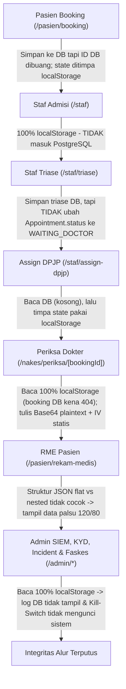
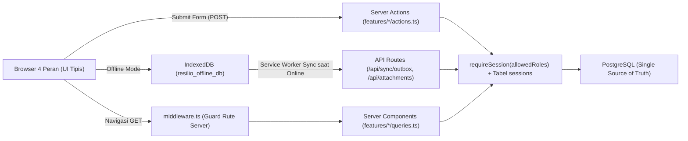

# Laporan Audit Menyeluruh & Master Plan Arsitektur JagaMedis

> **Metadata Dokumen**
> - **Proyek**: JagaMedis (sebelumnya Resilio-Health) — Cryptographic Offline-First HIS & RME
> - **Basis Kode yang Diaudit**: Branch `Week-7` (22 November 2026, Next.js 16.3.6, React 19.2.8, Prisma 7.10.1, Zod 4.6.7, PostgreSQL 17)
> - **Sifat Audit**: 100% *Read-Only* (seluruh temuan berasal dari inspeksi langsung kode sumber)
> - **Standar Acuan Internasional**: OWASP Top 10 (2021), OWASP API Security Top 10 (2023), OWASP ASVS v4.0, NIST SP 800-38D / 800-57 / 800-63B / 800-107, NISTIR 7804 (EHR Usability), RFC 5869 (HKDF), ISO/IEC 25010, ISO 27799, ISO 22301, ISO 9241-110, Nielsen's 10 Usability Heuristics, WCAG 2.1 AA, Core Web Vitals
> - **Regulasi Nasional**: Permenkes RI No. 24 Tahun 2022 (Rekam Medis Elektronik) & UU PDP No. 27 Tahun 2022 (Perlindungan Data Pribadi)

---

## Cara Membaca Dokumen Ini (Untuk Anda & Sesi AI Berikutnya)

1. **Untuk Pemahaman Anda (Pengembang / Mahasiswa)**:
   - Mulai dari **Glosarium Singkat** agar istilah keamanan/arsitektur/UX langsung terbayang.
   - Baca **Bagian 1 (Titik Pembeda Produk & Skor Kesiapan)** dan **Bagian 2 (Diagram Alur)** untuk melihat posisi unik JagaMedis dibanding produk serupa serta di mana alur saat ini terputus.
   - Baca **Bagian 3 (Audit per Domain)**: setiap temuan disusun dengan pola **Apa Masalahnya $\rightarrow$ Lokasi Kode $\rightarrow$ Mengapa Penting (Standar & Risiko) $\rightarrow$ Solusi Ideal**.
2. **Untuk Eksekusi di Sesi AI Baru**:
   - Cukup berikan perintah singkat seperti:
     > *"Baca `docs/audit_menyeluruh_jagamedis.md`, lalu buat rencana dan kerjakan **Fase 1 (F1.1 sampai F1.4)**."*
   - Setiap tugas pada **Bagian 4 (Master Plan)** sudah diberi kode ID (`F0.1` s.d. `F4.3`), daftar berkas target, rincian perubahan, serta **Tabel Indikator Pengujian (*Quality Gates*)** dengan target lulus terukur.

### Glosarium Istilah Kunci
| Istilah | Arti Sederhana & Mengapa Penting di JagaMedis |
| :--- | :--- |
| **BOLA / IDOR** (*Broken Object Level Authorization*) | Celah saat pengguna A bisa mengakses/mengubah data milik pengguna B cukup dengan mengganti ID (misal `P-101` jadi `P-102`) karena server tidak mengecek kepemilikan data. |
| **Split-Brain Architecture** | Kondisi saat sistem punya **dua sumber data terpisah** (`localStorage` browser dan database PostgreSQL) yang tidak sinkron, sehingga data yang disimpan di halaman A tidak muncul di halaman B. |
| **Fail-Closed vs Fail-Open** | *Fail-Closed*: jika verifikasi keamanan/dekripsi gagal, sistem **menolak menampilkan data**. *Fail-Open*: jika gagal, sistem malah tetap menampilkan data atau memunculkan data cadangan/palsu (berbahaya di dunia medis). |
| **AEAD (AES-256-GCM + AAD)** | Enkripsi yang melindungi kerahasiaan sekaligus keaslian data. **IV (Initialization Vector)** wajib acak tiap kali enkripsi; **AAD** mengikat ciphertext ke konteks pasien/rekam medis tertentu agar tidak bisa dipindah ke pasien lain. |
| **HKDF (Key Separation — RFC 5869)** | Menurunkan 2 kunci terpisah dari 1 kunci utama: satu khusus enkripsi (`encKey`) dan satu khusus tanda tangan integritas (`macKey`), sehingga satu kunci tidak dipakai untuk dua algoritma berbeda. |
| **Timing Attack (CWE-208)** | Serangan menebak tanda tangan HMAC dengan mengukur perbedaan waktu perbandingan string biasa (`===`). Pencegahannya adalah perbandingan *constant-time* (`crypto.subtle.verify`). |
| **RSC Waterfall** | Keterlambatan muat halaman di Next.js karena browser harus mengunduh JavaScript dulu, merender tampilan kosong/skeleton, baru memanggil server lewat `useEffect` — padahal **Server Component** bisa langsung mengambil data di server. |
| **God File** | Satu file kode yang terlalu gemuk (700–1.300+ baris) dan mencampur terlalu banyak tanggung jawab, sehingga rawan bug dan sulit dirawat. |
| **Progressive Disclosure** | Prinsip UX menyederhanakan layar utama memakai bahasa awam (misal untuk pasien), sementara detail teknis mendalam (*IV Hex, HMAC*) disembunyikan rapi di dalam panel/accordion yang dapat dibuka saat dibutuhkan. |
| **Core Web Vitals (LCP / INP / CLS)** | 3 metrik performa standar Google: **LCP** (kecepatan konten utama muncul $\le$ 2.5s), **INP** (responsivitas klik $\le$ 200ms), dan **CLS** (stabilitas tata letak tanpa lompat $\le$ 0.1). |

---

## 1. Ringkasan Eksekutif, Titik Pembeda (*UVP*) & Skor Kesiapan

Secara konsep dan fondasi, **JagaMedis** sudah sangat kuat untuk proyek tugas besar 3 mata kuliah (PAW + Kriptografi + Keamanan Siber): pemisahan 4 peran (Pasien, Staf Triase, Dokter DPJP, Admin Regulator), skema relasional dengan `onDelete: Restrict`, pustaka kriptografi Web Crypto (`aes.ts`, `hkdf.ts`, `hmac.ts`), validasi Zod v4, serta konfigurasi pengerasan Docker.

### 1.1. Titik Pembeda JagaMedis dibanding Aplikasi Kesehatan Serupa
| Kategori Produk Serupa | Contoh Nyata | Fokus Utama Mereka | Celah yang Dijawab oleh **JagaMedis** |
| :--- | :--- | :--- | :--- |
| **SIMRS Internal RS** | SIMRS Khanza, Web ERP RS | Administrasi & billing internal 1 rumah sakit | Data umumnya plaintext di server RS; **lumpuh total saat kena ransomware/internet mati**; pasien tidak punya kendali izin akses (*consent*). |
| **Telemedisin Komersial** | Halodoc, Alodokter | Chat dokter, tebus obat ritel, booking klinik | Bukan RME klinis terstandar Permenkes 24/2022 (tidak mencakup loket triase IGD, assign DPJP ber-PIN, CPPT addendum, & audit SIEM regulator). |
| **Portal Kesehatan Nasional** | SATUSEHAT Mobile | Agregasi riwayat kesehatan pasif bagi warga | Tidak menyediakan *workstation* operasional offline untuk perawat triase & dokter DPJP di faskes/daerah dengan koneksi tidak stabil. |

**5 Core Differentiators JagaMedis**:
1. **Kedaulatan Data *Zero-Knowledge* di Sisi Klien** *(NIST SP 800-38D + RFC 5869 HKDF)*: Isi klinis (SOAP, resep, citra rontgen) dienkripsi di browser sebelum dikirim ke server, sehingga kebocoran DB tidak membuka rahasia medis pasien.
2. **Ketahanan Operasional *Offline-First* Anti-Ransomware** *(ISO 22301 + W3C PWA/IndexedDB)*: Pelayanan IGD/poli tetap berjalan saat internet putus atau faskes dikarantina, lalu sinkron otomatis dengan verifikasi HMAC saat pulih.
3. **Kontrol Akses Kontekstual + 1-Click Revoke + Protokol *Break-Glass* IGD** *(ISO 27799 + UU PDP No. 27/2022 Pasal 20)*: Akses dokter terikat tiket kunjungan aktif ber-PIN dan bisa dicabut pasien kapan saja, namun tetap punya jalur darurat *Break-Glass* di IGD dengan alarm `CRITICAL` ke regulator.
4. **RME *Immutable Addendum-Only*** *(Permenkes RI No. 24/2022 Pasal 21)*: Catatan medis sah tidak pernah ditimpa/dihapus (`onDelete: Restrict`); koreksi wajib membuat versi Addendum baru dengan alasan tercatat.
5. **Transparansi Keamanan Manusiawi & *Auto-Watermarking* e-KYC**: Notifikasi akses bergaya *inbox* yang mudah dipahami pasien awam, dan foto KTP diberi tanda air permanen di canvas sebelum diunggah.

### 1.2. Kesenjangan Aktual & Skor Kesiapan 8 Dimensi
Audit kode aktual menemukan **4 kesenjangan utama** yang saat ini menahan 5 pembeda di atas agar benar-benar terwujud 100% di runtime:
1. **Keamanan & Otorisasi Server-Side**: Proteksi peran baru kuat di tampilan klien (`"use client"`), sedangkan mayoritas Server Actions belum memvalidasi cookie sesi & peran di sisi server.
2. **Alur Lintas Peran Terputus (*Split-Brain*)**: Setengah halaman membaca/menulis `localStorage` dan setengahnya PostgreSQL, sehingga pasien yang booking tidak mengalir utuh dari Admisi $\rightarrow$ Triase $\rightarrow$ Assign DPJP $\rightarrow$ Dokter $\rightarrow$ Admin.
3. **Kriptografi & PWA Belum Terhubung Penuh**: Modul `hkdf.ts`, `indexedDb.ts`, dan `public/sw.js` sudah dibuat rapi, tetapi belum disambungkan ke alur klinis; beberapa jalur simpan RME masih menyimpan Base64/Hex plaintext dengan IV dan HMAC statis.
4. **Kompleksitas Berkas, UX Klinis & Aksesibilitas**: File monolitik hingga 1.328 baris, 16 tabel yang sebagian redundan, *blind spot* UX klinis (tidak ada sticky patient banner, jargon teknis di layar pasien), serta pelanggaran WCAG 2.1 AA.

| Dimensi Evaluasi | Standar Acuan | Status Saat Ini | Risiko Utama |
| :--- | :--- | :---: | :--- |
| **1. Keamanan & Kontrol Akses** | OWASP Top 10 / ASVS v4.0 | **Kritis** | Missing server-side auth di Server Actions, BOLA fallback `DOC-01`/`P-101`, cookie escalation |
| **2. Kriptografi & Kedaulatan Data** | NIST SP 800-38D/57/107, RFC 5869 | **Kritis** | Base64/Hex plaintext + static IV/HMAC di `clinical.ts`, HKDF/AAD belum dipakai di UI, *fail-open* |
| **3. Alur End-to-End 4 Peran** | ISO/IEC 25010 | **Tinggi** | Split-brain `localStorage` vs PostgreSQL memutus pipeline Admisi $\rightarrow$ Triase $\rightarrow$ DPJP $\rightarrow$ Pemeriksaan |
| **4. Basis Data & Skema Prisma** | Permenkes 24/2022, UU PDP 27/2022 | **Sedang** | 16 tabel (sebagian redundan), `VarChar(32)` overflow UUID v4, status enum duplikat, belum ada tabel `sessions` |
| **5. PWA & Ketahanan Offline** | W3C PWA / Background Sync | **Tinggi** | `public/manifest.json` hilang, `sw.js` tidak diregistrasi, `indexedDb.ts` *dead code* |
| **6. Arsitektur File, Endpoint & Kode** | Next.js 16 / ISO 25010 | **Sedang** | *God files* 700–1.328 baris, `"use client"` + `useEffect` waterfall, Server Actions dipakai untuk GET |
| **7. Tampilan & Aksesibilitas** | WCAG 2.1 AA | **Sedang–Tinggi** | Dark mode clash di `globals.css`, missing `htmlFor`/modal ARIA, kontras `text-slate-400`, double sticky header |
| **8. Pengujian & DevOps** | OWASP Container / CI | **Sedang** | 33 unit test lulus, belum ada integration/E2E test; mismatch Node 20 vs 24 di `Dockerfile` |

---

## 2. Peta Alur Keseluruhan: Kondisi Aktual vs Target Ideal

### 2.1. Kondisi Saat Ini (Titik Putus *Split-Brain*)


### 2.2. Arsitektur Target Ideal (Setelah Refactor Bertahap)


---

## 3. Audit Mendalam per Domain

### 3.A. Keamanan, Autentikasi & Kontrol Akses (*OWASP Top 10 / ASVS v4.0 / NIST SP 800-63B*)

#### A1. [KRITIS] Server Actions Belum Memverifikasi Sesi & Peran di Server
- **Apa Masalahnya**: Hampir seluruh Server Action menerima `patientId`, `doctorId`, `grantId`, atau `faskesId` langsung dari argumen pemanggilan klien tanpa memeriksa siapa yang sedang login dari cookie HTTP-Only `resilio_session_token`.
- **Lokasi Kode**:
  - `lib/actions/consent.ts:24-150` (`getAccessGrantsServerAction`, `grantAccessServerAction`, `revokeAccessServerAction`, `updateAccessGrantServerAction`)
  - `lib/actions/faskes.ts:73-96` (`toggleFaskesKillSwitchServerAction`)
  - `lib/actions/auth.ts:349-455` (`approveKycServerAction`, `rejectKycServerAction`, `getKycSubmissionsServerAction`, `updatePatientProfileServerAction`)
  - `lib/actions/clinical.ts:36-45,177-260,379-532,678-1087` (termasuk `submitPemeriksaanKlinisAction` yang hanya mengecek `if (!sessionToken || sessionToken === "INVALID_TOKEN")` tanpa memvalidasi token ke `sessionStore` maupun mengecek role `nakes`)
  - `lib/actions/appointment.ts:27-65`, `lib/actions/triage.ts:26-30`, `lib/actions/ticket.ts:25-112`
- **Mengapa Berbahaya (OWASP A01:2021 / ASVS V4.1.1 & V4.2.1)**: Server Action di Next.js sebenarnya adalah endpoint HTTP `POST` publik. Tanpa cek sesi & peran di server, penyerang dapat memanggil `toggleFaskesKillSwitchServerAction` untuk mematikan rumah sakit, menyetujui e-KYC sendiri, mencabut izin pasien lain, atau membuka RME pasien lain (`getSingleMedicalRecordServerAction` di `app/(dashboard)/pasien/rekam-medis/[recordId]/page.tsx:250` tidak mengecek `record.patientId === session.id`).
- **Solusi Ideal**: Buat satu fungsi terpusat `requireSession(allowedRoles)` yang membaca `resilio_session_token` via `cookies()`, memvalidasinya ke tabel `sessions` di PostgreSQL, lalu mengambil `actorId` dan `role` dari sesi server (bukan dari parameter klien).

#### A2. [KRITIS] Eskalasi Hak Akses via Cookie Non-HttpOnly & Ketiadaan Middleware
- **Apa Masalahnya**:
  1. Belum ada `middleware.ts` untuk menjaga rute `/pasien`, `/staf`, `/nakes`, `/admin` di sisi server; proteksi saat ini hanya ada di Client Component `app/(dashboard)/layout.tsx:42-50`.
  2. Di `lib/auth/auth.ts:171-198`, fungsi *self-healing* `getUserSession()` membaca cookie biasa `resilio_user_role` (tidak `HttpOnly`, tidak bertanda tangan) lalu langsung memuat objek user penuh dari `DEMO_USERS` ke `localStorage`.
  3. Pesan error di `app/(dashboard)/layout.tsx:96` menulis `"403 Forbidden (Log dicatat ke SIEM)"`, padahal tidak ada pemanggilan audit log ke server.
- **Mengapa Berbahaya (OWASP A07:2021 / ASVS V3.4)**: Siapa pun yang membuka Chrome DevTools lalu mengetik `localStorage.clear(); document.cookie = "resilio_user_role=admin";` dan me-refresh halaman akan langsung masuk sebagai Admin di UI.
- **Solusi Ideal**: Hapus pemulihan sesi berbasis cookie `resilio_user_role` dari `DEMO_USERS`. Gunakan `GET /api/auth/session` (yang memverifikasi cookie `HttpOnly` `resilio_session_token` di server) untuk memulihkan sesi klien, dan pasang `middleware.ts` di level server.

#### A3. [KRITIS] Celah BOLA & Kebocoran PII / Kunci Enkripsi Lintas Pengguna
- **Apa Masalahnya**:
  1. **Kunci & PII bocor meski akses ditolak**: `lookupPatientByNikServerAction` (`lib/actions/clinical.ts:442-456`) dan `getPatientDetailForDoctorServerAction` (`lib/actions/clinical.ts:728-744`) tetap mengirim `patient.encryptionKeyHex`, `nik`, `allergies`, `phone`, dan riwayat kunjungan meskipun `accessAllowed === false`. `getDoctorPatientListServerAction` (`lib/actions/clinical.ts:627-638`) mengirim `encryptionKeyHex` dan `nik` utuh seluruh pasien (masking NIK baru dilakukan di browser).
  2. **Bypass multi-dokter via `|| "DOC-01"` & grant kedaluwarsa**: Di `lib/actions/clinical.ts:714-722` dan `1091`, kondisi `g.entityId === doctorId || g.entityId === "DOC-01" || g.entityType === "FASKES"` membuat dokter `DOC-02` bisa membuka pasien/jadwal milik `DOC-01`, dan tidak memeriksa `new Date(g.validUntil) > now`.
  3. **Kebocoran data pasien `P-101`**: Fallback `localStorage` di `pasien/rekam-medis/page.tsx:385-388`, `pasien/consent/page.tsx:124`, dan `pasien/tiket-kendala/page.tsx:121` menampilkan RME, grant, dan tiket milik `P-101` (Budi Santoso) ke akun pasien baru.
  4. **Bypass PIN 6-Digit pada Assign DPJP**: `staf/assign-dpjp/page.tsx:127` dan `lib/actions/appointment.ts:189` mengecek `if (apt.consentPin && inputPin && apt.consentPin !== inputPin)` — artinya jika `inputPin` dikosongkan (`""`), kondisi bernilai `false` dan verifikasi PIN **lolos begitu saja**! Selain itu, UI baris 345–354 membocorkan PIN asli di placeholder.
- **Mengapa Berbahaya (OWASP API1:2023 & API3:2023 / UU PDP)**: Melanggar prinsip *Least Privilege* dan membocorkan data pribadi spesifik (NIK, alergi, kunci kriptografi) ke pihak yang tidak berwenang.
- **Solusi Ideal**: Kembalikan hanya metadata minimal (`id`, `name`, `mrn`) saat `accessAllowed === false`; hapus seluruh kondisi `|| "DOC-01"` dan `|| "P-101"`; cek `validUntil > now` di query; wajibkan `inputPin` tidak kosong dan cocok dengan `apt.consentPin`.

#### A4. [TINGGI] Manajemen Sesi, Jalur Login & HTTP Security Headers
- **Apa Masalahnya**:
  1. `lib/auth/sessionStore.ts:12-21` menyimpan sesi di `Map` RAM (`globalThis`), sehingga seluruh pengguna ter-logout otomatis saat server restart atau berjalan multi-instance.
  2. `app/api/auth/session/route.ts:11-17` hanya memvalidasi `DEMO_USERS` (tidak sinkron dengan `loginServerAction` yang memakai Prisma + Bcrypt).
  3. `lib/actions/auth.ts:74-86` masih memiliki cabang fallback komparasi plaintext (`password === expectedPlain` dan `dbUser.passwordHash === password`).
  4. `next.config.ts:1-7` belum memasang HTTP Security Headers (`Content-Security-Policy`, `X-Frame-Options: DENY`, `X-Content-Type-Options: nosniff`, `Referrer-Policy`).
- **Solusi Ideal**: Simpan sesi ke tabel `sessions` PostgreSQL, hapus fallback plaintext password (100% `bcrypt.compare`), samakan jalur `/api/auth/session` dengan Prisma, dan pasang security headers di `next.config.ts`.

---

### 3.B. Kriptografi & Kedaulatan Data (*NIST SP 800-38D / 800-57 / 800-107 / RFC 5869*)

#### B1. [KRITIS] Enkripsi Palsu (Plaintext Base64/Hex) & Static IV/HMAC pada Jalur Penulisan RME
- **Apa Masalahnya**:
  - `submitPemeriksaanKlinisAction` (`lib/actions/clinical.ts:121-141`), `addPrescriptionToMedicalRecordServerAction` (`850-901`), `addLabResultToMedicalRecordServerAction` (`945-975`), dan `addProcedureToMedicalRecordServerAction` (`1023-1067`) **tidak mengenkripsi data dengan AES-256-GCM**, melainkan hanya melakukan encoding `Buffer.from(JSON.stringify(...)).toString("base64" | "hex")`.
  - Nilai `ivHex` di-hardcode statis `"1234567890abcdef12345678"` dan `hmacDigest` memakai hash SHA-256 string kosong `"e3b0c44298fc..."`.
  - Pada `app/(dashboard)/nakes/periksa/[bookingId]/page.tsx:327-387`, browser sebenarnya sudah menjalankan `encryptAES()`, tetapi hasilnya **hanya disimpan ke `localStorage`** — yang dikirim ke server lewat `FormData` tetap plaintext.
  - Lebih fatal: saat dokter menambah resep pada berkas yang benar-benar terenkripsi AES-GCM, `addPrescriptionToMedicalRecordServerAction` gagal `JSON.parse()` lalu **menimpa dan menghapus seluruh isi S/O/A** menjadi `{ plan: { resep: [...] } }`.
- **Mengapa Berbahaya (NIST SP 800-38D / CWE-329)**: Base64 dan Hex bukan enkripsi (bisa dibaca siapa pun dalam 1 detik). Penggunaan IV statis pada AES-GCM menghancurkan kerahasiaan dan otentikasi pesan.
- **Solusi Ideal**: Enkripsi penuh di klien menggunakan `deriveSubKeysHKDF` $\rightarrow$ `encryptAES(payload, encKey, aadText)` + `generateHMAC(ciphertext, macKey)`, lalu kirim `encryptedPayload`, `ivHex`, dan `hmacDigest` (bukan plaintext) ke Server Action untuk disimpan apa adanya di PostgreSQL. Untuk tambah resep/lab/tindakan pada berkas terenkripsi, dekripsi di klien terlebih dulu, tambahkan item, lalu buat versi addendum terenkripsi baru.

#### B2. [KRITIS] Pelanggaran *Fail-Closed* & Pemalsuan Data Klinis saat Dekripsi/HMAC Gagal
- **Apa Masalahnya**: Di `pasien/rekam-medis/page.tsx:402-427`, `pasien/rekam-medis/[recordId]/page.tsx:427-466`, dan `nakes/pasien-lookup/[patientId]/page.tsx:223-250`:
  1. Jika `verifyHMAC()` mengembalikan `false` (indikasi data diubah/korup), UI tetap melanjutkan dekripsi dan menampilkan isi rekam medis.
  2. Jika dekripsi gagal, UI **diam-diam menyuntikkan data medis fiktif** (tensi `120/80`, diagnosis `I10`, resep `Amlodipine 10mg` / `Kandesartan 8mg`) seolah-olah data sah pasien.
- **Mengapa Berbahaya (ISO 27799 / Keselamatan Pasien)**: Di sistem rumah sakit, menampilkan diagnosis atau dosis obat palsu ketika integritas data gagal jauh lebih berbahaya daripada menampilkan layar error, karena dokter bisa salah meresepkan obat berdasarkan data palsu.
- **Solusi Ideal**: Tegakkan **Fail-Closed murni** — jika `verifyHMAC()` atau `decryptAES()` gagal, **blokir tampilan konten medis**, tampilkan banner peringatan *Tamper/Corruption Detected*, dan catat insiden `HMAC_MISMATCH` ke `security_audit_logs`.

#### B3. [TINGGI] HKDF & AAD Belum Dipakai di UI + Key Reuse + Timing Attack
- **Apa Masalahnya**:
  - `deriveSubKeysHKDF` (`lib/crypto/hkdf.ts:32-79`) dan `aadText` (`lib/crypto/aes.ts:20`) hanya aktif di unit test (`tests/crypto.test.ts`), tidak dipakai di halaman klinis mana pun.
  - `encryptBinaryAttachment` (`lib/crypto/aes.ts:107-139`) memakai `rawKey` yang sama untuk `AES-GCM` dan `HMAC-SHA256` (melanggar **NIST SP 800-57** *Key Separation*).
  - `verifyHMAC` (`lib/crypto/hmac.ts:36-43`) memakai `===` biasa alih-alih `crypto.subtle.verify("HMAC", ...)` (rentan *timing attack*, **CWE-208**).
  - Kunci fallback konstan `"a1b2c3d4e5f60718293a4b5c6d7e8f90..."` di-hardcode di 4 halaman (`periksa`, `pasien-lookup`, `pasien-lookup/[patientId]`, `verifikasi-kyc`).
- **Solusi Ideal**: Buat 1 wrapper `features/medical-records/crypto-service.ts` yang wajib menjalankan HKDF (`encKey` vs `macKey`), mengikat AAD (`patientId:recordId:version`), menggunakan `crypto.subtle.verify` di `hmac.ts`, dan menghapus seluruh hardcoded fallback key.

---

### 3.C. Basis Data, Skema Prisma & Audit 16 Tabel (`prisma/schema.prisma`)

#### C1. Apakah 16 Tabel Terlalu Banyak?
Untuk proyek mandiri/tim kecil, 16 tabel memang agak *over-engineered* karena ada tabel yang tidak terpakai dan ada 2 tabel yang strukturnya nyaris kembar. Berikut pemetaannya:

- **9 Tabel Inti (Wajib Dipertahankan)**:
  `users`, `faskes`, `patients`, `doctors`, `staff_members`, `appointments`, `medical_records`, `access_grants`, `security_audit_logs`.
- **7 Tabel Evaluasi (Redundan / Opsional)**:
  | Tabel | Kondisi Aktual | Rekomendasi |
  | :--- | :--- | :--- |
  | `active_encounters` | **Redundan / tidak dipakai.** Seluruh fungsinya (`dpjpId`, `consentPin`, `consentActive`, `status`) sudah ditangani tabel `appointments`. | **Hapus** pada perampingan v1.0. |
  | `kyc_submissions` & `kyd_submissions` | **Duplikat struktur (~85% kolom identik):** `userId`, `nik`, `namaLengkap`, `watermarkText`, `status`, `alasanPenolakan`, `submittedAt`, `verifiedAt`. | **Gabung** menjadi 1 tabel `verifications` (`type: KYC \| KYD`, `metadata: Json`). |
  | `triage_assessments` | Normalisasi 1:1 dengan `appointments` & dibahas di laporan Modul 6/7. | **Pertahankan.** |
  | `medical_images` | Mendukung rubrik Kriptografi (citra biner AES-GCM + HMAC). | **Pertahankan**, sambungkan ke upload nyata. |
  | `family_members` | Baru dipakai parsial di `/pasien`. | **Opsional** (selesaikan penuh atau lepaskan). |
  | `trouble_tickets` | Berdiri sendiri & sederhana. | **Pertahankan.** |
- **2 Tabel Penting yang Justru Kurang**:
  1. **`sessions`**: Wajib ditambahkan agar sesi login tersimpan persisten di PostgreSQL (bukan di RAM).
  2. **`referrals`** *(opsional)*: Dibutuhkan agar `/nakes/rujukan` dan `/staf/rujukan` punya penyimpanan relasional nyata.
- **Target Ideal v1.0**: **10–12 tabel** yang semuanya aktif terpakai. *(Catatan akademik: Jangan hapus/gabung tabel sebelum penilaian Modul 6 & 7 selesai agar tetap sinkron dengan `docs/praktikum/modul06.md` & `docs/database.md`.)*

#### C2. Celah Teknis Skema Prisma Saat Ini
1. **Kunci Enkripsi Satu DB dengan Ciphertext (`schema.prisma:182`)**: `Patient.encryptionKeyHex` tersimpan plaintext di tabel `patients` dalam database yang sama dengan `medical_records`. Jika ingin *Zero-Knowledge* lebih kuat, bungkus (*wrap*) kunci tersebut memakai kunci turunan PIN pasien atau KMS.
2. **Primary Key `VarChar(32)` vs UUID v4 (`36` karakter)**: `User.id` sudah `VarChar(36)`, tetapi `Patient`, `Appointment`, `MedicalRecord`, `AccessGrant`, dan `TroubleTicket` masih `VarChar(32)`. ID berbasis `Date.now().slice(-4)` (berulang tiap 10 detik) rawan tabrakan, tetapi jika diganti `crypto.randomUUID()` (36 karakter) kolom `VarChar(32)` akan overflow — wajib dilebarkan ke `VarChar(36)`.
3. **Overlap Enum `AppointmentStatus` (`schema.prisma:60-69`)**: Memiliki status tumpang tindih (`WAITING_TRIAGE` + `WAITING_DOCTOR` + `WAITING`; `IN_EXAMINATION` + `IN_PROGRESS`), membuat kartu statistik di `nakes/page.tsx:129-132` menampilkan `0` untuk antrean DB.
4. **Kolom Hilang & Padding `CHAR(16)`**: `Patient` belum memiliki kolom `phone` dan `alamat` terpisah (`pasien/profil/page.tsx:90-122` membuang nomor darurat & alamat); `Patient.nik @db.Char(16)` membuat nilai sementara `"TEMP-xxxxxxxx"` (13 karakter) ter-padding spasi di PostgreSQL.
5. **Metadata Klinis Plaintext (UU PDP Pasal 4 ayat 2)**: `primaryIcd10`, `diagnosisShort`, dan `vitalSignsTrend` (`schema.prisma:324-331`) tersimpan sebagai plaintext di database.

---

### 3.D. Alur End-to-End 4 Peran (*Business Logic & Split-Brain Gaps*)

| Peran | Titik Putus / Bug Aktual di Aplikasi | Efek Nyata Saat Dipakai User |
| :--- | :--- | :--- |
| **1. Pasien** (`app/(dashboard)/pasien/`) | - `booking/page.tsx:176-211`: Membuang ID DB hasil `createAppointmentServerAction`, menimpa state dengan ID lokal; auto-consent hanya ditulis ke `localStorage`.<br>- `profil/page.tsx:125-161`: Submit KYC lolos tanpa file, menulis path palsu `/uploads/ktp-...`, langsung menimpa `patient.nik` sebelum disetujui Admin.<br>- `pasien/page.tsx:278-324`: Ganti anggota keluarga hanya ubah nama/NIK; alergi, jadwal, dan grafik tetap akun utama.<br>- `audit-log/page.tsx:99-105`: Cek enum `READ_RME`/`GRANT_ACCESS`/`LOGIN_SUCCESS` (DB memakai `VIEW_RME`, `LOGIN`).<br>- `faskes/page.tsx:8-10`: Baca `localStorage`, mengabaikan status `QUARANTINED` DB. | - Klik Reschedule/Batal pada booking baru gagal (`Prisma P2025`).<br>- Auto-consent tidak muncul di `/pasien/consent`.<br>- Faskes yang dikarantina Admin tetap bisa di-booking pasien. |
| **2. Staf Nakes** (`app/(dashboard)/staf/`) | - `staf/page.tsx:59-138`: 100% `localStorage` (check-in & walk-in tidak masuk DB).<br>- `triase/page.tsx:133-176` & `lib/actions/triage.ts:26-98`: Simpan triase tanpa mengubah `Appointment.status` menjadi `WAITING_DOCTOR` di DB.<br>- `assign-dpjp/page.tsx:41-94`: Mengabaikan `triageAssessment` dari DB dan me-refetch seluruh DB tiap klik pasien (`selectedAptId` di `useEffect`).<br>- `rujukan/page.tsx:57-146`: Tab Keluar & Masuk merender array yang sama; tombol terima rujukan tidak membuat `Appointment`. | - Pasien walk-in dari Loket hilang di halaman Triase.<br>- Pasien selesai Triase hilang di halaman Assign DPJP.<br>- Pasien darurat `MERAH` tampil sebagai `HIJAU` di Assign DPJP. |
| **3. Dokter DPJP** (`app/(dashboard)/nakes/`) | - `periksa/[bookingId]/page.tsx:109-140`: Membaca antrean 100% dari `localStorage`; input Tab 5 (GCS, ICD-9, surat sakit, rujukan, kontrol) & gambar tidak pernah dikirim ke DB.<br>- Bentuk JSON SOAP datar (`submitPemeriksaanKlinisAction`) tidak cocok dengan bentuk bersarang yang dibaca halaman RME.<br>- `DoctorCalendarSchedule.tsx:37` & `jadwal/page.tsx:43`: Kalender dikunci pada tanggal `12–18 Oktober 2026`.<br>- `pasien-lookup/[patientId]/page.tsx:616-662`: Klik cetak sebelum dekripsi menghasilkan data fiktif. | - Booking baru dari DB terkena **404** saat dokter klik Periksa.<br>- Tanda vital & resep yang diinput dokter tidak terbaca di sisi pasien.<br>- Jadwal hari ini tidak muncul di kalender dokter. |
| **4. Admin** (`app/(dashboard)/admin/`) | - Overview (`/admin`), SIEM (`/admin/siem-monitor`), e-KYD (`/admin/verifikasi-kyd`), dan Incident Center (`/admin/incident-center`) membaca 100% dari `localStorage`.<br>- `rejectKycServerAction` (`lib/actions/auth.ts:415`) menyimpan `SUSPENDED`, lalu `verifikasi-kyc/page.tsx:61` memetakannya kembali jadi `PENDING` saat reload.<br>- Kill-Switch tidak dicek oleh Server Action booking/klinis mana pun. | - Insiden `IDOR_BLOCKED` & `BREAK_GLASS_ACCESS` di PostgreSQL tidak muncul di SIEM Monitor.<br>- Pengajuan e-KYC yang ditolak Admin hidup kembali jadi Pending saat refresh. |

---

### 3.E. PWA & Ketahanan Offline-First

- **Apa Masalahnya**:
  1. `public/manifest.json` **tidak ada**, padahal `public/sw.js:10` mencoba melakukan pre-cache `"/manifest.json"`.
  2. Service Worker `public/sw.js` **tidak pernah diregistrasi** (`navigator.serviceWorker.register("/sw.js")` tidak ada di aplikasi) dan tidak ada listener untuk event `RESILIO_TRIGGER_OFFLINE_SYNC`.
  3. Wrapper IndexedDB `lib/storage/indexedDb.ts` (yang sudah memiliki 3 *Object Stores*: `cached_active_patients`, `offline_clinical_outbox`, `offline_media_blobs`) adalah ***dead code*** — tidak diimpor di mana pun. Halaman `app/(dashboard)/nakes/offline-sync/page.tsx:20-101` sebenarnya hanya memindahkan item antar-key `localStorage` tanpa pernah mengirim ke server, dan tombol simulasi antreannya menghasilkan HMAC palsu yang selalu gagal diverifikasi.
- **Alur Offline-First yang Seharusnya**:
  1. Saat aplikasi dimuat, komponen client provider mendaftarkan `/sw.js` dan mendengarkan pesan sinkronisasi + event browser `online`/`offline`.
  2. Saat dokter menyimpan pemeriksaan dalam kondisi offline, data terenkripsi disimpan ke `offline_clinical_outbox` (IndexedDB) menggunakan `saveToOutbox()`.
  3. Begitu internet pulih (atau tombol *Sinkronkan* ditekan), antrean IndexedDB dikirim ke endpoint `POST /api/sync/outbox`, diverifikasi HMAC & disimpan ke PostgreSQL, lalu dihapus dari outbox dengan `removeOutboxItem()`.

---

### 3.F. Arsitektur File, Data Fetching, Endpoint REST & DevOps (*Next.js 16 / ISO 25010*)

#### F1. Pemecahan File Berbasis Fitur (*Hybrid Feature-Modular*)
Saat ini berkas di proyek menggunakan pola *layer-based* murni sehingga muncul beberapa *god files*:
- `app/(dashboard)/nakes/periksa/[bookingId]/page.tsx`: **1.328 baris**
- `app/(dashboard)/nakes/pasien-lookup/[patientId]/page.tsx`: **1.151 baris**
- `lib/actions/clinical.ts`: **1.130 baris**
- `lib/db/mockData.ts`: **942 baris**
- `app/(dashboard)/beranda/page.tsx`: **762 baris**
- `lib/actions/auth.ts`: **725 baris**

Selain itu, fungsi `safeRevalidate` diduplikasi di 5 berkas Server Actions, dan `smartDecryptPayload` + `parsePrescriptionDetail` (~180 baris) di-copy-paste di 3 halaman.

**Struktur Target (*Hybrid Feature-Modular*)**: Pertahankan `app/` tipis (khusus routing, layout, loading, error, dan API routes), lalu kelompokkan logika + UI domain ke `features/`:
```text
app/                          # TIPIS (< 100 baris/file): routing, layout, loading, error, API routes
├── (auth)/
├── (dashboard)/
└── api/
    ├── health/route.ts
    ├── auth/session/route.ts
    ├── sync/outbox/route.ts
    └── attachments/route.ts

features/                     # Dipecah berdasarkan FITUR / DOMAIN bisnis
├── auth/                     # login, register, guard.ts (requireSession), schemas, verifikasi
├── appointments/             # booking, admisi, triase, assign DPJP, kalender (actions + queries)
├── medical-records/          # SOAP 5 tab terpisah, crypto-service.ts, PrintableMedicalResume
├── consent/                  # izin akses UU PDP & Break-Glass
└── admin/                    # SIEM monitor, master faskes/kill-switch, verifikasi, tiket

lib/ & components/ui/         # Utilitas & komponen generik lintas fitur
├── crypto/                   # primitif aes.ts, hkdf.ts, hmac.ts
├── db/prisma.ts
├── storage/indexedDb.ts
└── ui/                       # Modal.tsx (WCAG), ToastBanner.tsx, Skeleton.tsx, Icons.tsx
```

#### F2. Kapan Pakai Server Components vs Server Actions vs API Endpoints (`app/api/`)?
Di proyek saat ini, hampir semua halaman dashboard memakai `"use client"` + `useEffect` untuk memanggil Server Actions (`POST`) sebagai pengganti `GET` (termasuk `beranda/page.tsx:29-38` yang selalu memanggil `getDoctorPatientListServerAction` untuk semua peran).

Aturan standar industri di Next.js 16 App Router:
| Mekanisme | Fungsi & Kapan Dipakai | Contoh di JagaMedis |
| :--- | :--- | :--- |
| **1. Server Components (`queries.ts`)** | **Membaca data awal halaman (`GET`/Read)** langsung ke Prisma di server dengan `<Suspense>` streaming. Cepat, aman, tanpa *waterfall*. | Memuat daftar pasien, daftar antrean, profil faskes, ringkasan dasbor `/beranda`. |
| **2. Server Actions (`actions.ts`)** | **Mutasi data dari form/tombol internal UI (`Create/Update/Delete`)** yang langsung butuh `revalidatePath()` / `redirect()`. | Submit booking, simpan triase, tanda tangan SOAP, revoke consent, approve KYC. |
| **3. API Endpoints (`app/api/**/route.ts`)** | **Antarmuka HTTP REST penuh** (`GET/POST/PUT/DELETE`, kontrol status `401/403/404`, biner/streaming, klien eksternal, PWA, audit keamanan). | - `GET /api/health` (Docker healthcheck)<br>- `/api/auth/session` (verifikasi sesi HTTP `401`/`200` & uji `curl`/OWASP ZAP)<br>- `POST /api/sync/outbox` (PWA Background Sync)<br>- `POST/GET /api/attachments` (upload/download biner KTP & citra medis)<br>- *(Opsional)* `GET /api/fhir/Patient/[id]` (SATUSEHAT). |

#### F3. Pengujian & DevOps
- 33 unit test Vitest lulus, namun belum ada uji integrasi untuk Server Actions (`auth`, `triage`, `clinical`, `consent`) maupun uji E2E alur lintas peran (Playwright).
- `Dockerfile:7` masih memakai `node:20-alpine` (lokal Node v24), dan `docker-compose.yml:12` menaruh password database langsung di file komposisi (sebaiknya tarik dari `.env`).

---

### 3.G. Tampilan (*UI/UX*), *Blind Spot* Usability Klinis & Aksesibilitas (*NISTIR 7804, Nielsen, ISO 9241-110, WCAG 2.1 AA*)

#### G1. *Blind Spot* Alur Fitur & Usability Aplikasi Kesehatan
Aplikasi klinis memiliki standar usability lebih ketat dari aplikasi umum karena kesalahan klik dapat memengaruhi keselamatan pasien (*patient safety*):
1. **Identifikasi Pasien & Konteks Klinis (*NISTIR 7804 — Patient Identification Safety*)**: Saat dokter berpindah tab di `periksa/[bookingId]/page.tsx` (5 tab), identitas pasien & daftar alergi tergulir ke atas (*recall*). **Solusi**: Pasang **Sticky Patient Banner** tipis yang selalu menampilkan Nama + Usia/Gender, MRN, **Badge Alergi Berwarna Tegas**, dan Level Triase di semua tab.
2. **Kecepatan Alur & Transisi Antar Peran (*Nielsen #7 — Efficiency of Use*)**: Tombol *"Mulai Triase"* di `staf/page.tsx:286` tidak membawa `?aptId=`; input 8 vital di `triase/page.tsx` belum memberi peringatan otomatis (*Clinical Decision Support* ringan) untuk angka kritis (misal SpO2 < 92% atau Sistolik > 180 mmHg); tab nonaktif di `periksa/[bookingId]` di-*unmount* sehingga dokter tidak tahu tab mana yang memiliki error validasi. **Solusi**: Terapkan *one-click handoff* (`?aptId=`), auto-highlight nilai vital abnormal, dan badge indikator kelengkapan/error per tab tanpa meng-unmount input.
3. **Pencegahan Kesalahan Fatal (*Nielsen #5 — Error Prevention & ISO 9241-110*)**: Tombol *"Hapus Log"* SIEM tidak punya konfirmasi; tombol *"Cetak Resume Medis"* aktif sebelum RME didekripsi; tanggal booking/lahir tidak dibatasi `min`/`max`; belum ada kunci *double-submit* (`isSubmitting`) dan peringatan *unsaved changes* pada form panjang. **Solusi**: Nonaktifkan tombol yang prasyaratnya belum terpenuhi (dengan tooltip alasan), pakai modal konfirmasi terstruktur untuk aksi destruktif, dan kunci tombol saat sedang submit.
4. **Bahasa Pasien vs Bahasa Nakes (*Nielsen #2 — Match Between System & Real World*)**: Layar utama Pasien dipenuhi jargon teknis (*Ciphertext*, *HKDF*, *IV Hex*, *BOLA Guard*) yang membingungkan pasien awam. **Solusi**: Terapkan **Progressive Disclosure** — pakai bahasa awam yang menenangkan di tampilan utama Pasien (*"Rekam Medis Terlindungi & Asli"*), dan taruh bukti teknis (*IV Hex*, *HMAC Digest*, *AAD*) di dalam accordion *"Lihat Bukti Kriptografi"*.
5. **Visibilitas Status & *Empty State* Jujur (*Nielsen #1 — Visibility of System Status*)**: Beberapa halaman menyuntikkan data medis palsu (`120/80`, `Amlodipine`, notifikasi palsu) saat data kosong/gagal, dan banner notifikasi di atas halaman sering tergulir keluar layar (*out of viewport*). **Solusi**: Gunakan *empty state* yang jujur dengan tombol aksi yang jelas serta *floating toast* aksesibel (`role="status"`/`role="alert"`).

#### G2. Audit Teknis Aksesibilitas (*WCAG 2.1 AA*) & Tata Letak
1. **Bug Kontras OS Dark Mode (`app/globals.css:15-26`)**: `@media (prefers-color-scheme: dark)` menyetel `--foreground: #ededed` (putih terang) padahal kartu UI dipaksa `bg-white`. Pada pengguna OS mode gelap, teks tanpa kelas warna eksplisit jadi tidak terbaca (gagal **WCAG 1.4.3**).
2. **Label Formulir & Aksesibilitas Keyboard**:
   - Mayoritas `<label>` di halaman auth, pasien, staf, nakes, dan admin belum terikat via `htmlFor` + `id`; input tanda vital di triase & pemeriksaan dokter memakai `<span>`.
   - Elemen `<tr onClick>` (`pasien-lookup/page.tsx:515`), `<div onClick>` (`audit-log/page.tsx:233`, `DoctorCalendarSchedule.tsx:190`) tidak dapat dijangkau tombol `Tab`/`Enter`.
   - Input file di `profil/page.tsx:473,497` memakai `hidden` (`display: none`) alih-alih `sr-only`.
3. **Modal, Tab & Live Regions**:
   - Selain `PrintableMedicalResume.tsx`, seluruh modal lain (`LogoutModal`, Walk-in Staf, Rujukan Staf, Break-Glass, 3 modal aksi klinis Nakes, 2 modal Admin) belum punya `role="dialog"`, `aria-modal="true"`, tutup `Escape`, dan fokus trap.
   - Form 5-tab (`periksa/[bookingId]/page.tsx:547-603`) belum memakai `role="tablist"`/`role="tab"`/`aria-selected`.
   - Banner notifikasi belum memakai `role="status"` / `role="alert"`.
4. **Layout Mobile, Kontras, Motion & Hydration**:
   - **Double Sticky Header di Mobile**: `RoleNav.tsx:130` (`sticky top-0 z-30`) dan `layout.tsx:59` (`sticky top-0 z-20`) tumpang tindih saat di-scroll di HP.
   - **Kontras**: `text-[9px]`/`text-[10px]` dengan `text-slate-400` (~2.56:1) dan `text-slate-300` (~1.58:1) di atas latar putih gagal ambang AA 4.5:1.
   - **Motion**: `animate-ping`/`animate-pulse` belum memakai `motion-reduce:animate-none` (**WCAG 2.3.3**).
   - **Hydration Risk**: Pemanggilan `getUserSession()`/`getStorageData()` langsung di badan render (`error.tsx:18`, `pasien/faskes/page.tsx:9`, `pasien/faskes/[faskesId]/page.tsx:19`, `nakes/rujukan/page.tsx:21,30`).
   - **Dialog Pemblokir**: Masih terdapat `window.alert()` / `window.confirm()` di `periksa`, `rujukan`, `offline-sync`, `booking`, `consent`, dan `admin/faskes`.

---

## 4. Master Plan Perombakan Terpadu & Indikator Pengujian (*Quality Gates*)

### Kapan Perombakan Cocok Dilakukan?
- **Sebelum Modul 7 selesai**: **Jangan rombak dulu** (hindari *big-bang rewrite* agar laporan Modul 4–7 & 33 unit test tetap utuh).
- **Setelah PR #12 Modul 7 di-merge ke `main`**: Jalankan **perombakan bertahap (*Incremental Refactor*)** di branch baru `refactor/v1-clean-architecture`. Setiap fase **baru dianggap lulus** jika seluruh **Quality Gate** pada tabelnya tercapai.

---

### Fase 0 — Prasyarat & Kunci Baseline *(SELESAI — 26 Nov 2026)*
- [x] **F0.1**: Selesaikan Subbagian 5.1 (*peer review* PR teman) di `docs/praktikum/modul07.md` dan hapus blok panduan `[!IMPORTANT]`.
- [x] **F0.2**: Commit & push branch `Week-7`, selesaikan konflik 1 baris di `app/(dashboard)/layout.tsx` (pilih `"Beranda Terpadu JagaMedis"`), lalu merge PR #12 ke `main`.
- [x] **F0.3**: Buat branch baru dari `main`: `git checkout -b refactor/fase-1-security-crypto` *(strategi 1 branch per fase)*.

**Quality Gates Fase 0**:
| Indikator Uji | Standar Acuan | Cara Menguji | Target Lulus |
| :--- | :--- | :--- | :--- |
| Build & Tipe Statis | TypeScript Strict / Next.js | `npx tsc --noEmit && npm run build` | **0 error**, 33/33 route sukses |
| Regresi Unit Test | ISO/IEC 25010 (Reliability) | `npx vitest run` | **33/33 lulus (100%)** |
| Kelengkapan Modul 7 | Rubrik Praktikum Modul 7 | Cek manual `modul07.md` & PR #12 | 5.1 & 5.2 terisi, PR #12 ter-merge ke `main` |

---

### Fase 1 (`P0 — Kritis`) — Keamanan Server-Side, Sesi Persisten & Kriptografi Nyata *(SELESAI & TERVERIFIKASI — 26 Nov 2026, 08:15 WIB; catatan lengkap: [fase-1-security-crypto-2026-11-26.md](../perubahan/fase-1-security-crypto-2026-11-26.md))*
- [x] **F1.1 — Sesi Persisten & Auth Guard Terpusat**:
  - *Target*: `prisma/schema.prisma`, `lib/auth/sessionStore.ts`, `features/auth/guard.ts` (baru), `proxy.ts` (baru — konvensi resmi Next.js 16 pengganti `middleware.ts`), `app/api/auth/session/route.ts`, `lib/auth/auth.ts`, `app/(dashboard)/layout.tsx`, `app/(auth)/login/page.tsx`.
  - *Aksi*: Tambah model `Session` di PostgreSQL (`20261126011004_add_persistent_sessions`); buat `requireSession(allowedRoles)` berbasis `cookies()`; pasang `proxy.ts` untuk rute `/beranda`, `/pasien`, `/staf`, `/nakes`, `/admin`; samakan `/api/auth/session` dengan Prisma + Bcrypt; hapus fallback cookie `resilio_user_role` dari `DEMO_USERS` dan hapus cabang plaintext password di `lib/actions/auth.ts`.
- [x] **F1.2 — Tutup Seluruh Celah BOLA & Kebocoran PII/Kunci**:
  - *Target*: `lib/actions/{auth,clinical,consent,appointment,triage,faskes,ticket,audit}.ts`, `lib/validations/triage.ts`.
  - *Aksi*: Wajibkan `requireSession(...)` di baris pertama setiap Server Action; ambil `actorId`/`role` dari sesi server (bukan parameter klien); hapus kondisi `|| "DOC-01"` dan `|| "P-101"`; tambahkan cek `validUntil > now` pada `accessGrants`; jangan kirim `encryptionKeyHex`/NIK utuh/riwayat saat `accessAllowed === false`; cek kepemilikan `patientId` pada `getSingleMedicalRecordServerAction`; wajibkan `inputPin` 6-digit terisi & cocok pada `assignDpjpServerAction`.
- [x] **F1.3 — Kriptografi AEAD Nyata & *Fail-Closed***:
  - *Target*: `features/medical-records/crypto-service.ts` (baru), `lib/crypto/{hmac,aes}.ts`, `lib/actions/clinical.ts`, `prisma/seed.ts`, `app/(dashboard)/nakes/periksa/[bookingId]/page.tsx`, `app/(dashboard)/nakes/pasien-lookup/[patientId]/page.tsx`, `app/(dashboard)/pasien/rekam-medis/{page,[recordId]/page}.tsx`.
  - *Aksi*: Ganti `===` di `lib/crypto/hmac.ts` dengan `crypto.subtle.verify("HMAC", ...)`; perbaiki key reuse di `encryptBinaryAttachment` memakai sub-kunci HKDF; terapkan `deriveSubKeysHKDF` + `encryptAES(..., aadText)` di alur SOAP & seeder; hapus enkripsi palsu Base64/Hex & IV/HMAC statis di `clinical.ts`; seragamkan 1 format JSON SOAP (`CanonicalSoapPayload`) + Addendum immutable; tegakkan *fail-closed* (hapus fallback data klinis palsu `120/80` / `Amlodipine` saat dekripsi/HMAC gagal & catat `HMAC_MISMATCH`).
- [x] **F1.4 — HTTP Security Headers**:
  - *Target*: `next.config.ts`.
  - *Aksi*: Tambahkan header `Content-Security-Policy`, `X-Frame-Options: DENY`, `X-Content-Type-Options: nosniff`, `Referrer-Policy`, `Permissions-Policy`, dan `X-DNS-Prefetch-Control`.

**Quality Gates Fase 1**:
| Indikator Uji | Standar Acuan | Cara Menguji | Target Lulus |
| :--- | :--- | :--- | :--- |
| Otorisasi Server Actions (Anti-BOLA) | OWASP ASVS V4.1.1, V4.2.1 & API1:2023 | Kirim POST ke aksi sensitif (`toggleFaskesKillSwitch`, `approveKyc`, `revokeAccess`, `getSingleMedicalRecord`) tanpa cookie atau dengan role salah | **100% ditolak (`401`/`403`)**; 0 mutasi DB |
| Ketahanan Sesi & Cookie | OWASP ASVS V3.2, V3.4 & NIST SP 800-63B | 1) Set `resilio_user_role=admin` saat `localStorage` kosong.<br>2) Restart server lalu cek `/api/auth/session`. | 1) Tidak bisa jadi Admin (`401`/redirect `/login`).<br>2) Sesi valid bertahan di tabel `sessions` DB. |
| Penegakan PIN 6-Digit | OWASP ASVS V2.1 | Uji `assignDpjpServerAction` dengan `inputPin = ""` dan PIN salah | Keduanya **ditolak**; hanya PIN 6-digit persis lolos |
| Kriptografi AEAD + HKDF + AAD | NIST SP 800-38D, SP 800-57, RFC 5869 | Cek baris baru di `medical_records` PostgreSQL | Payload bukan Base64/Hex JSON; 2 simpan menghasilkan `iv_hex` berbeda; dekripsi dengan AAD pasien lain gagal |
| *Fail-Closed* & Anti-Timing | ISO 27799 & CWE-208 (NIST SP 800-107) | Ubah 1 karakter `encrypted_payload`/`hmac_digest` di DB lalu buka RME | UI memblokir konten + alert tamper + log `HMAC_MISMATCH` (**0 data palsu tampil**) |
| HTTP Security Headers | OWASP Secure Headers | `curl -I http://localhost:3000/login` | Muncul `CSP`, `X-Frame-Options: DENY`, `X-Content-Type-Options: nosniff`, `Referrer-Policy` |

---

### Fase 2 (`P1 — Tinggi`) — Eliminasi *Split-Brain* & Integritas Alur End-to-End 4 Peran *(SELESAI & TERVERIFIKASI — 26 Nov 2026, 08:52 WIB; catatan lengkap: [fase-2-end-to-end-db-2026-11-26.md](../perubahan/fase-2-end-to-end-db-2026-11-26.md))*
- [x] **F2.1 — Alur Pasien 100% PostgreSQL**:
  - *Target*: `app/(dashboard)/pasien/{booking,consent,profil,faskes,faskes/[faskesId],audit-log,tiket-kendala,page}.tsx`, `lib/actions/{auth,appointment}.ts`.
  - *Aksi*: Gunakan ID & PIN kembalian DB di `/pasien/booking` dan simpan auto-consent ke tabel `access_grants`; sambungkan `/pasien/faskes` & `[faskesId]` ke `getFaskesListServerAction` dan blokir booking jika `QUARANTINED`; migrasikan `/pasien/consent` & `/pasien/tiket-kendala` ke 100% PostgreSQL; sinkronkan enum `audit-log` (`VIEW_RME`, `LOGIN`, `WRITE_RME`, `IDOR_BLOCKED`, dll.); perbaiki `pasien/page.tsx` (`safePatient.id`, tampilkan *empty state* jujur tanpa grafik vital palsu); wajibkan file pada KYC dan jangan timpa `patient.nik` sebelum disetujui Admin; batasi `min`/`max` tanggal booking & lahir serta kunci tombol saat `isSubmitting`.
- [x] **F2.2 — Alur Staf Triase & Admisi 100% PostgreSQL + Handoff Cepat**:
  - *Target*: `app/(dashboard)/staf/{page,triase/page,assign-dpjp/page,rujukan/page}.tsx`, `lib/actions/{triage,appointment}.ts`.
  - *Aksi*: Hubungkan `/staf` (check-in & walk-in) ke Server Actions PostgreSQL dan bawa `?aptId=` pada tombol *"Mulai Triase"*; perbaiki `submitTriageServerAction` agar mengubah `Appointment.status` ke `WAITING_DOCTOR` dalam `prisma.$transaction` serta tambahkan *auto-highlight* peringatan nilai vital abnormal; tampilkan `triageAssessment` asli di `/staf/assign-dpjp` & perbaiki dependency `useEffect` agar tidak refetch tiap klik; pisahkan data tab Keluar/Masuk di `/staf/rujukan`.
- [x] **F2.3 — Alur Dokter DPJP 100% PostgreSQL + Konteks Klinis**:
  - *Target*: `app/(dashboard)/nakes/{page,jadwal/page,rujukan/page,periksa/[bookingId]/page,pasien-lookup/[patientId]/page}.tsx`, `components/clinical/DoctorCalendarSchedule.tsx`, `lib/actions/clinical.ts`.
  - *Aksi*: Muat data booking `/nakes/periksa/[bookingId]` dari PostgreSQL (`getAppointmentForExamServerAction`), pasang **Sticky Patient Banner** (Nama, MRN, Alergi, Triase) di ruang periksa, update `Appointment.status` ke `COMPLETED` saat disimpan, ikutkan input Tab 2–5 ke payload terenkripsi, nonaktifkan cetak resume sebelum dekripsi berhasil, jadikan tanggal kalender dokter dinamis (hapus hardcode `12–18 Okt 2026`), dan perbaiki filter status kartu metrik di `/nakes`.
- [x] **F2.4 — Konsol Admin 100% PostgreSQL & Penegakan Kill-Switch**:
  - *Target*: `lib/actions/admin.ts` (baru), `app/(dashboard)/admin/{page,siem-monitor/page,verifikasi-kyc/page,verifikasi-kyd/page,incident-center/page,faskes/page}.tsx`, `lib/actions/{auth,clinical,appointment}.ts`.
  - *Aksi*: Hubungkan seluruh 6 halaman Admin ke Server Actions PostgreSQL (termasuk Server Action untuk e-KYD); perbaiki `rejectKycServerAction` agar menyimpan `AccountStatus.REJECTED` (bukan `SUSPENDED`); tambahkan pengecekan `faskes.status !== "QUARANTINED"` pada Server Action booking & seluruh 5 aksi tulis klinis.

**Quality Gates Fase 2**:
| Indikator Uji | Standar Acuan | Cara Menguji | Target Lulus |
| :--- | :--- | :--- | :--- |
| Zero `localStorage` Dependency (Online) | ISO/IEC 25010 (Functional Completeness) & NISTIR 7804 | Uji alur lengkap 1 pasien baru (Registrasi $\rightarrow$ Approve KYC $\rightarrow$ Booking $\rightarrow$ Check-In $\rightarrow$ Triase `MERAH` $\rightarrow$ Assign DPJP ber-PIN $\rightarrow$ Periksa SOAP + Tab 5 $\rightarrow$ Baca/Cetak RME $\rightarrow$ Cek SIEM) menggunakan **Incognito/browser berbeda** tiap peran | **100% data mengalir lewat PostgreSQL**, 0 error 404, 0 `Prisma P2025`, triase `MERAH` & resep dokter terbaca identik lintas peran |
| Penegakan Kill-Switch Faskes | ISO 27799 / UR-A03 | Admin karantina `FAS-01` $\rightarrow$ Pasien coba booking & Dokter coba simpan RME di `FAS-01` | Booking & aksi klinis di `FAS-01` **ditolak di server** |
| Siklus Status e-KYC/e-KYD | Permenkes / Administrasi | Admin tolak pengajuan e-KYC $\rightarrow$ hard refresh (`Cmd+Shift+R`) | Status tetap **`REJECTED`** beserta alasan penolakan |
| Audit Trail Nyata | UU PDP No. 27/2022 & ISO 27799 | Picu `IDOR_BLOCKED`, `REVOKE_CONSENT`, `BREAK_GLASS_ACCESS` $\rightarrow$ cek SIEM & Audit Pasien | Seluruh event muncul dari PostgreSQL dengan pemetaan enum tepat |

---

### Fase 3 (`P2 — Sedang`) — Modularisasi `features/`, Server Components, Endpoint REST & PWA Nyata
- [ ] **F3.1 — Pecah *God Files* ke Struktur `features/`**:
  - *Target*: `lib/actions/{clinical,auth}.ts`, `app/(dashboard)/nakes/{periksa/[bookingId],pasien-lookup/[patientId]}/page.tsx`, `app/(dashboard)/beranda/page.tsx`.
  - *Aksi*: Pindahkan aksi, query, skema, dan sub-komponen ke `features/{auth,appointments,medical-records,consent,admin}/` sehingga tidak ada file >300–350 baris; satukan `safeRevalidate`, `smartDecryptPayload`, dan `parsePrescriptionDetail` menjadi masing-masing 1 modul tunggal.
- [ ] **F3.2 — Migrasi Read Awal ke Server Components**:
  - *Target*: Halaman-halaman utama `app/(dashboard)/**/page.tsx`.
  - *Aksi*: Ubah pembacaan data awal dari `useEffect` + Server Action (`POST`) menjadi Server Components yang memanggil `features/*/queries.ts` dibungkus `<Suspense>` (dan pastikan `/beranda` hanya memuat statistik sesuai peran user aktif).
- [ ] **F3.3 — 4 Endpoint REST Strategis (`app/api/`)**:
  - *Target*: `app/api/{health,auth/session,sync/outbox,attachments}/route.ts`.
  - *Aksi*: Sediakan healthcheck DB, autentikasi sesi REST, sinkronisasi outbox offline, dan upload/download biner terenkripsi (menggantikan path dummy `/uploads/...`).
- [ ] **F3.4 — Aktivasi PWA & IndexedDB Nyata**:
  - *Target*: `public/manifest.json` (baru), `public/sw.js`, `lib/storage/indexedDb.ts`, `components/shared/NetworkStatusBanner.tsx`, `app/(dashboard)/nakes/offline-sync/page.tsx`.
  - *Aksi*: Buat `public/manifest.json`, registrasikan `sw.js`, dengarkan event `online`/`offline` browser, hubungkan `/nakes/offline-sync` & mode offline `/nakes/periksa` ke `lib/storage/indexedDb.ts` + `POST /api/sync/outbox`.

**Quality Gates Fase 3**:
| Indikator Uji | Standar Acuan | Cara Menguji | Target Lulus |
| :--- | :--- | :--- | :--- |
| Maintainability & Ukuran Berkas | ISO/IEC 25010 (Maintainability) | Cek baris file di `features/` & `app/**/page.tsx` + grep duplikasi | Tidak ada file >350 baris; **0 duplikasi** `safeRevalidate` / `smartDecryptPayload` |
| Performa & Server Components (CWV) | Core Web Vitals & Next.js 16 | Chrome DevTools Network & Lighthouse Performance di `/beranda`, `/pasien`, `/nakes` | **LCP $\le$ 2.5s**, **CLS $\le$ 0.1**, **INP $\le$ 200ms**; muat awal halaman tanpa POST Server Action di `useEffect` |
| Kontrak Endpoint REST | RESTful HTTP Standards | Uji `curl` ke `/api/health`, `/api/auth/session`, `/api/sync/outbox`, `/api/attachments` | Status HTTP tepat (`200/201/400/401/403/404`), respons JSON konsisten |
| PWA & IndexedDB Offline Nyata | W3C PWA & Background Sync | DevTools Application: cek Manifest & SW `activated`, matikan jaringan $\rightarrow$ simpan SOAP $\rightarrow$ cek IndexedDB $\rightarrow$ nyalakan jaringan $\rightarrow$ sync | Manifest valid, SW aktif, data offline masuk **IndexedDB** (`resilio_offline_db`) dan tersinkron ke **PostgreSQL** dengan HMAC valid |

---

### Fase 4 (`P3 — Poles & Rilis v1.0`) — Perampingan Skema DB, UX Pasien, WCAG 2.1 AA & DevOps
- [ ] **F4.1 — Perampingan Skema Database *(Opsional Pasca-Penilaian Modul 6)***:
  - *Target*: `prisma/schema.prisma`, `prisma/seed.ts`.
  - *Aksi*: Hapus `active_encounters`, gabung `kyc_submissions` + `kyd_submissions` menjadi `verifications`, tambah tabel `referrals` serta kolom `phone`/`alamat` pada `Patient`, lebarkan seluruh Primary Key ke `VarChar(36)` + `crypto.randomUUID()`, dan bersihkan duplikasi enum `AppointmentStatus`.
- [ ] **F4.2 — Kepatuhan Penuh WCAG 2.1 AA & Poles UX (*Progressive Disclosure*)**:
  - *Target*: `app/globals.css`, `components/ui/{Modal,ToastBanner}.tsx` (baru), `components/shared/RoleNav.tsx`, `app/(dashboard)/layout.tsx`, `app/(dashboard)/error.tsx`, halaman Pasien & form/modal.
  - *Aksi*: Hapus konflik `@media (prefers-color-scheme: dark)` di `globals.css`; terapkan *Progressive Disclosure* pada halaman Pasien (bahasa awam di depan, bukti kriptografi di accordion); ganti seluruh modal & `window.alert()`/`confirm()` dengan `Modal.tsx` (`role="dialog"`, `Escape`, focus trap) & *floating* `ToastBanner.tsx` (`role="alert"`/`role="status"`); pasang `htmlFor`/`id` di semua form & `role="tablist"` di SOAP 5-tab (jaga state tetap mounted dengan badge error per tab + peringatan *unsaved changes*); ubah `<tr/div onClick>` agar ramah keyboard; perbaiki double sticky header mobile; naikkan kontras teks (`text-slate-400` -> `text-slate-600`, minimal `text-xs`); tambahkan `motion-reduce:animate-none`; pindahkan `getUserSession()` di `error.tsx` ke `useEffect`.
- [ ] **F4.3 — Penyelarasan DevOps & Pengujian Otomatis**:
  - *Target*: `Dockerfile`, `docker-compose.yml`, `tests/`.
  - *Aksi*: Perbarui base image `Dockerfile` ke `node:24-alpine`, pindahkan kredensial `docker-compose.yml` ke `.env`, dan tambahkan integration tests untuk Server Actions serta E2E test alur utama.

**Quality Gates Fase 4**:
| Indikator Uji | Standar Acuan | Cara Menguji | Target Lulus |
| :--- | :--- | :--- | :--- |
| Aksesibilitas Otomatis & Keyboard | **WCAG 2.1 Level AA** | Lighthouse Accessibility + `axe DevTools` + navigasi penuh via `Tab`/`Enter`/`Escape` tanpa mouse | Skor Accessibility **$\ge$ 95**; **0 critical/serious axe violations**; semua modal tertutup `Escape` & fokus kembali ke pemicu |
| Kontras, Dark Mode & Mobile UX | **WCAG 2.1 SC 1.4.3, 2.3.3** & NISTIR 7804 | Uji viewport `375x667` & `1440x900` dengan OS Dark Mode aktif + `prefers-reduced-motion: reduce` | Kontras teks **$\ge$ 4.5:1**, **0 teks putih di atas kartu putih**, **0 tumpang tindih sticky header**, **0 `alert()`/`confirm()`**, **0 hydration warning** |
| Integritas Skema DB & Migrasi | Permenkes 24/2022 & Prisma 7 | `npx prisma validate && npx prisma migrate deploy && npx prisma db seed` (jalankan seed 2x) | Migrasi bersih, seluruh PK UUID v4 muat (`VarChar(36)`), `onDelete: Restrict` lulus uji rollback |
| Container & Test Suite | OWASP Docker / CIS Benchmark | `docker compose build`, `npx vitest run`, & E2E test | Build Docker sukses (`node:24-alpine`, `USER node`, tanpa password hardcoded), seluruh unit + integration + E2E test **100% lulus** |
