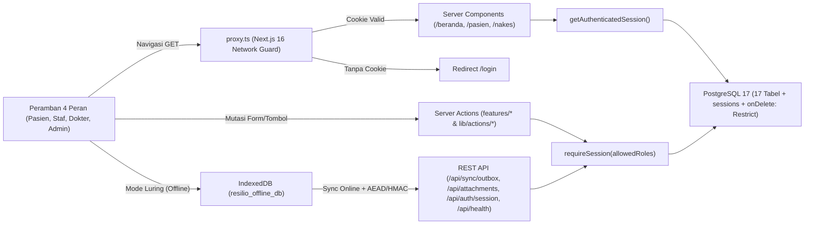
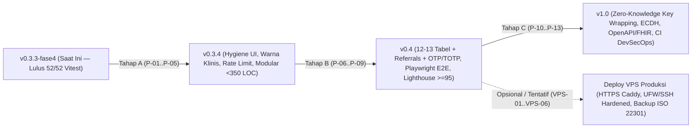

# Laporan Audit Ulang Menyeluruh & Keterlacakan Penuh (*Full Traceability*) — JagaMedis `v0.3`

> **Metadata Dokumen**
> - **Proyek**: JagaMedis (sebelumnya Resilio-Health) — Cryptographic Offline-First HIS & RME
> - **Versi & Target Milestone**: Transisi Milestone `v0.2` $\rightarrow$ **`v0.3`** (`v0.3.3-fase4`, pasca-eksekusi Fase 1 s.d. Fase 4)
> - **Branch Diaudit**: `audit/re-audit-v0.3-standards-sop` (snapshot pasca-merge `refactor/fase-1..4`)
> - **Tanggal & Waktu Verifikasi Langsung**: 26 November 2026, 10:11 WIB
> - **Dokumen Baseline Pembanding**: [audit_menyeluruh_jagamedis_22Nov2026.md](./audit_menyeluruh_jagamedis_22Nov2026.md) (`v0.2` / branch `Week-7`)
> - **Dokumen Pendamping Terpisah**:
>   - Matriks Standar Acuan & Justifikasi: [matriks_standar_acuan_v0.3.md](../standar/matriks_standar_acuan_v0.3.md)
>   - Simulasi Penggunaan, Alur Sistem & SOP Penanganan: [simulasi_alur_dan_sop_jagamedis.md](../sop/simulasi_alur_dan_sop_jagamedis.md)
>   - Log Perubahan Per Fase: [docs/perubahan/README.md](../perubahan/README.md)

---

## 1. Ringkasan Eksekutif & Skor Perbandingan (`v0.2` vs `v0.3.3-fase4`)

Audit ulang ini dilakukan secara *read-only* langsung terhadap basis kode aktual setelah seluruh fase refactor (`Fase 1` keamanan & kriptografi, `Fase 2` eliminasi *split-brain* 4 peran, `Fase 3` modularisasi `features/` + Server Components + 4 REST API + PWA/IndexedDB + isolasi cetak, serta `Fase 4` WCAG 2.1 AA + *Progressive Disclosure* + DevOps) diselesaikan.

### 1.1. Bukti Verifikasi Otomatis Langsung (26 Nov 2026, 10:11 WIB)

| Pemeriksaan Otomatis | Perintah Eksekusi | Hasil Aktual Terverifikasi | Status |
| :--- | :--- | :--- | :---: |
| **Pemeriksaan Tipe Statis** | `npx tsc --noEmit` | **0 error** TypeScript ketat | LULUS |
| **Analisis Statis Linter** | `npm run lint` (ESLint 9) | **0 error, 0 warning** | LULUS |
| **Rangkaian Uji Otomatis** | `npx vitest run` (Vitest v5.0.4) | **8 berkas uji, 52/52 skenario lulus (100%)** dalam `714ms` | LULUS |
| **Kompilasi Produksi** | `npm run build` (Next.js 16.3.6 Turbopack) | **36/36 rute + `ƒ Proxy (Middleware)`** terkompilasi bersih | LULUS |
| **Skema Basis Data** | `prisma/schema.prisma` | **17 model relasional + 14 enum** (`onDelete: Restrict`) | TERVERIFIKASI |
| **Cakupan Auth Guard** | `grep "requireSession(" features/ lib/ app/api/` | **52 panggilan `requireSession(...)`** melindungi aksi sensitif & API privat | TERVERIFIKASI |
| **Dialog Pemblokir UI** | `grep "window.(alert\|confirm)" app/ features/ components/` | **0 kemunculan** (100% diganti `Modal`/`ConfirmModal`/`ToastBanner`) | LULUS |
| **Bypass BOLA Server-Side** | `grep '\|\| "DOC-01"\|\|\| "P-101"' features/ lib/` | **0 kemunculan di server** (seluruh identitas aktor dari cookie `HttpOnly`) | LULUS |

### 1.2. Matriks Perbandingan 7 Domain Audit (`v0.2` Baseline vs `v0.3.3-fase4`)

| Domain Evaluasi | Standar Acuan Utama | Status Baseline (`v0.2` — 22 Nov 2026) | Status Audit Ulang (`v0.3.3-fase4` — 26 Nov 2026) | Perubahan Utama |
| :--- | :--- | :---: | :---: | :--- |
| **A. Keamanan & Kontrol Akses** | OWASP ASVS v4.0, OWASP API Top 10 (2023), NIST SP 800-63B | **KRITIS** | **LULUS (TERKENDALI)** | `sessions` PostgreSQL, `proxy.ts`, 52x `requireSession()`, anti-BOLA, 6-digit PIN ketat, 100% `bcrypt.compare`, OWASP Security Headers |
| **B. Kriptografi & Kedaulatan Data** | NIST SP 800-38D/57/107, RFC 5869, RFC 2104, CWE-208 | **KRITIS** | **LULUS (TERKENDALI)** | HKDF key separation (`encKey`/`macKey`), AES-256-GCM + CSPRNG IV 96-bit + AAD binding, *constant-time* `crypto.subtle.verify`, *Fail-Closed* murni |
| **C. Basis Data & Integritas Relasional** | Permenkes 24/2022, UU PDP 27/2022, Prisma 7 ACID | **SEDANG** | **TERKENDALI (CATATAN F4.1)** | 17 tabel fisik aktif + `sessions` + `onDelete: Restrict` + transaksi atomik; perampingan opsional `F4.1` siap dieksekusi di fase berikutnya (`P-06`) |
| **D. Alur End-to-End 4 Peran** | ISO/IEC 25010 (Functional Completeness), NISTIR 7804 | **TINGGI (TERPUTUS)** | **LULUS (TERKENDALI)** | Pipeline 4 peran (Booking $\rightarrow$ Admisi $\rightarrow$ Triase CDS $\rightarrow$ Assign DPJP $\rightarrow$ SOAP AEAD $\rightarrow$ Cetak A4 $\rightarrow$ SIEM) 100% PostgreSQL + penegakan Kill-Switch |
| **E. PWA & Ketahanan Offline-First** | W3C PWA, IndexedDB API, ISO 22301 | **TINGGI (DEAD CODE)** | **LULUS (AKTIF)** | `manifest.json`, `sw.js` teregistrasi via `PwaRegistrar`, IndexedDB `resilio_offline_db` terhubung ke `ExamWorkspace`, `NetworkStatusBanner`, & `POST /api/sync/outbox` |
| **F. Arsitektur, REST API & DevOps** | Next.js 16 App Router, RFC 9110, CIS Docker Benchmark | **SEDANG** | **LULUS (CATATAN RESIDUAL)** | Modularisasi `features/`, Server Components (`/beranda`, `/nakes`, `/pasien`), 4 endpoint REST (7 handler), `node:24-alpine` + `USER node` + `HEALTHCHECK` |
| **G. UI/UX Klinis & Aksesibilitas** | NISTIR 7804, Nielsen 10, ISO 9241-110, WCAG 2.1 AA | **SEDANG–TINGGI** | **LULUS (TERVERIFIKASI STATIS)** | Sticky Patient Banner, CDS vital kritis, isolasi cetak A4 via React Portal, *Progressive Disclosure*, WCAG `Modal`/`ToastBanner`, skip link, dark-mode fix, `prefers-reduced-motion` |

---

## 2. Peta Arsitektur Runtime Aktual (`v0.3.3-fase4`)

---

## 3. Matriks Keterlacakan Penuh (*Full Traceability Matrix*)

### 3.1. Keterlacakan Temuan Audit Baseline (`A1`–`G2`) & Master Plan (`F1.1`–`F4.3`)

| Kode Temuan / Tugas | Ringkasan Masalah Awal (`v0.2`) | Implementasi Perbaikan Nyata (`v0.3.3-fase4`) | Bukti Uji Otomatis | Status |
| :--- | :--- | :--- | :--- | :---: |
| **A1 / F1.1** | Server Actions tidak memverifikasi sesi & peran; sesi hanya di `Map` RAM | `prisma/schema.prisma` (`Session`), `lib/auth/sessionStore.ts`, `features/auth/guard.ts` (`requireSession`), `proxy.ts`, 52 panggilan `requireSession` | `tests/phase1-security-crypto.test.ts` (#1, #2) | **CLOSED** |
| **A2 / F1.1** | Eskalasi peran via cookie non-HttpOnly `resilio_user_role` dari `DEMO_USERS` | Hapus fallback `DEMO_USERS` di `lib/auth/auth.ts`, `app/(dashboard)/layout.tsx`, sinkronisasi `app/api/auth/session/route.ts` ke Prisma | `tests/phase1-security-crypto.test.ts` (#2), `tests/access-control.test.ts` (8/8) | **CLOSED** |
| **A3 / F1.2** | Kebocoran PII & `encryptionKeyHex` saat akses ditolak; bypass `DOC-01`/`P-101`; bypass PIN 6-digit kosong | `features/medical-records/patient-actions.ts`, `features/appointments/dpjp-actions.ts`, `lib/actions/consent.ts`; wajibkan PIN 6-digit persis; cek `validUntil > now` | `tests/phase1-security-crypto.test.ts` (#3, #4) | **CLOSED** |
| **A4 / F1.1 & F1.4** | Fallback komparasi password plaintext & absennya HTTP Security Headers | 100% `bcrypt.compare` di `features/auth/login-actions.ts` & `app/api/auth/session/route.ts`; 6 OWASP Security Headers di `next.config.ts` | `tests/phase1-security-crypto.test.ts` (#7) | **CLOSED** |
| **B1 / F1.3** | Enkripsi palsu Base64/Hex + IV & HMAC statis di `clinical.ts`; overwrite S/O/A saat tambah resep | `features/medical-records/crypto-service.ts`, `features/medical-records/exam-actions.ts`, `prisma/seed.ts`; enkripsi klien penuh + Addendum immutable | `tests/phase1-security-crypto.test.ts` (#5), `tests/crypto.test.ts` (8/8) | **CLOSED** |
| **B2 / F1.3** | *Fail-Open* menyuntikkan tensi `120/80` & resep `Amlodipine` palsu saat dekripsi/HMAC gagal | `features/medical-records/crypto-service.ts` (`decryptMedicalRecordSafe`), `pasien/rekam-medis/page.tsx`, `pasien/rekam-medis/[recordId]/page.tsx`, `PatientDetailWorkspace.tsx` + log `HMAC_MISMATCH` | `tests/phase1-security-crypto.test.ts` (#6), `tests/crypto.test.ts` (#3, #6) | **CLOSED** |
| **B3 / F1.3** | HKDF & AAD hanya di unit test; key reuse di `encryptBinaryAttachment`; `===` timing attack di `hmac.ts` | `lib/crypto/hmac.ts` (`crypto.subtle.verify`), `lib/crypto/aes.ts` (HKDF di biner), `lib/crypto/hkdf.ts`, `features/medical-records/crypto-service.ts` (AAD `patientId:recordId:version`) | `tests/crypto.test.ts` (#4, #5, #7, #8) | **CLOSED** |
| **C1–C2 / F4.1** | 16 tabel (+ `sessions` = 17), beberapa tabel redundan (`active_encounters`, `kyc`+`kyd`), ketiadaan tabel `referrals` | `sessions` ditambahkan (`20261126011004_add_persistent_sessions`); perampingan skema `F4.1` (17 $\rightarrow$ 12–13 tabel + `referrals` + OTP/TOTP) dijadwalkan bersih pada Tahap B (`P-06` & `P-08b`) tanpa hambatan praktikum | `tests/transaction.test.ts` (2/2) | **PLANNED (`P-06`)** |
| **D1 / F2.1** | Portal Pasien *split-brain* (`localStorage`), auto-consent hilang, faskes karantina masih bisa dibooking | `app/(dashboard)/pasien/{booking,consent,faskes,faskes/[faskesId],audit-log,tiket-kendala,profil}/page.tsx`, `features/appointments/booking-actions.ts` | `tests/phase2-end-to-end.test.ts` (#1, #2) | **CLOSED** |
| **D2 / F2.2** | Staf check-in/walk-in 100% `localStorage`; triase tidak ubah status `WAITING_DOCTOR`; assign DPJP abaikan triase | `app/(dashboard)/staf/{page,triase/page,assign-dpjp/page}.tsx`, `lib/actions/triage.ts` (`$transaction`), handoff `?aptId=`, CDS vital abnormal | `tests/phase2-end-to-end.test.ts` (#2) | **CLOSED** |
| **D3 / F2.3** | Ruang periksa dokter 404 untuk booking DB; Tab 2–5 hilang; kalender hardcode `12–18 Okt 2026`; cetak sebelum dekripsi | `features/medical-records/exam/*`, `features/medical-records/patient-detail/*`, `DoctorCalendarSchedule.tsx`, `nakes/jadwal/page.tsx`, `PrintableMedicalResume.tsx` (portal cetak A4 terisolasi) | `tests/phase2-end-to-end.test.ts` (#2), `tests/phase3-architecture-pwa.test.ts` (#1) | **CLOSED** |
| **D4 / F2.4** | Konsol Admin 100% `localStorage`; reject KYC jadi `SUSPENDED` lalu balik `PENDING`; Kill-Switch tidak mengunci server | `features/admin/*`, `lib/actions/admin.ts`, `app/(dashboard)/admin/*`, `AccountStatus.REJECTED`, guard `faskes.status === "QUARANTINED"` di booking & 5 aksi klinis | `tests/phase2-end-to-end.test.ts` (#3, #4) | **CLOSED** |
| **E1 / F3.4** | `manifest.json` hilang; `sw.js` tidak diregistrasi; `indexedDb.ts` *dead code* | `public/manifest.json`, `public/icon.svg`, `public/sw.js`, `components/shared/PwaRegistrar.tsx`, `lib/storage/indexedDb.ts`, `NetworkStatusBanner.tsx`, `nakes/offline-sync/page.tsx` | `tests/phase3-architecture-pwa.test.ts` (#4) | **CLOSED** |
| **F1 / F3.1** | *God files* 700–1.328 baris; duplikasi `safeRevalidate` (7x) & `parsePrescriptionDetail` (2x) | Struktur modular `features/{admin,appointments,auth,dashboard,medical-records}/`, `lib/utils/revalidate.ts`, `features/medical-records/prescription-parser.ts`; `page.tsx` utama dirampingkan ke 11–21 baris | `tests/phase3-architecture-pwa.test.ts` (#1) | **PARTIAL** *(lihat Catatan Residual #2)* |
| **F2 / F3.2** | RSC Waterfall (`"use client"` + `useEffect` memanggil Server Action untuk read) | Migrasi `/beranda`, `/nakes`, `/pasien` ke Next.js 16 Server Components (`features/*/queries.ts` + `<Suspense>`) | `tests/phase3-architecture-pwa.test.ts` (#2) | **CLOSED** |
| **F2 / F3.3** | Ketiadaan endpoint REST untuk healthcheck, PWA sync, & biner terenkripsi | 4 endpoint REST nyata: `GET /api/health`, `GET/POST/DELETE /api/auth/session`, `POST /api/sync/outbox`, `GET/POST /api/attachments` | `tests/phase3-architecture-pwa.test.ts` (#3) | **CLOSED** |
| **G1–G2 / F4.2** | Konflik dark mode `globals.css`, tanpa `Modal` ARIA, `window.alert/confirm`, double sticky header, jargon teknis pasien, tanpa `beforeunload`/skip link | `components/ui/{Modal,ToastBanner}.tsx`, `app/globals.css`, `app/(dashboard)/{layout,error}.tsx`, `pasien/rekam-medis/page.tsx` (`
`), `ExamWorkspace.tsx` (`beforeunload`, error dots), `DoctorCalendarSchedule.tsx` (keyboard) | `tests/phase4-ui-a11y-devops.test.ts` (#1, #2, #3) | **CLOSED** *(verifikasi statis; Lighthouse live di v0.4)* |
| **F3 / F4.3** | `Dockerfile` Node 20 vs 24; password DB hardcoded di `docker-compose.yml` | `Dockerfile` (`node:24-alpine`, `USER node`, `HEALTHCHECK /api/health`), `docker-compose.yml` (`${POSTGRES_PASSWORD}`), `.env.example` | `tests/phase4-ui-a11y-devops.test.ts` (#4) | **CLOSED** |

### 3.2. Keterlacakan Kebutuhan Pengguna (`UR-P/S/T/A`) ke Kode & Bukti Uji

| Kelompok Peran | Kode Kebutuhan | Rute / Modul Implementasi Utama | Guard & Mekanisme Keamanan | Bukti Pengujian | Status |
| :--- | :--- | :--- | :--- | :--- | :---: |
| **Portal Pasien** | `UR-P01`, `UR-P09` | `app/(auth)/register/pasien/page.tsx`, `features/auth/register-actions.ts`, `app/(dashboard)/pasien/profil/page.tsx` | Validasi Zod NIK 16 digit, Auto-Watermark KTP Canvas, `AccountStatus.PENDING` | `tests/validations.test.ts` (#1–5) | **TERPENUHI** |
| **Portal Pasien** | `UR-P02`, `UR-P03`, `UR-P04`, `UR-P10` | `app/(dashboard)/pasien/faskes/`, `pasien/booking/page.tsx`, `features/appointments/booking-actions.ts` | Blokir faskes `QUARANTINED`, transaksi atomik Booking + Auto-Consent + PIN 6-digit | `tests/phase2-end-to-end.test.ts` (#1, #2, #3) | **TERPENUHI** |
| **Portal Pasien** | `UR-P05`, `UR-P07` | `app/(dashboard)/pasien/consent/page.tsx`, `pasien/audit-log/page.tsx`, `lib/actions/consent.ts` | `requireSession(["pasien"])`, *1-Click Revoke* instan, Audit Trail PostgreSQL (UU PDP) | `tests/phase1-security-crypto.test.ts` (#1), `tests/phase2-end-to-end.test.ts` (#2) | **TERPENUHI** |
| **Portal Pasien** | `UR-P06`, `UR-P12` | `app/(dashboard)/pasien/rekam-medis/{page,[recordId]/page}.tsx`, `features/medical-records/crypto-service.ts`, `app/api/attachments/route.ts` | Dekripsi klien HKDF+AES-256-GCM+AAD, verifikasi HMAC *constant-time*, *Fail-Closed*, *Progressive Disclosure*, Cetak A4 terisolasi | `tests/crypto.test.ts` (8/8), `tests/phase1-security-crypto.test.ts` (#5, #6) | **TERPENUHI** |
| **Portal Pasien** | `UR-P08`, `UR-P11` | `app/(dashboard)/pasien/tiket-kendala/page.tsx`, `features/dashboard/PasienDashboardClient.tsx`, `lib/actions/ticket.ts` | Pemisahan metadata tiket dari payload klinis, Family Proxy per nomor KK | `tests/phase2-end-to-end.test.ts` (#2) | **TERPENUHI** |
| **Staf Triase** | `UR-S01`, `UR-S02`, `UR-S03` | `app/(dashboard)/staf/{page,triase/page,assign-dpjp/page}.tsx`, `lib/actions/triage.ts`, `features/appointments/dpjp-actions.ts` | `requireSession(["staf"])`, transaksi atomik `WAITING_TRIAGE` $\rightarrow$ `WAITING_DOCTOR`, CDS vital kritis, validasi ketat PIN 6-digit | `tests/phase1-security-crypto.test.ts` (#4), `tests/phase2-end-to-end.test.ts` (#2), `tests/validations.test.ts` (#6–9) | **TERPENUHI** |
| **Staf Triase** | `UR-S04` | `app/(dashboard)/staf/rujukan/page.tsx` | Pemisahan tab Keluar/Masuk UI; penyimpanan relasional masih memakai fallback `localStorage` sambil menunggu tabel `referrals` (`F4.1`) | Verifikasi manual UI | **PARSIAL** *(menunggu F4.1)* |
| **Dokter DPJP** | `UR-T01`, `UR-T02` | `app/(auth)/register/nakes/page.tsx`, `app/(dashboard)/nakes/page.tsx`, `nakes/jadwal/page.tsx`, `DoctorCalendarSchedule.tsx` | Validasi STR/SIP `PENDING`, Server Component `queries.ts`, sinkronisasi jadwal WIB hari ini & pekan aktif | `tests/phase3-architecture-pwa.test.ts` (#2) | **TERPENUHI** |
| **Dokter DPJP** | `UR-T03`, `UR-T08` | `app/(dashboard)/nakes/pasien-lookup/{page,[patientId]/page}.tsx`, `features/medical-records/patient-actions.ts`, `PatientDetailWorkspace.tsx` | Anti-BOLA (0 bocoran PII/kunci saat ditolak), log `IDOR_BLOCKED`, protokol *Break-Glass* IGD beralasan klinis wajib + log `CRITICAL` | `tests/phase1-security-crypto.test.ts` (#3), `tests/access-control.test.ts` (8/8) | **TERPENUHI** |
| **Dokter DPJP** | `UR-T04`, `UR-T07`, `UR-T09`, `UR-T10` | `features/medical-records/exam/*`, `features/medical-records/exam-actions.ts`, `lib/validations/clinical.ts` | Validasi Zod v4, enkripsi AEAD+HKDF+AAD klien, *Sticky Patient Banner*, alert kontraindikasi alergi obat, Addendum immutable (`version + 1`), penegakan Kill-Switch | `tests/validations.test.ts` (#10–15), `tests/phase2-end-to-end.test.ts` (#2, #3) | **TERPENUHI** |
| **Dokter DPJP** | `UR-T05`, `UR-T06` | `public/manifest.json`, `public/sw.js`, `lib/storage/indexedDb.ts`, `app/(dashboard)/nakes/offline-sync/page.tsx`, `app/api/sync/outbox/route.ts` | IndexedDB `resilio_offline_db` (3 object stores), Background Sync ke `POST /api/sync/outbox` dengan validasi format AEAD/HMAC | `tests/phase3-architecture-pwa.test.ts` (#3, #4) | **TERPENUHI** |
| **Admin Regulator** | `UR-A01`, `UR-A02`, `UR-A06` | `app/(dashboard)/admin/{verifikasi-kyc,verifikasi-kyd}/page.tsx`, `features/admin/verification-actions.ts` | `requireSession(["admin"])`, review visual KTP/Selfie/STR/SIP, siklus status persisten `APPROVED` / `REJECTED` | `tests/phase2-end-to-end.test.ts` (#4) | **TERPENUHI** |
| **Admin Regulator** | `UR-A03`, `UR-A04`, `UR-A05`, `UR-A07` | `app/(dashboard)/admin/{page,faskes,siem-monitor,incident-center}/page.tsx`, `features/admin/*`, `lib/actions/faskes.ts` | Ransomware Kill-Switch (`QUARANTINED`) berdampak ke seluruh server action klinis/booking, SIEM feed PostgreSQL real-time, observabilitas tiket tanpa isi medis | `tests/phase1-security-crypto.test.ts` (#1), `tests/phase2-end-to-end.test.ts` (#3) | **TERPENUHI** |

---

## 4. Inventaris Keamanan Endpoint, Server Actions & Basis Data (`v0.3.3-fase4`)

### 4.1. Inventaris 4 Endpoint REST (`app/api/`) — 7 HTTP Handlers

| Endpoint | Method | Guard Sesi & Peran | Kode Status HTTP | Fungsi & Kontrol Keamanan |
| :--- | :---: | :--- | :---: | :--- |
| `/api/health` | `GET` | Publik (Healthcheck) | `200`, `503` | Verifikasi konektivitas PostgreSQL (`SELECT 1`), dipakai oleh `HEALTHCHECK` Docker |
| `/api/auth/session` | `GET` | Cookie `HttpOnly` | `200`, `401` | Validasi sesi persisten PostgreSQL (`sessions`), mengembalikan profil user terotorisasi |
| `/api/auth/session` | `POST` | Publik (Login REST) | `200`, `400`, `401`, `403` | Autentikasi `bcrypt.compare` terhadap tabel `users`, menerbitkan cookie `HttpOnly` + `SameSite=Lax` |
| `/api/auth/session` | `DELETE` | Cookie `HttpOnly` | `200` | Menghapus sesi dari PostgreSQL (`sessions`) & membersihkan cookie sesi |
| `/api/sync/outbox` | `POST` | `requireSession(["nakes"])` | `200`, `400`, `401`, `403`, `423` | Menerima antrean luring IndexedDB, validasi struktur ciphertext + IV 24-hex + HMAC 64-hex, cek Kill-Switch `QUARANTINED`, simpan ke `medical_records` |
| `/api/attachments` | `GET` | `requireSession(["pasien", "nakes", "admin"])` | `200`, `400`, `401`, `403`, `404` | Unduh citra medis biner terenkripsi dengan verifikasi BOLA kepemilikan pasien / izin aktif dokter |
| `/api/attachments` | `POST` | `requireSession(["nakes"])` | `201`, `400`, `401`, `403`, `423` | Unggah citra medis terenkripsi (Rontgen/USG/Lab) dengan validasi Kill-Switch & metadata HMAC |

### 4.2. Cakupan Server Actions & Network Boundary

- **Network Boundary (`proxy.ts`)**: Mencegat seluruh permintaan ke `/beranda`, `/pasien/*`, `/staf/*`, `/nakes/*`, dan `/admin/*`. Tanpa cookie `resilio_session_token`, permintaan langsung dialihkan (`307 Redirect`) ke `/login` sebelum React dirender.
- **Server Actions (`features/*` & `lib/actions/*`)**: Total **63 fungsi `export async function`** (termasuk re-export fasad kompatibilitas di `lib/actions/`), dilindungi oleh **52 panggilan `requireSession(allowedRoles)`**.
- **Pengecualian Publik yang Sah (Disengaja)**:
  - Autentikasi & Registrasi: `loginServerAction`, `logoutServerAction`, `getServerSessionData`, `registerPasienServerAction`, `registerPasienCepatServerAction`.
  - Direktori Publik Faskes: `getFaskesListServerAction`, `getFaskesDetailServerAction` (hanya mengembalikan informasi direktori faskes & kuota dokter tanpa PII pasien).
  - Server Component Queries (`features/*/queries.ts`): Menggunakan `getAuthenticatedSession()` yang juga memvalidasi cookie `HttpOnly` terhadap tabel `sessions` PostgreSQL.

### 4.3. Inventaris 17 Tabel & 14 Enum (`prisma/schema.prisma`)

- **17 Model Aktif**: `User`, `Session`, `Faskes`, `Doctor`, `StaffMember`, `Patient`, `FamilyMember`, `KycSubmission`, `KydSubmission`, `Appointment`, `TriageAssessment`, `ActiveEncounter`, `MedicalRecord`, `MedicalImage`, `AccessGrant`, `SecurityAuditLog`, `TroubleTicket`.
- **14 Enum**: `UserRole`, `AccountStatus`, `FaskesType`, `FaskesStatus`, `Gender`, `FamilyRelation`, `TriaseLevel`, `AppointmentStatus`, `ImageType`, `GrantEntityType`, `AuditSeverity`, `AuditAction`, `TicketCategory`, `TicketStatus`.
- **Integritas Referensial**: Seluruh relasi klinis utama (`Appointment`, `MedicalRecord`, `TriageAssessment`, `AccessGrant`) menerapkan `onDelete: Restrict` sesuai aturan retensi medikolegal Permenkes RI No. 24 Tahun 2022, terbukti di `tests/transaction.test.ts`.

---

## 5. Temuan Residual Teknis Jujur (*Honest Residual Findings*)

Untuk menjaga integritas audit profesional, berikut **6 temuan residual teknis nyata** yang masih tercatat pada snapshot `v0.3.3-fase4` (tidak ada yang berstatus `KRITIS`/`P0`):

| No | Kategori | Lokasi Kode Aktual | Penjelasan Jujur & Tingkat Risiko | Standar Terkait & Tindak Lanjut |
| :---: | :--- | :--- | :--- | :--- |
| **R1** | **Residual `localStorage` / `MOCK_*` (5 Halaman)** | `staf/rujukan/page.tsx:6-8,18,34`, `nakes/rujukan/page.tsx:7-8,99`, `nakes/pasien-lookup/page.tsx:8-9,90,190`, `pasien/rekam-medis/page.tsx:6,126`, `pasien/rekam-medis/[recordId]/page.tsx:7,9,140` | **Sedang (Non-Security)**: 2 halaman rujukan masih bergantung pada `localStorage` karena tabel `referrals` belum dibuat (`F4.1`); 3 halaman lainnya menyimpan fallback offline/cache `localStorage` saat server tidak terjangkau. | **ISO/IEC 25010 & W3C IndexedDB**: Tambah tabel `referrals` (`P-06`) & migrasikan cache luring ke IndexedDB (`cached_active_patients`). |
| **R2** | **4 Berkas Domain >350 Baris** | `features/medical-records/exam/ExamWorkspace.tsx` (720 baris), `features/medical-records/patient-detail/PatientDetailWorkspace.tsx` (479 baris), `features/medical-records/exam-actions.ts` (457 baris), `features/medical-records/exam/ExamTabs4To5.tsx` (395 baris) | **Rendah (Maintainability)**: Seluruh `page.tsx` rute sudah ramping (11–21 baris), tetapi 4 berkas domain medis masih melampaui ambang ideal 350 baris akibat kompleksitas formulir SOAP 5-tab dan 4 modal aksi klinis. | **ISO/IEC 25010 (Maintainability)**: Pecah ke *custom hook* `useExamForm.ts` + pisahkan Tab 4 dan Tab 5 (`P-04`). |
| **R3** | **Fallback UI `session?.id \|\| "DOC-01"` (4 Baris Klien)** | `app/(dashboard)/nakes/pasien-lookup/page.tsx:75,152,205`, `app/(dashboard)/nakes/offline-sync/page.tsx:154` | **Rendah (Hygiene UI)**: Di server-side (`features/`, `lib/`) sudah **0** bypass karena `requireSession()` menimpa `actorId` dari cookie sesi. Namun 4 baris di komponen klien masih memiliki string fallback `"DOC-01"` (ditambah 1 query default `pasien/booking/page.tsx:47` yang wajar). | **OWASP ASVS V4 (Defense-in-Depth)**: Hapus fallback `"DOC-01"` di klien; wajibkan guard `if (!session?.id) return;` (`P-01`). |
| **R4** | **Penyimpanan `encryptionKeyHex` di DB yang Sama** | `prisma/schema.prisma` (`Patient.encryptionKeyHex`) | **Sedang (Kriptografi *Zero-Knowledge* Murni)**: Saat ini kunci 256-bit pasien disimpan di kolom `patients.encryption_key_hex` PostgreSQL dan dikirim ke sesi terotorisasi untuk dekripsi Web Crypto di browser (model *pragmatic hybrid* untuk evaluasi akademik). Jika penyerang menguasai dump DB penuh beserta tabel `patients`, kunci tersebut ikut terbaca. | **NIST SP 800-57 & UU PDP Pasal 35**: Terapkan *Key Wrapping* (PBKDF2/Argon2id berbasis PIN/passphrase pasien) atau KMS *Envelope Encryption* + pertukaran kunci ECDH/X25519 di `v1.0` (`P-10`). |
| **R5** | **Perampingan Skema DB (`F4.1`) Belum Dieksekusi** | `prisma/schema.prisma` (`active_encounters`, `kyc_submissions` + `kyd_submissions`, `VarChar(32)` PK, overlap `AppointmentStatus`) | **Rendah (Arsitektur DB)**: Belum dirampingkan pada Fase 4; siap dieksekusi langsung di fase berikutnya (`docs/praktikum/modul06.md` bersifat arsip praktikum dan tidak perlu diubah). | **Permenkes 24/2022 & ISO/IEC 25010**: Eksekusi perampingan dari 17 ke 12–13 tabel + `VarChar(36)` UUID v4 (`P-06`) dan sinkronkan `docs/database.md`. |
| **R6** | **Uji E2E Browser Nyata & Lighthouse Live** | `tests/` (52 tes Vitest) | **Rendah (QA)**: 52/52 uji unit & integrasi DB/API/static-A11y lulus 100%, namun pengujian browser headless (*Playwright E2E*) dan pengukuran skor Lighthouse CWV/Accessibility secara *live* di Chromium belum diotomatisasi di CI. | **WCAG 2.1 AA & Core Web Vitals**: Tambah suite Playwright 4 peran + GitHub Actions CI (`P-09`, `P-13`). |
| **R7** | ***Account Enumeration* Login & Autentikasi Tunggal (*AAL1*)** | `features/auth/session-actions.ts:55,67,73`, `prisma/schema.prisma:120-140` | **Sedang (Keamanan Auth)**: Pesan gagal login masih membedakan *"Kredensial/NIK tidak valid"* vs *"Kata sandi salah"* vs *"Akun ditolak"* (memungkinkan enumerasi NIK/email/STR); belum ada verifikasi kepemilikan email (`emailVerifiedAt`), alur reset sandi, maupun MFA (OTP/TOTP) untuk akun berisiko tinggi (`admin`/`nakes`/`staf`). | **OWASP ASVS V2.2.2 (CWE-204), NIST SP 800-63B (AAL2), RFC 6238**: Seragamkan pesan error + dummy `bcrypt.compare` di `v0.3.4` (`P-05b`); terapkan **Email OTP + TOTP Offline** di `v0.4` (`P-08b`). |

---

## 6. Evaluasi Kedalaman Produk: Efisiensi Tabel DB, Tampilan UI/UX & Relevansi Fitur

Selain temuan teknis `R1`–`R6`, audit menyeluruh juga meninjau efisiensi skema basis data, ergonomi antarmuka lintas 4 peran, serta ketepatan ruang lingkup fitur terhadap tujuan utama **JagaMedis** (*Cryptographic Offline-First HIS & RME berstandar Zero-Trust*).

### 6.1. Evaluasi Jumlah Tabel Basis Data (17 Model Aktual vs Target Ideal 12–13 Model)

Berdasarkan penghitungan langsung pemakaian `prisma.<model>.*` di seluruh `features/`, `lib/`, dan `app/`:

| Kategori Model | Model Prisma (`prisma/schema.prisma`) | Pemakaian Runtime | Keputusan Audit |
| :--- | :--- | :---: | :--- |
| **Inti Operasional (11)** | `User` (6), `Session` (3), `Faskes` (12), `Doctor` (2), `StaffMember` (2), `Patient` (11), `Appointment` (18), `TriageAssessment` (via `$transaction` & `include`), `MedicalRecord` (16), `AccessGrant` (12), `SecurityAuditLog` (11) | Aktif Tinggi | **Pertahankan 100%** sebagai tulang punggung 4 peran, keamanan, & kriptografi. |
| **Pendukung Sah (2)** | `MedicalImage` (4), `TroubleTicket` (6) | Aktif | **Pertahankan** untuk lampiran citra terenkripsi (`UR-T07`/`UR-P12`) & observabilitas non-medis (`UR-A05`). |
| **Kembar / Redundan (2 $\rightarrow$ 1)** | `KycSubmission` (6) & `KydSubmission` (5) | Aktif (85% kolom identik) | **Gabung** menjadi 1 tabel `Verification` (`type: KYC \| KYD`, `metadata: Json`) pada `P-06`. |
| **Tidak Terpakai / Parsial (2)** | `ActiveEncounter` (**0** query), `FamilyMember` (**0** query langsung) | *Dead Table* / Parsial | **Hapus `ActiveEncounter`** (sudah ditangani `Appointment`); **sederhanakan atau selesaikan penuh `FamilyMember`** (`P-06`, `P-08`). |
| **Tabel Hilang (1)** | *Belum ada tabel `Referral`* | Dibutuhkan 2 halaman | **Tambah `Referral`** (atau perluas `AccessGrant` tipe rujukan) agar `/staf/rujukan` & `/nakes/rujukan` 100% bebas `localStorage` (`P-06`). |

> **Catatan Dokumentasi**: Berkas praktikum terdahulu (`docs/praktikum/modul06.md`) bersifat arsip historis dan **tidak perlu diubah**. Saat perampingan skema (`P-06` & `P-08b`) dieksekusi, cukup mutakhirkan dokumentasi proyek aktif (`docs/database.md`, `CHANGELOG.md`, `EVALUASI.md`, dan `README.md`).

### 6.2. Evaluasi Tampilan & UX Klinis (*NISTIR 7804, Nielsen 10, WCAG 2.1 AA*)

| No | Area Tampilan yang Perlu Diperbaiki | Lokasi Kode | Standar Acuan | Usulan Perbaikan Terukur |
| :---: | :--- | :--- | :--- | :--- |
| **U1** | **Redundansi Menu `/beranda` vs Dasbor Peran** (Pasien memiliki 9 item sidebar; 4 peran punya 2 halaman ringkasan berbeda) | `components/shared/RoleNav.tsx:52-92`, `app/(dashboard)/beranda/page.tsx` | **Nielsen #8** (*Aesthetic & Minimalist Design*) & **ISO 9241-110** | Jadikan `/beranda` pengarah otomatis ke dasbor peran atau lebur ringkasan sehingga sidebar setiap peran ringkas (5–7 menu utama). |
| **U2** | **Konflik Semantik Warna Merah Brand vs Peringatan Klinis** (`bg-red-600` dipakai untuk tombol primer & logo landing page) | `app/page.tsx:40,62,90`, `components/shared/RoleNav.tsx` | **NISTIR 7804** (*Alert Fatigue Prevention*) | Gunakan palet enterprise medis yang tenang (misal *Clinical Teal/Blue/Slate*) untuk navigasi & CTA primer, dan **khususkan warna merah hanya untuk kondisi bahaya/kritis** (alergi obat, triase `MERAH`, `HMAC_MISMATCH`, *Kill-Switch*). |
| **U3** | **Eksposur *Quick Demo* dengan Kredensial pada Halaman Publik** | `app/page.tsx:12-32,103-140`, `app/(auth)/login/page.tsx` | **OWASP ASVS V2** & **OWASP Secure Deployment** | Bungkus tombol *Quick Demo* dan hapus fallback `loginUser()` mock di balik *feature flag* `NEXT_PUBLIC_ENABLE_DEMO_LOGIN` (aktif di dev/demo dosen, **wajib `false`** di produksi/VPS). |
| **U4** | **Kepadatan Visual (*Visual Density*) & Tipografi Mikro** | `features/medical-records/exam/ExamWorkspace.tsx`, `app/(dashboard)/admin/siem-monitor/page.tsx` | **WCAG 2.1 SC 1.4.3/1.4.8** & **NISTIR 7804** | Naikkan label penting dari `text-[9px]`/`text-[10px]` ke minimal `text-xs` (12px), batasi 1 CTA utama per layar, dan perjelas hierarki visual antar bagian. |
| **U5** | **Visibilitas Antrean Offline pada Navigasi Dokter** | `components/shared/RoleNav.tsx:71`, `lib/storage/indexedDb.ts` | **Nielsen #1** (*Visibility of System Status*) & **ISO 22301** | Tampilkan lencana angka *pending* IndexedDB secara langsung di item menu *"Status Sinkronisasi Offline"* agar dokter langsung melihat jika ada berkas belum tersinkronisasi. |

### 6.3. Audit Relevansi Fitur terhadap Tujuan Utama (*Product Scope Fit*)

| Fitur / Modul | Tingkat Relevansi | Analisis Jujur & Arahan Strategis |
| :--- | :---: | :--- |
| **Kriptografi AEAD+HKDF+HMAC, *Fail-Closed*, Zero-Trust BOLA Guard, PIN 6-Digit, Break-Glass IGD, Kill-Switch, SIEM, Triase CDS + SOAP + Addendum, Offline PWA + IndexedDB** | **Sangat Inti (100%)** | Identitas utama JagaMedis yang menjawab 3 mata kuliah sekaligus (PAW, Kriptografi, KKS). Seluruh investasi kualitas diprioritaskan di pilar ini. |
| **Akun Tanggungan Keluarga (*Family Proxy* — `UR-P11`)** | **Rendah / Parsial** | Saat ini `familyMember` memiliki `0` query DB langsung dan baru sebatas *switcher* profil di klien. **Keputusan**: Selesaikan secara menyeluruh (relasi KK terverifikasi + isolasi kunci/rekam medis anak) di `v0.4`/`v1.0` **atau** tunda/sederhanakan sebagai modul opsional agar tidak menjadi titik lemah saat uji penguji. |
| **Pencarian Faskes Pintar berbasis Gejala (`UR-P02`)** | **Sedang (Sekunder)** | Cenderung mendekati fitur *marketplace* telemedisin. Tetap pertahankan kondisi saat ini (sudah terhubung ke status `ACTIVE` vs `QUARANTINED`), namun **jangan perluas** ke arah rekomendasi AI/chat konsultasi ritel. |
| **Rujukan Lintas Faskes (`UR-P05`, `UR-S04`)** | **Tinggi (Saat Ini Setengah Jadi)** | Sangat relevan untuk portabilitas RME, namun masih menyimpan data di `localStorage`. **Wajib** dituntaskan ke PostgreSQL pada `P-06`. |
| **Tiket Kendala (`trouble_tickets` / `UR-P08`, `UR-A05`)** | **Sedang (Pelengkap)** | Relevan sebagai bukti prinsip *Zero-Knowledge Observability* (Admin menangani tiket tanpa melihat data klinis). Pertahankan versi ringkas; hindari *scope creep* menjadi sistem *helpdesk* kompleks. |

### 6.4. Audit Keamanan Login, Registrasi (Email vs Nomor HP) & Strategi OTP/MFA

Inspeksi langsung terhadap [session-actions.ts](../../features/auth/session-actions.ts) dan model `User`/`Patient` pada [schema.prisma](../../prisma/schema.prisma) menghasilkan keputusan arsitektur autentikasi berikut:

1. **Kebijakan Identitas Registrasi (Email Wajib + Nomor HP Sekunder)**:
   - **`Email` wajib sebagai identitas akun utama**: Unik permanen, tidak didaur ulang operator seperti kartu prabayar hangus (*recycled number risk*), gratis diverifikasi, dan mudah diaudit sesuai prinsip minimisasi data **UU PDP No. 27/2022**.
   - **`Nomor HP` disimpan sebagai atribut kontak terpisah** (opsional saat registrasi cepat, wajib saat e-KYC/rawat jalan): Digunakan untuk kontak darurat IGD, pengingat antrean/PIN 6-digit, dan komunikasi klinis — **bukan** faktor keamanan tunggal.
2. **Perbandingan Kanal OTP & Kesesuaian *Offline-First***:

| Kanal Verifikasi | Kepatuhan NIST SP 800-63B | Biaya Operasional | Jalan Saat *Offline*? | Keputusan untuk JagaMedis |
| :--- | :--- | :--- | :---: | :--- |
| **SMS OTP** | **Restricted / Lemah** (rentan *SIM Swap*, SS7, *smishing*) | Berbayar per SMS & rawan *SMS pumping* | Tidak | **Ditolak** sebagai faktor keamanan utama. |
| **WhatsApp OTP** | **Sedang** (E2EE, namun tetap terikat nomor HP/*SIM Swap*) | Berbayar (Meta Business API) | Tidak | Opsional di masa depan hanya untuk **notifikasi** jadwal/PIN. |
| **Email OTP** | **Sedang–Baik** (bebas *SIM Swap*, cocok untuk verifikasi kepemilikan) | **Gratis / Murah** (Mailpit lokal, Resend, Brevo, SMTP) | Tidak | **Dipakai** untuk verifikasi registrasi, lupa sandi, & OTP perangkat baru Pasien. |
| **TOTP App (*RFC 6238*)** | **Tinggi (*AAL2*)** (bebas *SIM Swap* & bebas kebocoran kanal) | **100% Gratis** (tanpa gateway pihak ketiga) | **YA (100% Offline)** | **Dipakai untuk MFA Dokter DPJP, Staf Triase, & Admin Regulator** — selaras penuh dengan tema *Offline-First* JagaMedis. |

3. **Kesiapan Eksekusi Lokal (Tanpa Memerlukan VPS)**:
   - **TOTP (RFC 6238)** berjalan **100% lokal & bahkan tanpa internet**: server Next.js lokal menghasilkan secret acak, merender QR code `otpauth://`, pengguna memindai dengan Google Authenticator/Authy di ponsel, lalu kode 6-digit diverifikasi secara matematis di server lokal.
   - **Email OTP** berjalan **100% di `localhost` tanpa VPS**: untuk lingkungan dev/pengujian lokal gunakan container **Mailpit** (`SMTP localhost:1025` + Web Inbox `localhost:8025` tanpa internet), atau layanan *outbound* gratis (**Resend** / **Nodemailer Gmail App Password**) yang mengirim email nyata ke kotak masuk pengguna langsung dari `localhost:3000`.
4. **Kontrol Keamanan Wajib Implementasi OTP (OWASP ASVS V2.6 & V2.8)**:
   - Simpan **hash `HMAC-SHA256(otp, secret)`** di DB (dilarang *plaintext*), TTL **3–5 menit**, *single-use* (`usedAt`), batas salah **maks. 5 kali**, cooldown kirim ulang **60 detik**, perbandingan *constant-time* (`crypto.timingSafeEqual`), dan pesan error login seragam (anti-*Account Enumeration* **CWE-204**).

---

## 7. Rencana Perbaikan & Peta Jalan Komprehensif Berbasis Standar (`v0.3.x` $\rightarrow$ `v0.4` $\rightarrow$ `v1.0`)

Seluruh rencana perbaikan berikut disusun bertahap (*incremental*), dipetakan langsung ke katalog [matriks_standar_acuan_v0.3.md](../standar/matriks_standar_acuan_v0.3.md), dan menjaga stabilitas artefak praktikum yang sedang berjalan.

### 7.1. Tahap A — Perbaikan Cepat Tanpa Migrasi Skema (`v0.3.4` — Pembersihan Residual, Anti-Enumeration & Poles UX)
*Fokus pengerasan keamanan login, higiene UI, modularitas berkas, dan penyederhanaan navigasi tanpa migrasi basis data.*

| Kode | Item Perbaikan | Berkas Target | Standar & Aturan Acuan | Indikator Lulus (*Quality Gate*) |
| :--- | :--- | :--- | :--- | :--- |
| **P-01** | **Hapus Residual Fallback UI `\|\| "DOC-01"` & Gating *Quick Demo*** | `nakes/pasien-lookup/page.tsx`, `nakes/offline-sync/page.tsx`, `app/page.tsx`, `app/(auth)/login/page.tsx`, `.env.example` | **OWASP ASVS V2 & V4** | `grep '\|\| "DOC-01"' app/ features/ lib/` menghasilkan **0** (kecuali default query non-auth); *Quick Demo* & fallback `loginUser()` hanya aktif bila `NEXT_PUBLIC_ENABLE_DEMO_LOGIN="true"`. |
| **P-02** | **Penyelarasan Navigasi & Pemisahan Warna Klinis (*Anti-Alert Fatigue*)** | `components/shared/RoleNav.tsx`, `app/(dashboard)/beranda/page.tsx`, `app/page.tsx` | **NISTIR 7804**, **Nielsen #8**, **WCAG 2.1 SC 1.4.3** | Sidebar setiap peran $\le 7$ menu tanpa duplikasi beranda; warna primer memakai palet medis tenang & warna merah khusus untuk alert klinis/keamanan (kontras $\ge 4.5:1$). |
| **P-03** | **Lencana Status Antrean Luring di Sidebar Dokter & Migrasi Cache Luring** | `components/shared/RoleNav.tsx`, `pasien/rekam-medis/{page,[recordId]/page}.tsx`, `nakes/pasien-lookup/page.tsx`, `lib/storage/indexedDb.ts` | **W3C IndexedDB**, **ISO 22301**, **Nielsen #1** | Sidebar dokter menampilkan jumlah item *pending* IndexedDB secara reaktif; fallback baca offline tidak lagi bergantung pada `MOCK_*` statis. |
| **P-04** | **Pemecahan 4 Berkas Domain Medis (>350 Baris)** | `features/medical-records/exam/{ExamWorkspace,ExamTabs4To5}.tsx`, `patient-detail/PatientDetailWorkspace.tsx`, `exam-actions.ts` | **ISO/IEC 25010 (Maintainability)** | Seluruh berkas di `features/` berada di bawah **350 baris** dengan *hook* & sub-komponen terpisah; `0` regresi pada 52 tes Vitest. |
| **P-05** | **Penguatan *Rate Limiting* Endpoint Autentikasi & Akses Sensitif** | `app/api/auth/session/route.ts`, `features/auth/session-actions.ts`, `lib/auth/rateLimit.ts` (baru) | **OWASP ASVS V2.2.1** (*Anti-Automation*), **OWASP API4:2023** | Percobaan login gagal berulang ($\ge 10$x/menit per IP/identifier) diblokir dengan HTTP `429 Too Many Requests` & tercatat ke `security_audit_logs`. |
| **P-05b** | **Penutupan Celah *Account Enumeration* pada Login** | `features/auth/session-actions.ts:53-76`, `app/api/auth/session/route.ts` | **OWASP ASVS V2.2.2**, **CWE-204** | Pesan gagal login 100% seragam (*"Kredensial atau kata sandi tidak valid."*) + jalankan dummy `bcrypt.compare` saat akun tidak ditemukan agar waktu respons setara. |

### 7.2. Tahap B — Refactoring Skema DB, Email OTP/TOTP MFA & QA E2E (`v0.4`)
*Dapat langsung dieksekusi kapan pun siap (berkas arsip praktikum `modul06.md` tidak perlu diubah; cukup sinkronkan `docs/database.md` & log perubahan).*

| Kode | Item Perbaikan | Berkas Target | Standar & Aturan Acuan | Indikator Lulus (*Quality Gate*) |
| :--- | :--- | :--- | :--- | :--- |
| **P-06** | **Perampingan Skema DB (`F4.1`: 17 $\rightarrow$ 12–13 Tabel) + Tabel `referrals`** | `prisma/schema.prisma`, `prisma/migrations/*`, `prisma/seed.ts`, `staf/rujukan/page.tsx`, `nakes/rujukan/page.tsx` | **Permenkes 24/2022**, **ISO/IEC 25010** | Hapus `active_encounters`; gabung `kyc`+`kyd` $\rightarrow$ `verifications`; tambah `referrals` (100% bebas `localStorage`); lebarkan PK ke `VarChar(36)` UUID v4; bersihkan overlap `AppointmentStatus`; `onDelete: Restrict` tetap lulus uji rollback. |
| **P-07** | **Pembersihan Metadata Klinis Sensitif di DB** | `prisma/schema.prisma`, `features/medical-records/*` | **UU PDP No. 27/2022 Pasal 4 ayat (2)** | `diagnosisShort` & `vitalSignsTrend` tidak lagi disimpan plaintext di kolom terpisah (cukup kode indeks `primaryIcd10` atau indeks terenkripsi/tertokenisasi), seluruh detail klinis berada di dalam ciphertext AEAD. |
| **P-08** | **Keputusan Tegas Modul *Family Proxy* (`UR-P11`)** | `prisma/schema.prisma` (`FamilyMember`), `features/dashboard/PasienDashboardClient.tsx` | **OWASP API1:2023 (BOLA)**, **UU PDP Pasal 25** (Data Anak) | Selesaikan isolasi query & kunci enkripsi berbasis relasi KK terverifikasi di PostgreSQL, **atau** tandai/keluarkan dari ruang lingkup inti jika belum diperlukan. |
| **P-08b** | **Implementasi Verifikasi Email OTP & MFA TOTP Offline (*Tiered MFA*)** | `prisma/schema.prisma` (`VerificationToken`, kolom `User.emailVerifiedAt`/`totpSecretEnc`/`phone`), `lib/auth/otp.ts`, `lib/auth/totp.ts`, `app/(auth)/verify-otp/page.tsx` | **NIST SP 800-63B (AAL2)**, **RFC 6238 (TOTP)**, **OWASP ASVS V2.6 & V2.8** | Registrasi & reset sandi wajib Email OTP 6-digit ter-hash (TTL 5 menit, maks 5 salah, cooldown 60 dtk, uji lokal via Mailpit/Resend); peran `admin`/`nakes`/`staf` mendukung MFA TOTP offline + *recovery codes*. |
| **P-09** | **Suite Uji E2E Browser Nyata (Playwright) & Audit Lighthouse Live** | `tests/e2e/*.spec.ts` (baru), `playwright.config.ts` | **WCAG 2.1 AA**, **Google Core Web Vitals** | Uji otomatis 4 peran di Chromium nyata (termasuk mode offline PWA, cetak A4, & *Break-Glass*); Lighthouse Accessibility $\ge 95$, Performance LCP $\le 2.5$s, CLS $\le 0.1$, 0 pelanggaran *axe* kritis/serius. |

### 7.3. Tahap C — Pematangan Rilis Penuh (`v1.0` — *Zero-Knowledge* Murni & Interoperabilitas)

| Kode | Item Perbaikan | Berkas Target | Standar & Aturan Acuan | Indikator Lulus (*Quality Gate*) |
| :--- | :--- | :--- | :--- | :--- |
| **P-10** | ***Zero-Knowledge Key Wrapping* & Pertukaran Kunci ECDH/X25519** | `lib/crypto/` (tambah `keywrap.ts`, `ecdh.ts`), `prisma/schema.prisma` (`Patient.encryptionKeyHex` $\rightarrow$ `wrappedKey`) | **NIST SP 800-57**, **NIST SP 800-132 (PBKDF2)**, **RFC 7748 (X25519)** | Master Key pasien dibungkus (*wrapped*) menggunakan KDF dari PIN/passphrase pasien sehingga dump penuh tabel `patients` + `medical_records` tetap tidak dapat didekripsi oleh penyerang/admin DB; delegasi akses dokter memakai *ephemeral key exchange*. |
| **P-11** | **Standarisasi OpenAPI 3.1 & Adaptor Interoperabilitas HL7 FHIR R4** | `docs/api/openapi.yaml` (baru), `app/api/fhir/*` (opsional) | **OpenAPI 3.1**, **HL7 FHIR R4 / SATUSEHAT Kemenkes**, **RFC 9110** | Seluruh kontrak REST API terdokumentasi di OpenAPI 3.1 dan pemetaan entitas `Patient`/`Encounter`/`Condition` selaras profil SATUSEHAT. |
| **P-12** | **Retensi, Rotasi Log & Notifikasi Insiden UU PDP (3x24 Jam)** | `features/admin/siem-actions.ts`, `docs/sop/simulasi_alur_dan_sop_jagamedis.md` | **UU PDP Pasal 46**, **ISO 27799**, **UU ITE No. 1/2024** | Ekspor bukti forensik SIEM bertanda tangan (*tamper-evident audit export*) dan alur pelaporan insiden terstruktur sesuai `SOP-JM-05` & `SOP-JM-06`. |
| **P-13** | **Pipeline CI/CD Keamanan Otomatis (DevSecOps)** | `.github/workflows/ci.yml` (baru) | **OWASP DevSecOps**, **CIS Docker Benchmark** | Setiap PR otomatis menjalankan: `tsc`, `eslint`, `vitest`, `playwright`, `npm audit`, Trivy container scan (`0 Critical/0 High`), dan generasi SBOM CycloneDX. |

---

### 7.4. Rencana Tentatif Implementasi VPS (*Status: Opsional / Belum Pasti — Tahap Perencanaan*)

> **Catatan Status**: Implementasi ke server VPS saat ini **belum dijadwalkan secara pasti** dan dicatat semata-mata sebagai **cetak biru kesiapan infrastruktur (*blueprint*)** apabila di kemudian hari proyek diputuskan untuk dideploy ke lingkungan publik.

Apabila deployment VPS jadi dilaksanakan, seluruh prasyarat berikut **wajib dipenuhi** agar Web Crypto API, PWA Service Worker, dan standar keamanan KKS tetap berjalan sah secara hukum & teknis:

| Kode | Komponen Kesiapan VPS | Standar Acuan | Spesifikasi Teknis yang Harus Disiapkan |
| :--- | :--- | :--- | :--- |
| **VPS-01** | **HTTPS Wajib (*TLS 1.2/1.3*) via Caddy / Nginx Reverse Proxy** | **W3C Secure Context**, **OWASP TLS Cheat Sheet** | Browser **memblokir Web Crypto API (`crypto.subtle`) dan Service Worker** pada alamat HTTP non-localhost. Gunakan **Caddy** di depan container `app` dengan domain valid untuk penerbitan & perpanjangan otomatis sertifikat Let's Encrypt + header HSTS (`Strict-Transport-Security`). |
| **VPS-02** | **Pengerasan Sesi & Penonaktifan Mode Demo** | **OWASP ASVS V3.4**, **NIST SP 800-63B** | Setel `NODE_ENV=production`, `NEXT_PUBLIC_ENABLE_DEMO_LOGIN=false`, paksa cookie `Secure; HttpOnly; SameSite=Lax`, dan pastikan seluruh kata sandi akun awal dirotasi (tidak memakai `admin123`/`doctor123`). |
| **VPS-03** | **Pengerasan OS Host & Firewall (Selaras Modul KKS)** | **CIS Linux Benchmark**, **Lynis Hardening ($\ge 70$)** | Aktifkan **UFW** (hanya buka port `80`, `443`, dan `SSH`), konfigurasi `sshd` (*SSH Key-Only*, `PermitRootLogin no`, `PasswordAuthentication no`), pasang **Fail2Ban**, dan pertahankan port `5432` (PostgreSQL) serta `3000` (Next.js) tertutup dari publik (hanya di jaringan internal Docker `resilio_internal_net`). |
| **VPS-04** | ***Rate Limiting* & Proteksi DoS Lapisan Edge** | **OWASP API4:2023**, **ISO 27799** | Terapkan batas laju permintaan pada reverse proxy (misal $\le 10$ req/menit pada `/login` & `/api/auth/session`; batas ukuran body unggahan pada `/api/attachments`). |
| **VPS-05** | **Strategi Backup Terenkripsi & Pemulihan Bencana** | **ISO 22301**, **Permenkes 24/2022 Pasal 39** | Volume Docker persisten untuk PostgreSQL + skrip cron `pg_dump` harian terkompresi & terenkripsi yang disalin ke penyimpanan terpisah (*off-site*) beserta uji restore berkala. |
| **VPS-06** | **Spesifikasi Sumber Daya & Pemantauan Kesehatan** | **CIS Docker Benchmark**, **ISO/IEC 25010** | Rekomendasi minimum **2 vCPU, 2–4 GB RAM, 25–40 GB SSD** (gunakan *pre-built image* dari CI/registry atau swap 2 GB bila RAM 2 GB); pantau `GET /api/health` untuk *uptime monitoring* otomatis. |

### 7.5. Ringkasan Peta Jalan & *Quality Gates* Lintas Versi

---

## 8. Kesimpulan & Rekomendasi Status Rilis

Berdasarkan seluruh bukti verifikasi statis (`tsc` 0 error, `eslint` 0 error/warning), kompilasi produksi (`36/36` rute + `ƒ Proxy`), rangkaian uji otomatis (`52/52` Vitest lulus 100%), inspeksi keterlacakan penuh, serta evaluasi produk & peta jalan di atas, basis kode **JagaMedis `v0.3.3-fase4`** dinyatakan:

- **LAYAK & SIAP** untuk penetapan Milestone **`v0.3` (`sec-0.3`)** pada mata kuliah terpadu PAW, Kriptografi, dan KKS.
- **TIDAK ADA** temuan keamanan berprioritas Kritis (`P0`) maupun putus alur lintas peran (`P1`) yang tersisa pada jalur operasional utama.
- Seluruh catatan residual (`R1`–`R7`), evaluasi efisiensi tabel/UX/ruang lingkup/auth (`U1`–`U5`), rencana perbaikan terstruktur (`P-01`–`P-13`, termasuk `P-05b` & `P-08b`), serta cetak biru tentatif VPS (`VPS-01`–`VPS-06`) telah terdokumentasi secara transparan dan selaras standar internasional maupun regulasi nasional menuju target akhir **`v1.0`**.
