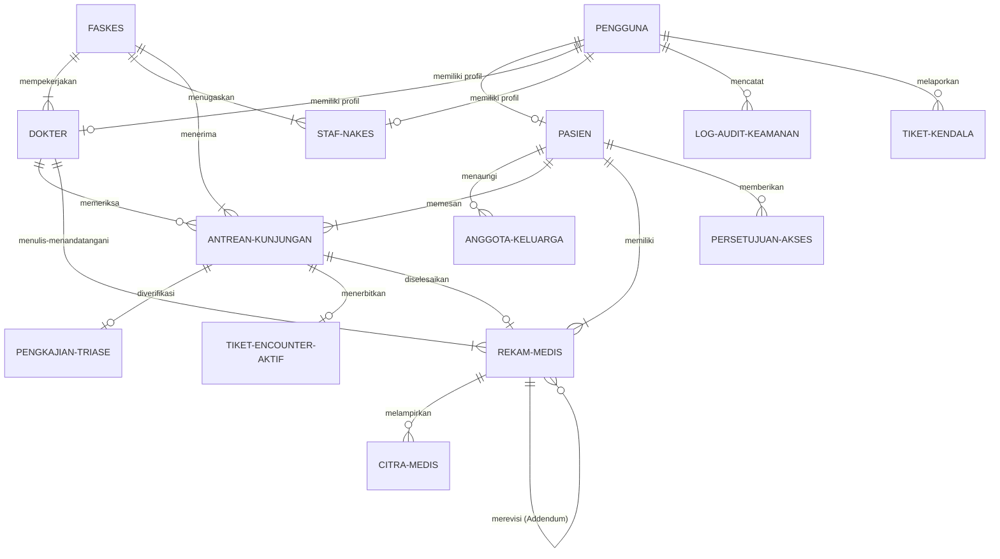
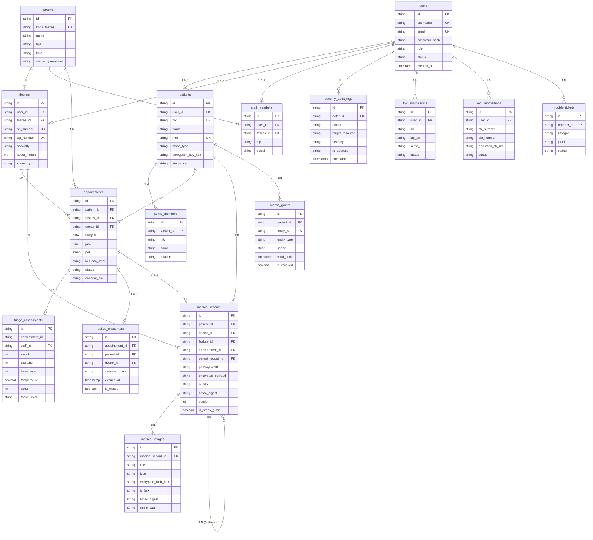

# Spesifikasi Basis Data Terpadu — Resilio-Health

Dokumen ini mendokumentasikan perancangan basis data relasional sistem **Resilio-Health** (*Hospital Information System* berbasis *Zero-Trust*, Kriptografi *Client-Side*, dan *Offline-First* PWA). Dokumen ini memuat identifikasi entitas bisnis, pemetaan relasi antar-entitas, penentuan *Primary Key* dan *Foreign Key*, rancangan model data berjenjang (**CDM**, **LDM**, dan **PDM**), skrip DDL SQL PostgreSQL siap eksekusi, serta Kamus Data (*Data Dictionary*) lengkap.

---

## 1. Identifikasi Entitas Sistem

Sistem Resilio-Health membagi struktur data ke dalam 15 entitas utama yang mendukung 4 peran pengguna (*Pasien*, *Staf Nakes Triase & Admisi*, *Dokter DPJP*, dan *Admin Regulator Kemenkes*), kepatuhan regulasi (UU PDP No. 27/2022 & Permenkes No. 24/2022), serta arsitektur keamanan *Zero-Knowledge*:

1. **`User` (`users`)**: Entitas induk autentikasi dan kredensial akses seluruh pengguna sistem (Pasien, Nakes, Staf, Admin).
2. **`Faskes` (`faskes`)**: Entitas master data Fasilitas Pelayanan Kesehatan (Rumah Sakit, Klinik Pratama, Puskesmas) beserta status isolasi siber (*Kill-Switch*).
3. **`Patient` (`patients`)**: Entitas profil demografi medis pasien, Nomor Rekam Medis (MRN), golongan darah, riwayat alergi, dan kunci enkripsi simetris/derivasi.
4. **`FamilyMember` (`family_members`)**: Entitas anggota keluarga untuk perwalian akun (*Family Proxy Access*) anak di bawah umur atau lansia.
5. **`Doctor` (`doctors`)**: Entitas kredensial tenaga medis dokter pemeriksa (DPJP), mencakup verifikasi STR Konsil Kedokteran Indonesia (KKI) dan SIP Dinas Kesehatan.
6. **`Staff` (`staff_members`)**: Entitas staf operasional fasilitas kesehatan (Perawat Triase, Meja Admisi, Kepala Ruangan).
7. **`Appointment` (`appointments`)**: Entitas transaksi pendaftaran, reservasi antrean kunjungan pasien, dan pelacakan alur pelayanan loket ke klinik.
8. **`TriageAssessment` (`triage_assessments`)**: Entitas pengkajian awal tanda-tanda vital fisik oleh perawat dan penentuan kategori triase (Hijau, Kuning, Merah).
9. **`MedicalRecord` (`medical_records`)**: Entitas rekam medis elektronik (RME) terenkripsi AES-256-GCM dengan tag integritas HMAC-SHA256, diagnosis ICD-10, dan silsilah versi koreksi (*Addendum*).
10. **`MedicalImage` (`medical_images`)**: Entitas berkas citra diagnostik biner (Foto Rontgen Thorax, USG, Scan Lab, EKG) terenkripsi biner dalam format *Blob*.
11. **`AccessGrant` (`access_grants`)**: Entitas kedaulatan persetujuan akses medis (*Consent Management*) eksplisit pasien kepada dokter/faskes sesuai UU PDP.
12. **`ActiveEncounter` (`active_encounters`)**: Entitas tiket sesi pemeriksaan aktif berbatas waktu (*Time-Bound Token*) terikat PIN 6-digit untuk proteksi mitigasi BOLA/IDOR.
13. **`SecurityAuditLog` (`security_audit_logs`)**: Entitas log jejak audit keamanan forensik *immutable* untuk mendeteksi anomali akses, pelanggaran izin, dan peringatan *Break-Glass*.
14. **`KycSubmission` (`kyc_submissions`)**: Entitas permohonan verifikasi identitas kependudukan digital (e-KYC) pasien dengan foto fisik KTP dan swafoto ber-watermark.
15. **`KydSubmission` (`kyd_submissions`)**: Entitas permohonan verifikasi legalitas izin praktik dokter (e-KYD) dengan dokumen STR dan SIP resmi.
16. **`TroubleTicket` (`trouble_tickets`)**: Entitas pelaporan kendala teknis sistem dan sengketa ketidaksesuaian data medis dari pengguna ke regulator.

---

## 2. Relasi Antar-Entitas & Kardinalitas

### 2.1 Matriks Kardinalitas

| Entitas Asal | Relasi Bisnis | Entitas Tujuan | Kardinalitas | Aturan Integritas Referensial |
| :--- | :--- | :--- | :---: | :--- |
| `users` | Berelasi sebagai profil pasien | `patients` | 1 : 0..1 | ON DELETE CASCADE |
| `users` | Berelasi sebagai profil dokter | `doctors` | 1 : 0..1 | ON DELETE CASCADE |
| `users` | Berelasi sebagai profil staf | `staff_members` | 1 : 0..1 | ON DELETE CASCADE |
| `faskes` | Mempekerjakan dokter | `doctors` | 1 : 1..N | ON DELETE RESTRICT |
| `faskes` | Menugaskan staf faskes | `staff_members` | 1 : 1..N | ON DELETE RESTRICT |
| `faskes` | Menerima pendaftaran antrean | `appointments` | 1 : 0..N | ON DELETE RESTRICT |
| `patients` | Memiliki anggota keluarga tanggungan | `family_members` | 1 : 0..N | ON DELETE CASCADE |
| `patients` | Melakukan pendaftaran berobat | `appointments` | 1 : 0..N | ON DELETE RESTRICT |
| `patients` | Memiliki berkas rekam medis | `medical_records` | 1 : 0..N | ON DELETE RESTRICT |
| `patients` | Menerbitkan persetujuan akses data | `access_grants` | 1 : 0..N | ON DELETE CASCADE |
| `doctors` | Ditugaskan melayani konsultasi | `appointments` | 1 : 0..N | ON DELETE RESTRICT |
| `doctors` | Menulis dan menandatangani RME | `medical_records` | 1 : 0..N | ON DELETE RESTRICT |
| `appointments` | Diberikan pengkajian triase fisik | `triage_assessments` | 1 : 0..1 | ON DELETE CASCADE |
| `appointments` | Menghasilkan berkas pemeriksaan RME | `medical_records` | 1 : 0..1 | ON DELETE SET NULL |
| `appointments` | Menerbitkan tiket pemeriksaan aktif | `active_encounters` | 1 : 0..1 | ON DELETE CASCADE |
| `medical_records` | Melampirkan berkas citra medis biner | `medical_images` | 1 : 0..N | ON DELETE CASCADE |
| `medical_records` | Mengoreksi rekam medis sebelumnya (*Addendum*) | `medical_records` | 0..1 : 0..N | ON DELETE SET NULL (*Self-Referencing*) |
| `users` | Melakukan aktivitas yang dicatat di log | `security_audit_logs`| 1 : 0..N | ON DELETE SET NULL |
| `users` | Mengajukan berkas e-KYC | `kyc_submissions` | 1 : 0..N | ON DELETE CASCADE |
| `users` | Mengajukan berkas e-KYD | `kyd_submissions` | 1 : 0..N | ON DELETE CASCADE |
| `users` | Mengirimkan laporan kendala data | `trouble_tickets` | 1 : 0..N | ON DELETE SET NULL |

---

## 3. Spesifikasi Primary Key & Foreign Key

| Entitas (Tabel) | Primary Key (PK) | Format ID / Tipe Data | Foreign Key (FK) | Kolom Induk Referensi |
| :--- | :--- | :--- | :--- | :--- |
| `users` | `id` | `VARCHAR(36)` (UUID) | - | - |
| `faskes` | `id` | `VARCHAR(32)` (`FAS-xx`) | - | - |
| `patients` | `id` | `VARCHAR(32)` (`P-xxx`) | `user_id` | `users(id)` |
| `family_members` | `id` | `VARCHAR(32)` (`FAM-xxx`) | `patient_id` | `patients(id)` |
| `doctors` | `id` | `VARCHAR(32)` (`DOC-xxx`) | `user_id`, `faskes_id` | `users(id)`, `faskes(id)` |
| `staff_members` | `id` | `VARCHAR(32)` (`STF-xxx`) | `user_id`, `faskes_id` | `users(id)`, `faskes(id)` |
| `appointments` | `id` | `VARCHAR(32)` (`APT-xxxx-xxx`)| `patient_id`, `faskes_id`, `doctor_id` | `patients(id)`, `faskes(id)`, `doctors(id)` |
| `triage_assessments`| `id` | `VARCHAR(32)` (`TRG-xxx`) | `appointment_id`, `assessed_by_staff_id` | `appointments(id)`, `staff_members(id)` |
| `medical_records` | `id` | `VARCHAR(32)` (`REC-xxxx-xxx`)| `patient_id`, `doctor_id`, `faskes_id`, `appointment_id`, `parent_record_id` | `patients(id)`, `doctors(id)`, `faskes(id)`, `appointments(id)`, `medical_records(id)` |
| `medical_images` | `id` | `VARCHAR(32)` (`IMG-xxx`) | `medical_record_id` | `medical_records(id)` |
| `access_grants` | `id` | `VARCHAR(32)` (`AGR-xxx`) | `patient_id`, `entity_id` | `patients(id)`, `users(id)` |
| `active_encounters` | `id` | `VARCHAR(32)` (`ENC-xxx`) | `appointment_id`, `patient_id`, `doctor_id` | `appointments(id)`, `patients(id)`, `doctors(id)` |
| `security_audit_logs`| `id` | `VARCHAR(36)` (UUID) | `actor_id` | `users(id)` |
| `kyc_submissions` | `id` | `VARCHAR(32)` (`KYC-xxx`) | `user_id` | `users(id)` |
| `kyd_submissions` | `id` | `VARCHAR(32)` (`KYD-xxx`) | `user_id` | `users(id)` |
| `trouble_tickets` | `id` | `VARCHAR(32)` (`TCK-xxx`) | `reporter_id`, `faskes_id` | `users(id)`, `faskes(id)` |

---

## 4. Conceptual Data Model (CDM)

*Conceptual Data Model* merepresentasikan struktur data tingkat tinggi yang berfokus pada entitas bisnis, batasan semantik regulasi, dan hubungan konseptual tanpa memedulikan detail teknis penyimpanan fisik:



### Penjelasan Konsep CDM:
1. **Pemisahan Kedaulatan Pasien (*Data Sovereignty*)**: Pasien adalah pemilik mutlak data medis. Relasi antara Pasien dan Rekam Medis dijembatani oleh *Persetujuan Akses (Consent)* yang dapat dibatalkan sewaktu-waktu (*1-Click Revoke*).
2. **Prinsip *Need-to-Know* Pemeriksaan**: Dokter hanya berhak mengakses rekam medis pasien jika terdapat *Tiket Encounter Aktif* yang diterbitkan saat pasien melakukan *check-in* di loket dan diverifikasi oleh Staf Triase.
3. **Ketahanan Riwayat Hukum (*Immutability & Addendum*)**: Rekam medis yang telah ditandatangani dokter tidak dapat diubah atau dihapus (*Append-Only*). Perubahan diagnosa dilakukan melalui pembuatan relasi koreksi (*Addendum*) yang menunjuk ke berkas rekam medis induk (*parent record*).

---

## 5. Logical Data Model (LDM)

*Logical Data Model* mentransformasikan entitas konseptual ke dalam bentuk relasional yang ternormalisasi (3NF), mendefinisikan kunci relasi (*Foreign Keys*), tipe data logis, serta kendala integritas domain:



---

## 6. Physical Data Model (PDM) & Skrip DDL PostgreSQL

Berikut adalah spesifikasi fisik skema basis data PostgreSQL lengkap dengan penentuan tipe data fisik, batas panjang karakter, batasan integritas referensial, *constraints*, serta indeks optimasi kueri dan pertahanan keamanan siber:

```sql
-- ============================================================================
-- SKRIP PHYSICAL DATA MODEL (PDM) RESILIO-HEALTH HIS
-- Target RDBMS: PostgreSQL 14+ / 16+ (Prisma ORM Compatible)
-- ============================================================================

-- 1. EKSTENSI & ENUM TYPES
CREATE EXTENSION IF NOT EXISTS "uuid-ossp";

CREATE TYPE user_role_enum AS ENUM ('pasien', 'nakes', 'staf', 'admin');
CREATE TYPE account_status_enum AS ENUM ('VERIFIED', 'PENDING', 'REJECTED', 'SUSPENDED');
CREATE TYPE faskes_type_enum AS ENUM ('Rumah Sakit', 'Klinik Pratama', 'Puskesmas');
CREATE TYPE faskes_status_enum AS ENUM ('ACTIVE', 'QUARANTINED');
CREATE TYPE gender_enum AS ENUM ('L', 'P');
CREATE TYPE family_relation_enum AS ENUM ('Anak', 'Orang Tua', 'Pasangan', 'Wali');
CREATE TYPE triase_level_enum AS ENUM ('HIJAU', 'KUNING', 'MERAH');
CREATE TYPE appointment_status_enum AS ENUM (
    'PENDING_ARRIVAL', 'WAITING_TRIAGE', 'WAITING_DOCTOR', 
    'IN_EXAMINATION', 'COMPLETED', 'CANCELLED'
);
CREATE TYPE image_type_enum AS ENUM ('RONTGEN', 'USG', 'LAB', 'EKG', 'FOTO_KLINIS');
CREATE TYPE grant_entity_type_enum AS ENUM ('DOKTER', 'FASKES');
CREATE TYPE audit_severity_enum AS ENUM ('INFO', 'WARN', 'CRITICAL');
CREATE TYPE audit_action_enum AS ENUM (
    'LOGIN', 'VIEW_RME', 'WRITE_RME', 'IDOR_BLOCKED', 'HMAC_VERIFIED', 
    'HMAC_MISMATCH', 'REVOKE_CONSENT', 'QUARANTINE_FASKES', 'BREAK_GLASS_ACCESS', 
    'CHECK_IN_TRIAGE', 'ASSIGN_DPJP'
);
CREATE TYPE ticket_category_enum AS ENUM ('BUG', 'SYNC_FAIL', 'DATA_MISMATCH', 'OTHER');
CREATE TYPE ticket_status_enum AS ENUM ('OPEN', 'INVESTIGATING', 'RESOLVED');

-- 2. TABEL PENGGUNA SISTEM (USERS)
CREATE TABLE users (
    id VARCHAR(36) PRIMARY KEY DEFAULT uuid_generate_v4()::text,
    username VARCHAR(50) NOT NULL UNIQUE,
    email VARCHAR(120) NOT NULL UNIQUE,
    password_hash VARCHAR(255) NOT NULL,
    role user_role_enum NOT NULL,
    status account_status_enum NOT NULL DEFAULT 'PENDING',
    created_at TIMESTAMP WITH TIME ZONE DEFAULT CURRENT_TIMESTAMP,
    updated_at TIMESTAMP WITH TIME ZONE DEFAULT CURRENT_TIMESTAMP
);

-- 3. TABEL FASILITAS KESEHATAN (FASKES)
CREATE TABLE faskes (
    id VARCHAR(32) PRIMARY KEY,
    kode_faskes VARCHAR(50) NOT NULL UNIQUE,
    nama VARCHAR(150) NOT NULL,
    tipe faskes_type_enum NOT NULL,
    alamat TEXT NOT NULL,
    kota VARCHAR(100) NOT NULL,
    kontak VARCHAR(50) NOT NULL,
    spesialisasi_list TEXT[] NOT NULL DEFAULT '{}',
    kategori_penyakit TEXT[] NOT NULL DEFAULT '{}',
    status faskes_status_enum NOT NULL DEFAULT 'ACTIVE',
    created_at TIMESTAMP WITH TIME ZONE DEFAULT CURRENT_TIMESTAMP
);

-- 4. TABEL PROFIL PASIEN (PATIENTS)
CREATE TABLE patients (
    id VARCHAR(32) PRIMARY KEY,
    user_id VARCHAR(36) NOT NULL UNIQUE REFERENCES users(id) ON DELETE CASCADE,
    nik CHAR(16) NOT NULL UNIQUE,
    name VARCHAR(120) NOT NULL,
    birth_date DATE NOT NULL,
    gender gender_enum NOT NULL,
    blood_type VARCHAR(5) NOT NULL,
    mrn VARCHAR(30) NOT NULL UNIQUE,
    allergies TEXT[] NOT NULL DEFAULT '{}',
    emergency_contact_name VARCHAR(120) NOT NULL,
    emergency_contact_relation VARCHAR(50) NOT NULL,
    emergency_contact_phone VARCHAR(20) NOT NULL,
    encryption_key_hex CHAR(64) NOT NULL,
    created_at TIMESTAMP WITH TIME ZONE DEFAULT CURRENT_TIMESTAMP,
    CONSTRAINT chk_nik_numeric CHECK (nik ~ '^[0-9]{16}$')
);

-- 5. TABEL ANGGOTA KELUARGA / TANGGUNGAN (FAMILY_MEMBERS)
CREATE TABLE family_members (
    id VARCHAR(32) PRIMARY KEY,
    patient_id VARCHAR(32) NOT NULL REFERENCES patients(id) ON DELETE CASCADE,
    nik CHAR(16) NOT NULL,
    name VARCHAR(120) NOT NULL,
    relation family_relation_enum NOT NULL,
    birth_date DATE NOT NULL,
    created_at TIMESTAMP WITH TIME ZONE DEFAULT CURRENT_TIMESTAMP,
    CONSTRAINT chk_fam_nik_numeric CHECK (nik ~ '^[0-9]{16}$')
);

-- 6. TABEL DOKTER / TENAGA MEDIS (DOCTORS)
CREATE TABLE doctors (
    id VARCHAR(32) PRIMARY KEY,
    user_id VARCHAR(36) NOT NULL UNIQUE REFERENCES users(id) ON DELETE CASCADE,
    faskes_id VARCHAR(32) NOT NULL REFERENCES faskes(id) ON DELETE RESTRICT,
    name VARCHAR(120) NOT NULL,
    str_number VARCHAR(50) NOT NULL UNIQUE,
    sip_number VARCHAR(50) NOT NULL UNIQUE,
    specialty VARCHAR(100) NOT NULL,
    kuota_harian INT NOT NULL DEFAULT 30,
    foto_profil_url VARCHAR(255),
    is_active BOOLEAN NOT NULL DEFAULT TRUE,
    created_at TIMESTAMP WITH TIME ZONE DEFAULT CURRENT_TIMESTAMP
);

-- 7. TABEL STAF FASKES (STAFF_MEMBERS)
CREATE TABLE staff_members (
    id VARCHAR(32) PRIMARY KEY,
    user_id VARCHAR(36) NOT NULL UNIQUE REFERENCES users(id) ON DELETE CASCADE,
    faskes_id VARCHAR(32) NOT NULL REFERENCES faskes(id) ON DELETE RESTRICT,
    name VARCHAR(120) NOT NULL,
    nip VARCHAR(50) NOT NULL UNIQUE,
    posisi VARCHAR(50) NOT NULL,
    created_at TIMESTAMP WITH TIME ZONE DEFAULT CURRENT_TIMESTAMP
);

-- 8. TABEL PENDAFTARAN ANTREAN & RESERVASI (APPOINTMENTS)
CREATE TABLE appointments (
    id VARCHAR(32) PRIMARY KEY,
    patient_id VARCHAR(32) NOT NULL REFERENCES patients(id) ON DELETE RESTRICT,
    faskes_id VARCHAR(32) NOT NULL REFERENCES faskes(id) ON DELETE RESTRICT,
    doctor_id VARCHAR(32) NOT NULL REFERENCES doctors(id) ON DELETE RESTRICT,
    dpjp_id VARCHAR(32) REFERENCES doctors(id) ON DELETE SET NULL,
    tanggal DATE NOT NULL,
    jam VARCHAR(20) NOT NULL,
    poli VARCHAR(100) NOT NULL,
    keluhan_awal TEXT NOT NULL,
    consent_active BOOLEAN NOT NULL DEFAULT TRUE,
    consent_pin CHAR(6),
    status appointment_status_enum NOT NULL DEFAULT 'PENDING_ARRIVAL',
    check_in_time TIMESTAMP WITH TIME ZONE,
    created_at TIMESTAMP WITH TIME ZONE DEFAULT CURRENT_TIMESTAMP,
    CONSTRAINT chk_consent_pin_format CHECK (consent_pin IS NULL OR consent_pin ~ '^[0-9]{6}$')
);

-- 9. TABEL PENGKAJIAN TRIASE AWAL (TRIAGE_ASSESSMENTS)
CREATE TABLE triage_assessments (
    id VARCHAR(32) PRIMARY KEY,
    appointment_id VARCHAR(32) NOT NULL UNIQUE REFERENCES appointments(id) ON DELETE CASCADE,
    staff_id VARCHAR(32) NOT NULL REFERENCES staff_members(id) ON DELETE RESTRICT,
    systolic INT NOT NULL,
    diastolic INT NOT NULL,
    heart_rate INT NOT NULL,
    temperature NUMERIC(4, 1) NOT NULL,
    respiratory_rate INT NOT NULL,
    spo2 INT NOT NULL,
    berat_badan NUMERIC(5, 2),
    tinggi_badan NUMERIC(5, 2),
    triase_level triase_level_enum NOT NULL,
    catatan_perawat TEXT,
    assessed_at TIMESTAMP WITH TIME ZONE DEFAULT CURRENT_TIMESTAMP,
    CONSTRAINT chk_systolic_range CHECK (systolic BETWEEN 50 AND 300),
    CONSTRAINT chk_diastolic_range CHECK (diastolic BETWEEN 30 AND 200),
    CONSTRAINT chk_temp_range CHECK (temperature BETWEEN 30.0 AND 45.0),
    CONSTRAINT chk_spo2_range CHECK (spo2 BETWEEN 40 AND 100)
);

-- 10. TABEL REKAM MEDIS ELEKTRONIK TERENKRIPSI (MEDICAL_RECORDS)
CREATE TABLE medical_records (
    id VARCHAR(32) PRIMARY KEY,
    patient_id VARCHAR(32) NOT NULL REFERENCES patients(id) ON DELETE RESTRICT,
    doctor_id VARCHAR(32) NOT NULL REFERENCES doctors(id) ON DELETE RESTRICT,
    faskes_id VARCHAR(32) NOT NULL REFERENCES faskes(id) ON DELETE RESTRICT,
    appointment_id VARCHAR(32) REFERENCES appointments(id) ON DELETE SET NULL,
    parent_record_id VARCHAR(32) REFERENCES medical_records(id) ON DELETE SET NULL,
    primary_icd10 VARCHAR(20) NOT NULL,
    diagnosis_short VARCHAR(255) NOT NULL,
    encrypted_payload TEXT NOT NULL,
    iv_hex CHAR(24) NOT NULL,
    hmac_digest CHAR(64) NOT NULL,
    version INT NOT NULL DEFAULT 1,
    addendum_reason TEXT,
    is_break_glass BOOLEAN NOT NULL DEFAULT FALSE,
    break_glass_reason TEXT,
    created_at TIMESTAMP WITH TIME ZONE DEFAULT CURRENT_TIMESTAMP,
    CONSTRAINT chk_iv_length CHECK (length(iv_hex) = 24),
    CONSTRAINT chk_hmac_length CHECK (length(hmac_digest) = 64)
);

-- 11. TABEL CITRA MEDIS TERENKRIPSI (MEDICAL_IMAGES)
CREATE TABLE medical_images (
    id VARCHAR(32) PRIMARY KEY,
    medical_record_id VARCHAR(32) NOT NULL REFERENCES medical_records(id) ON DELETE CASCADE,
    title VARCHAR(150) NOT NULL,
    type image_type_enum NOT NULL,
    encrypted_blob_hex TEXT NOT NULL,
    iv_hex CHAR(24) NOT NULL,
    hmac_digest CHAR(64) NOT NULL,
    mime_type VARCHAR(50) NOT NULL,
    notes TEXT,
    created_at TIMESTAMP WITH TIME ZONE DEFAULT CURRENT_TIMESTAMP
);

-- 12. TABEL PERSETUJUAN HAK AKSES PASIEN (ACCESS_GRANTS)
CREATE TABLE access_grants (
    id VARCHAR(32) PRIMARY KEY,
    patient_id VARCHAR(32) NOT NULL REFERENCES patients(id) ON DELETE CASCADE,
    entity_id VARCHAR(36) NOT NULL REFERENCES users(id) ON DELETE CASCADE,
    entity_name VARCHAR(150) NOT NULL,
    entity_type grant_entity_type_enum NOT NULL,
    scope VARCHAR(100) NOT NULL DEFAULT 'READ_RME',
    valid_until TIMESTAMP WITH TIME ZONE NOT NULL,
    is_revoked BOOLEAN NOT NULL DEFAULT FALSE,
    revoked_at TIMESTAMP WITH TIME ZONE,
    is_break_glass BOOLEAN NOT NULL DEFAULT FALSE,
    created_at TIMESTAMP WITH TIME ZONE DEFAULT CURRENT_TIMESTAMP
);

-- 13. TABEL TIKET SESI ENCOUNTER AKTIF (ACTIVE_ENCOUNTERS)
CREATE TABLE active_encounters (
    id VARCHAR(32) PRIMARY KEY,
    appointment_id VARCHAR(32) NOT NULL UNIQUE REFERENCES appointments(id) ON DELETE CASCADE,
    patient_id VARCHAR(32) NOT NULL REFERENCES patients(id) ON DELETE CASCADE,
    doctor_id VARCHAR(32) NOT NULL REFERENCES doctors(id) ON DELETE CASCADE,
    encounter_token VARCHAR(128) NOT NULL UNIQUE,
    issued_at TIMESTAMP WITH TIME ZONE DEFAULT CURRENT_TIMESTAMP,
    expires_at TIMESTAMP WITH TIME ZONE NOT NULL,
    is_closed BOOLEAN NOT NULL DEFAULT FALSE
);

-- 14. TABEL JEJAK AUDIT KEAMANAN FORENSIK (SECURITY_AUDIT_LOGS)
CREATE TABLE security_audit_logs (
    id VARCHAR(36) PRIMARY KEY DEFAULT uuid_generate_v4()::text,
    actor_id VARCHAR(36) REFERENCES users(id) ON DELETE SET NULL,
    actor_name VARCHAR(120) NOT NULL,
    actor_role user_role_enum NOT NULL,
    action audit_action_enum NOT NULL,
    target_resource VARCHAR(150) NOT NULL,
    ip_address VARCHAR(45) NOT NULL,
    user_agent TEXT NOT NULL,
    severity audit_severity_enum NOT NULL DEFAULT 'INFO',
    detail TEXT NOT NULL,
    timestamp TIMESTAMP WITH TIME ZONE DEFAULT CURRENT_TIMESTAMP
);

-- 15. TABEL PENGAJUAN VERIFIKASI IDENTITAS (KYC_SUBMISSIONS)
CREATE TABLE kyc_submissions (
    id VARCHAR(32) PRIMARY KEY,
    user_id VARCHAR(36) NOT NULL REFERENCES users(id) ON DELETE CASCADE,
    nik CHAR(16) NOT NULL,
    nama_lengkap VARCHAR(120) NOT NULL,
    birth_date DATE NOT NULL,
    alamat TEXT NOT NULL,
    ktp_url VARCHAR(255) NOT NULL,
    selfie_url VARCHAR(255) NOT NULL,
    watermark_text VARCHAR(255) NOT NULL,
    status account_status_enum NOT NULL DEFAULT 'PENDING',
    alasan_penolakan TEXT,
    submitted_at TIMESTAMP WITH TIME ZONE DEFAULT CURRENT_TIMESTAMP,
    verified_at TIMESTAMP WITH TIME ZONE
);

-- 16. TABEL PENGAJUAN VERIFIKASI LISENSI DOKTER (KYD_SUBMISSIONS)
CREATE TABLE kyd_submissions (
    id VARCHAR(32) PRIMARY KEY,
    user_id VARCHAR(36) NOT NULL REFERENCES users(id) ON DELETE CASCADE,
    nik CHAR(16) NOT NULL,
    nama_lengkap VARCHAR(120) NOT NULL,
    str_number VARCHAR(50) NOT NULL,
    sip_number VARCHAR(50) NOT NULL,
    spesialisasi VARCHAR(100) NOT NULL,
    dokumen_str_url VARCHAR(255) NOT NULL,
    surat_tugas_url VARCHAR(255),
    watermark_text VARCHAR(255) NOT NULL,
    status account_status_enum NOT NULL DEFAULT 'PENDING',
    alasan_penolakan TEXT,
    submitted_at TIMESTAMP WITH TIME ZONE DEFAULT CURRENT_TIMESTAMP,
    verified_at TIMESTAMP WITH TIME ZONE
);

-- 17. TABEL TIKET KENDALA DATA & SISTEM (TROUBLE_TICKETS)
CREATE TABLE trouble_tickets (
    id VARCHAR(32) PRIMARY KEY,
    reporter_id VARCHAR(36) REFERENCES users(id) ON DELETE SET NULL,
    reporter_name VARCHAR(120) NOT NULL,
    reporter_role user_role_enum NOT NULL,
    faskes_id VARCHAR(32) REFERENCES faskes(id) ON DELETE SET NULL,
    kategori ticket_category_enum NOT NULL,
    judul VARCHAR(150) NOT NULL,
    deskripsi TEXT NOT NULL,
    status ticket_status_enum NOT NULL DEFAULT 'OPEN',
    created_at TIMESTAMP WITH TIME ZONE DEFAULT CURRENT_TIMESTAMP,
    resolved_at TIMESTAMP WITH TIME ZONE
);

-- ============================================================================
-- INDEKS OPTIMASI KUERI, KINERJA & PERTAHANAN KEAMANAN (BOLA / IDOR GATE)
-- ============================================================================

-- Indeks Keamanan Akses Rekam Medis (BOLA Protection)
CREATE INDEX idx_rme_patient_doctor ON medical_records (patient_id, doctor_id);
CREATE INDEX idx_rme_parent ON medical_records (parent_record_id);
CREATE INDEX idx_access_grants_lookup ON access_grants (patient_id, entity_id, is_revoked, valid_until);
CREATE INDEX idx_active_encounters_guard ON active_encounters (patient_id, doctor_id, is_closed, expires_at);

-- Indeks Operasional Antrean Faskes & Triase
CREATE INDEX idx_appointments_faskes_date ON appointments (faskes_id, tanggal, status);
CREATE INDEX idx_appointments_patient ON appointments (patient_id, status);
CREATE INDEX idx_triage_appointment ON triage_assessments (appointment_id);

-- Indeks Jejak Audit Forensik SIEM
CREATE INDEX idx_audit_timestamp_severity ON security_audit_logs (timestamp DESC, severity);
CREATE INDEX idx_audit_actor ON security_audit_logs (actor_id, action);
```

---

## 7. Kamus Data Lengkap (*Data Dictionary*)

### 7.1 Tabel `users`
Menyimpan akun pengguna utama untuk autentikasi sistem dan otorisasi kontrol akses peran (*Role-Based Access Control*).

| Nama Kolom | Tipe Data Fisik | Nullable | Nilai Default / Constraint | Keterangan & Deskripsi Aturan Bisnis |
| :--- | :--- | :---: | :--- | :--- |
| `id` | `VARCHAR(36)` | Tidak | `uuid_generate_v4()` (PK) | Pengidentifikasi unik global akun pengguna. |
| `username` | `VARCHAR(50)` | Tidak | `UNIQUE` | Nama unik untuk kredensial masuk sistem. |
| `email` | `VARCHAR(120)` | Tidak | `UNIQUE` | Alamat surel aktif untuk notifikasi dan pemulihan. |
| `password_hash` | `VARCHAR(255)` | Tidak | - | Hasil hash kata sandi menggunakan Argon2id atau bcrypt. |
| `role` | `user_role_enum` | Tidak | - | Peran wewenang: `pasien`, `nakes`, `staf`, `admin`. |
| `status` | `account_status_enum`| Tidak | `'PENDING'` | Status legalitas: `VERIFIED`, `PENDING`, `REJECTED`, `SUSPENDED`. |
| `created_at` | `TIMESTAMPTZ` | Tidak | `CURRENT_TIMESTAMP` | Waktu pendaftaran akun dibuat. |
| `updated_at` | `TIMESTAMPTZ` | Tidak | `CURRENT_TIMESTAMP` | Waktu pembaruan profil terakhir. |

---

### 7.2 Tabel `faskes`
Menyimpan data induk fasilitas kesehatan yang terdaftar pada ekosistem Resilio-Health.

| Nama Kolom | Tipe Data Fisik | Nullable | Nilai Default / Constraint | Keterangan & Deskripsi Aturan Bisnis |
| :--- | :--- | :---: | :--- | :--- |
| `id` | `VARCHAR(32)` | Tidak | PK (`FAS-xx`) | Kode unik master faskes. |
| `kode_faskes` | `VARCHAR(50)` | Tidak | `UNIQUE` | Kode registrasi faskes resmi Kementerian Kesehatan. |
| `nama` | `VARCHAR(150)` | Tidak | - | Nama resmi institusi faskes (misal: RSUP Dr. Sardjito). |
| `tipe` | `faskes_type_enum`| Tidak | - | Jenis entitas: `Rumah Sakit`, `Klinik Pratama`, `Puskesmas`. |
| `alamat` | `TEXT` | Tidak | - | Alamat fisik fasilitas pelayanan kesehatan. |
| `kota` | `VARCHAR(100)` | Tidak | - | Wilayah kota/kabupaten domisili faskes. |
| `kontak` | `VARCHAR(50)` | Tidak | - | Nomor telepon layanan instalasi gawat darurat / loket. |
| `spesialisasi_list` | `TEXT[]` | Tidak | `'{}'` | Daftar poliklinik dan layanan spesialisasi yang tersedia. |
| `kategori_penyakit` | `TEXT[]` | Tidak | `'{}'` | Kata kunci gejala / penyakit untuk pencarian pintar pasien. |
| `status` | `faskes_status_enum`| Tidak | `'ACTIVE'` | Saklar siber: `ACTIVE` atau `QUARANTINED` (*Kill-Switch*). |
| `created_at` | `TIMESTAMPTZ` | Tidak | `CURRENT_TIMESTAMP` | Waktu registrasi faskes ke sistem. |

---

### 7.3 Tabel `patients`
Menyimpan data identitas medis pasien dan parameter kriptografi sisi klien.

| Nama Kolom | Tipe Data Fisik | Nullable | Nilai Default / Constraint | Keterangan & Deskripsi Aturan Bisnis |
| :--- | :--- | :---: | :--- | :--- |
| `id` | `VARCHAR(32)` | Tidak | PK (`P-xxx`) | Nomor unik identitas internal pasien. |
| `user_id` | `VARCHAR(36)` | Tidak | `UNIQUE, FK -> users` | Relasi akun login pemegang data. |
| `nik` | `CHAR(16)` | Tidak | `UNIQUE, CHECK regex` | NIK 16-digit tervalidasi terhadap database kependudukan. |
| `name` | `VARCHAR(120)` | Tidak | - | Nama lengkap pasien sesuai dokumen KTP. |
| `birth_date` | `DATE` | Tidak | - | Tanggal lahir pasien untuk kalkulasi usia dan dosis. |
| `gender` | `gender_enum` | Tidak | - | Jenis kelamin biologis: `L` (Laki-laki) atau `P` (Perempuan). |
| `blood_type` | `VARCHAR(5)` | Tidak | - | Golongan darah dan rhesus (misal: `O+`, `A-`, `B+`, `AB+`). |
| `mrn` | `VARCHAR(30)` | Tidak | `UNIQUE` | *Medical Record Number* terpusat pasien. |
| `allergies` | `TEXT[]` | Tidak | `'{}'` | Riwayat alergi obat berbahaya (pemicu kontraindikasi UR-T10). |
| `emergency_contact_name` | `VARCHAR(120)` | Tidak | - | Nama kerabat yang dapat dihubungi saat kondisi darurat. |
| `emergency_contact_relation`| `VARCHAR(50)` | Tidak | - | Hubungan relasi kontak darurat (Orang Tua, Anak, Pasangan). |
| `emergency_contact_phone` | `VARCHAR(20)` | Tidak | - | Nomor kontak telepon darurat. |
| `encryption_key_hex` | `CHAR(64)` | Tidak | - | Kunci publik/simetris 256-bit hex untuk derivasi dekripsi RME. |
| `created_at` | `TIMESTAMPTZ` | Tidak | `CURRENT_TIMESTAMP` | Waktu pembuatan rekam data pasien. |

---

### 7.4 Tabel `doctors`
Menyimpan profil profesional dokter penanggung jawab pelayanan (DPJP).

| Nama Kolom | Tipe Data Fisik | Nullable | Nilai Default / Constraint | Keterangan & Deskripsi Aturan Bisnis |
| :--- | :--- | :---: | :--- | :--- |
| `id` | `VARCHAR(32)` | Tidak | PK (`DOC-xxx`) | Nomor identitas kerja dokter. |
| `user_id` | `VARCHAR(36)` | Tidak | `UNIQUE, FK -> users` | Relasi akun login dokter. |
| `faskes_id` | `VARCHAR(32)` | Tidak | `FK -> faskes` | Faskes tempat dokter bertugas utama. |
| `name` | `VARCHAR(120)` | Tidak | - | Nama lengkap beserta gelar akademik dan spesialisasi. |
| `str_number` | `VARCHAR(50)` | Tidak | `UNIQUE` | Nomor Surat Tanda Registrasi Konsil Kedokteran Indonesia. |
| `sip_number` | `VARCHAR(50)` | Tidak | `UNIQUE` | Nomor Surat Izin Praktik dari Dinas Kesehatan setempat. |
| `specialty` | `VARCHAR(100)` | Tidak | - | Bidang keahlian klinis (misal: Spesialis Penyakit Dalam). |
| `kuota_harian` | `INT` | Tidak | `30` | Batas maksimum pasien rawat jalan per hari. |
| `foto_profil_url` | `VARCHAR(255)` | Ya | `NULL` | Tautan foto profil dokter terverifikasi. |
| `is_active` | `BOOLEAN` | Tidak | `TRUE` | Status ketersediaan jadwal praktik dokter. |
| `created_at` | `TIMESTAMPTZ` | Tidak | `CURRENT_TIMESTAMP` | Waktu onboarding dokter ke sistem. |

---

### 7.5 Tabel `staff_members`
Menyimpan profil staf operasional loket admisi dan perawat triase.

| Nama Kolom | Tipe Data Fisik | Nullable | Nilai Default / Constraint | Keterangan & Deskripsi Aturan Bisnis |
| :--- | :--- | :---: | :--- | :--- |
| `id` | `VARCHAR(32)` | Tidak | PK (`STF-xxx`) | Nomor identitas penugasan staf. |
| `user_id` | `VARCHAR(36)` | Tidak | `UNIQUE, FK -> users` | Relasi akun login staf. |
| `faskes_id` | `VARCHAR(32)` | Tidak | `FK -> faskes` | Lokasi faskes tempat staf bertugas. |
| `name` | `VARCHAR(120)` | Tidak | - | Nama lengkap petugas staf medis/admisi. |
| `nip` | `VARCHAR(50)` | Tidak | `UNIQUE` | Nomor Induk Pegawai staf faskes. |
| `posisi` | `VARCHAR(50)` | Tidak | - | Jabatan operasional: `Perawat Triase`, `Staf Admisi`. |
| `created_at` | `TIMESTAMPTZ` | Tidak | `CURRENT_TIMESTAMP` | Waktu registrasi staf. |

---

### 7.6 Tabel `appointments`
Menyimpan transaksi antrean, reservasi rawat jalan, dan status alur klinis.

| Nama Kolom | Tipe Data Fisik | Nullable | Nilai Default / Constraint | Keterangan & Deskripsi Aturan Bisnis |
| :--- | :--- | :---: | :--- | :--- |
| `id` | `VARCHAR(32)` | Tidak | PK (`APT-xxxx-xxx`) | Nomor registrasi antrean berobat unik. |
| `patient_id` | `VARCHAR(32)` | Tidak | `FK -> patients` | Pasien yang dijadwalkan berobat. |
| `faskes_id` | `VARCHAR(32)` | Tidak | `FK -> faskes` | Faskes tujuan pemeriksaan. |
| `doctor_id` | `VARCHAR(32)` | Tidak | `FK -> doctors` | Dokter tujuan yang dipilih saat booking. |
| `dpjp_id` | `VARCHAR(32)` | Ya | `FK -> doctors` | DPJP definitif yang ditetapkan oleh Staf Triase (UR-S03). |
| `tanggal` | `DATE` | Tidak | - | Tanggal kedatangan yang direncanakan. |
| `jam` | `VARCHAR(20)` | Tidak | - | Sesi estimasi jam konsultasi (misal: `09:00 - 10:00`). |
| `poli` | `VARCHAR(100)` | Tidak | - | Poliklinik tujuan pelayanan. |
| `keluhan_awal` | `TEXT` | Tidak | - | Keluhan awal yang diketik pasien saat reservasi. |
| `consent_active` | `BOOLEAN` | Tidak | `TRUE` | Status pemberian izin akses otomatis (*Auto-Consent*). |
| `consent_pin` | `CHAR(6)` | Ya | `CHECK regex` | 6-digit PIN persetujuan pasien untuk aktivasi DPJP. |
| `status` | `appointment_status_enum`| Tidak| `'PENDING_ARRIVAL'` | Status progres alur antrean loket hingga selesai. |
| `check_in_time` | `TIMESTAMPTZ` | Ya | `NULL` | Waktu saat pasien melakukan check-in di faskes. |
| `created_at` | `TIMESTAMPTZ` | Tidak | `CURRENT_TIMESTAMP` | Waktu pemesanan tiket diterbitkan. |

---

### 7.7 Tabel `triage_assessments`
Menyimpan hasil pemeriksaan tanda-tanda vital fisik awal sebelum bertemu dokter.

| Nama Kolom | Tipe Data Fisik | Nullable | Nilai Default / Constraint | Keterangan & Deskripsi Aturan Bisnis |
| :--- | :--- | :---: | :--- | :--- |
| `id` | `VARCHAR(32)` | Tidak | PK (`TRG-xxx`) | Nomor pengkajian triase keperawatan. |
| `appointment_id` | `VARCHAR(32)` | Tidak | `UNIQUE, FK -> appointments`| Tiket antrean berobat terkait. |
| `staff_id` | `VARCHAR(32)` | Tidak | `FK -> staff_members`| Petugas perawat yang melakukan pemeriksaan fisik. |
| `systolic` | `INT` | Tidak | `CHECK (50..300)` | Nilai tekanan darah sistolik (mmHg). |
| `diastolic` | `INT` | Tidak | `CHECK (30..200)` | Nilai tekanan darah diastolik (mmHg). |
| `heart_rate` | `INT` | Tidak | - | Frekuensi denyut nadi/jantung (bpm). |
| `temperature` | `NUMERIC(4, 1)` | Tidak | `CHECK (30.0..45.0)` | Suhu tubuh aktual (°C). |
| `respiratory_rate`| `INT` | Tidak | - | Frekuensi laju pernapasan (kali/menit). |
| `spo2` | `INT` | Tidak | `CHECK (40..100)` | Tingkat saturasi oksigen darah perifer (%). |
| `berat_badan` | `NUMERIC(5, 2)` | Ya | `NULL` | Berat badan pasien dalam satuan kilogram (kg). |
| `tinggi_badan` | `NUMERIC(5, 2)` | Ya | `NULL` | Tinggi badan pasien dalam satuan sentimeter (cm). |
| `triase_level` | `triase_level_enum`| Tidak | - | Klasifikasi keparahan: `HIJAU`, `KUNING`, `MERAH`. |
| `catatan_perawat`| `TEXT` | Ya | `NULL` | Catatan observasi fisik awal perawat. |
| `assessed_at` | `TIMESTAMPTZ` | Tidak | `CURRENT_TIMESTAMP` | Waktu pemeriksaan triase dicatat. |

---

### 7.8 Tabel `medical_records`
Menyimpan catatan rekam medis SOAP terenkripsi *Zero-Knowledge* (AES-256-GCM + HMAC-SHA256).

| Nama Kolom | Tipe Data Fisik | Nullable | Nilai Default / Constraint | Keterangan & Deskripsi Aturan Bisnis |
| :--- | :--- | :---: | :--- | :--- |
| `id` | `VARCHAR(32)` | Tidak | PK (`REC-xxxx-xxx`) | Nomor unik berkas rekam medis. |
| `patient_id` | `VARCHAR(32)` | Tidak | `FK -> patients` | Pasien pemilik rekam medis sah. |
| `doctor_id` | `VARCHAR(32)` | Tidak | `FK -> doctors` | DPJP pemeriksa yang menandatangani berkas. |
| `faskes_id` | `VARCHAR(32)` | Tidak | `FK -> faskes` | Faskes tempat pelayanan diselenggarakan. |
| `appointment_id` | `VARCHAR(32)` | Ya | `FK -> appointments` | Sesi antrean terkait pemeriksaan. |
| `parent_record_id`| `VARCHAR(32)` | Ya | `FK -> medical_records` | Relasi *Addendum* ke RME sebelumnya yang dikoreksi. |
| `primary_icd10` | `VARCHAR(20)` | Tidak | - | Kode klasifikasi internasional penyakit (WHO ICD-10). |
| `diagnosis_short` | `VARCHAR(255)` | Tidak | - | Ringkasan diagnosa publik tanpa rincian rahasia. |
| `encrypted_payload`| `TEXT` | Tidak | - | Ciphertext biner Base64 hasil enkripsi AES-256-GCM. |
| `iv_hex` | `CHAR(24)` | Tidak | `CHECK length = 24` | 96-bit Initialization Vector CSPRNG per berkas. |
| `hmac_digest` | `CHAR(64)` | Tidak | `CHECK length = 64` | Tag keutuhan 256-bit HMAC-SHA256 (*Tamper Detection*). |
| `version` | `INT` | Tidak | `1` | Nomor versi berkas (Versi 1, 2, dst. untuk Addendum). |
| `addendum_reason` | `TEXT` | Ya | `NULL` | Alasan medikolegal revisi catatan rekam medis. |
| `is_break_glass` | `BOOLEAN` | Tidak | `FALSE` | Indikator akses darurat IGD pasien koma/kritis. |
| `break_glass_reason`| `TEXT` | Ya | `NULL` | Alasan kegawatan klinis pemecahan kaca akses darurat. |
| `created_at` | `TIMESTAMPTZ` | Tidak | `CURRENT_TIMESTAMP` | Waktu pengesahan tanda tangan rekam medis. |

---

### 7.9 Tabel `medical_images`
Menyimpan lampiran citra diagnostik biner berkapasitas besar (Rontgen Thorax, USG, Scan Lab, EKG).

| Nama Kolom | Tipe Data Fisik | Nullable | Nilai Default / Constraint | Keterangan & Deskripsi Aturan Bisnis |
| :--- | :--- | :---: | :--- | :--- |
| `id` | `VARCHAR(32)` | Tidak | PK (`IMG-xxx`) | Nomor unik berkas citra medis. |
| `medical_record_id`| `VARCHAR(32)`| Tidak | `FK -> medical_records`| Rekam medis pemilik lampiran radiologi. |
| `title` | `VARCHAR(150)` | Tidak | - | Judul deskriptif (misal: *Rontgen Thorax AP/PA*). |
| `type` | `image_type_enum`| Tidak | - | Kategori: `RONTGEN`, `USG`, `LAB`, `EKG`, `FOTO_KLINIS`. |
| `encrypted_blob_hex`| `TEXT` | Tidak | - | String heksadesimal representasi biner Blob terenkripsi. |
| `iv_hex` | `CHAR(24)` | Tidak | `CHECK length = 24` | 96-bit IV unik per berkas gambar. |
| `hmac_digest` | `CHAR(64)` | Tidak | `CHECK length = 64` | Tag digest integritas biner citra medis. |
| `mime_type` | `VARCHAR(50)` | Tidak | - | Tipe konten berkas (misal: `image/jpeg`, `image/png`). |
| `notes` | `TEXT` | Ya | `NULL` | Catatan dokter spesialis radiologi/patologi. |
| `created_at` | `TIMESTAMPTZ` | Tidak | `CURRENT_TIMESTAMP` | Waktu unggah citra terenkripsi. |

---

### 7.10 Tabel `access_grants`
Menyimpan hak akses eksplisit dan penarikan izin (*Revoke*) sesuai UU PDP No. 27/2022.

| Nama Kolom | Tipe Data Fisik | Nullable | Nilai Default / Constraint | Keterangan & Deskripsi Aturan Bisnis |
| :--- | :--- | :---: | :--- | :--- |
| `id` | `VARCHAR(32)` | Tidak | PK (`AGR-xxx`) | Nomor izin persetujuan akses digital. |
| `patient_id` | `VARCHAR(32)` | Tidak | `FK -> patients` | Pasien pemilik sah yang memberikan persetujuan. |
| `entity_id` | `VARCHAR(36)` | Tidak | `FK -> users` | Dokter atau faskes penerima wewenang baca. |
| `entity_name` | `VARCHAR(150)` | Tidak | - | Nama dokter atau institusi penerima izin. |
| `entity_type` | `grant_entity_type_enum`| Tidak| - | Jenis penerima: `DOKTER` atau `FASKES`. |
| `scope` | `VARCHAR(100)` | Tidak | `'READ_RME'` | Lingkup kewenangan (misal: `FULL_RME`, `SUMMARY_ONLY`). |
| `valid_until` | `TIMESTAMPTZ` | Tidak | - | Batas waktu kedaluwarsa izin persetujuan. |
| `is_revoked` | `BOOLEAN` | Tidak | `FALSE` | Status pencabutan izin (*1-Click Revoke*). |
| `revoked_at` | `TIMESTAMPTZ` | Ya | `NULL` | Waktu pencabutan izin secara instan oleh pasien. |
| `is_break_glass` | `BOOLEAN` | Tidak | `FALSE` | Izin yang diterbitkan otomatis melalui jalur darurat IGD. |
| `created_at` | `TIMESTAMPTZ` | Tidak | `CURRENT_TIMESTAMP` | Waktu persetujuan mulai berlaku. |

---

### 7.11 Tabel `active_encounters`
Menyimpan token sesi pemeriksaan sementara untuk pertahanan *Zero-Trust Broken Object Level Authorization* (BOLA).

| Nama Kolom | Tipe Data Fisik | Nullable | Nilai Default / Constraint | Keterangan & Deskripsi Aturan Bisnis |
| :--- | :--- | :---: | :--- | :--- |
| `id` | `VARCHAR(32)` | Tidak | PK (`ENC-xxx`) | Nomor tiket pertemuan klinis aktif. |
| `appointment_id` | `VARCHAR(32)` | Tidak | `UNIQUE, FK -> appointments`| Tiket antrean berobat yang sedang dilayani. |
| `patient_id` | `VARCHAR(32)` | Tidak | `FK -> patients` | Pasien yang sedang berada di ruang periksa. |
| `doctor_id` | `VARCHAR(32)` | Tidak | `FK -> doctors` | DPJP bertugas yang berhak membuka rekam medis. |
| `encounter_token` | `VARCHAR(128)` | Tidak | `UNIQUE` | Token kriptografis sesi periksa berbatas waktu. |
| `issued_at` | `TIMESTAMPTZ` | Tidak | `CURRENT_TIMESTAMP` | Waktu verifikasi PIN 6-digit di loket/ruangan. |
| `expires_at` | `TIMESTAMPTZ` | Tidak | - | Batas waktu kedaluwarsa sesi periksa (misal: 4 jam). |
| `is_closed` | `BOOLEAN` | Tidak | `FALSE` | Status penutupan sesi saat dokter selesai memeriksa. |

---

### 7.12 Tabel `security_audit_logs`
Menyimpan catatan jejak audit siber *immutable* untuk visibilitas konsol SIEM Admin Kemenkes.

| Nama Kolom | Tipe Data Fisik | Nullable | Nilai Default / Constraint | Keterangan & Deskripsi Aturan Bisnis |
| :--- | :--- | :---: | :--- | :--- |
| `id` | `VARCHAR(36)` | Tidak | `uuid_generate_v4()` (PK) | Pengenal peristiwa keamanan forensik. |
| `actor_id` | `VARCHAR(36)` | Ya | `FK -> users` | Aktor yang memicu peristiwa (`NULL` jika anonim/gateway). |
| `actor_name` | `VARCHAR(120)` | Tidak | - | Nama aktor atau identitas layanan pemanggil API. |
| `actor_role` | `user_role_enum` | Tidak | - | Peran aktif aktor saat peristiwa terjadi. |
| `action` | `audit_action_enum`| Tidak | - | Jenis aksi: `VIEW_RME`, `IDOR_BLOCKED`, `BREAK_GLASS_ACCESS`, dll. |
| `target_resource`| `VARCHAR(150)` | Tidak | - | Endpoint atau ID objek data target yang disentuh. |
| `ip_address` | `VARCHAR(45)` | Tidak | - | Alamat IP pemanggil (mendukung format IPv4 dan IPv6). |
| `user_agent` | `TEXT` | Tidak | - | Header peramban / perangkat lunak klien pemanggil. |
| `severity` | `audit_severity_enum`| Tidak | `'INFO'` | Tingkat urgensi: `INFO`, `WARN`, `CRITICAL`. |
| `detail` | `TEXT` | Tidak | - | Uraian naratif rincian peristiwa keamanan. |
| `timestamp` | `TIMESTAMPTZ` | Tidak | `CURRENT_TIMESTAMP` | Waktu presisi milidetik saat peristiwa dicatat. |

---

### 7.13 Tabel `kyc_submissions` & `kyd_submissions`
Menyimpan pengajuan verifikasi identitas kependudukan pasien dan verifikasi lisensi STR/SIP dokter.

| Nama Kolom | Tipe Data Fisik | Nullable | Nilai Default / Constraint | Keterangan & Deskripsi Aturan Bisnis |
| :--- | :--- | :---: | :--- | :--- |
| `id` | `VARCHAR(32)` | Tidak | PK (`KYC-xxx` / `KYD-xxx`) | Nomor pengajuan verifikasi legalitas. |
| `user_id` | `VARCHAR(36)` | Tidak | `FK -> users` | Pengguna yang mengajukan onboarding akun. |
| `nik` | `CHAR(16)` | Tidak | `CHECK regex` | NIK 16 digit yang dicocokkan ke dokumen fisik. |
| `nama_lengkap` | `VARCHAR(120)` | Tidak | - | Nama lengkap sesuai kartu tanda identitas resmi. |
| `str_number` | `VARCHAR(50)` | Ya | (Hanya di KYD) | Nomor STR dokter untuk verifikasi ke pangkalan KKI. |
| `sip_number` | `VARCHAR(50)` | Ya | (Hanya di KYD) | Nomor SIP dokter untuk verifikasi ke Dinkes. |
| `ktp_url` / `dokumen_str_url` | `VARCHAR(255)` | Tidak | - | Tautan penyimpanan aman berkas fisik KTP / STR. |
| `watermark_text` | `VARCHAR(255)` | Tidak | - | Teks watermark digital yang dibubuhkan peramban. |
| `status` | `account_status_enum`| Tidak| `'PENDING'` | Keputusan admin: `PENDING`, `VERIFIED`, `REJECTED`. |
| `alasan_penolakan`| `TEXT` | Ya | `NULL` | Keterangan alasan jika berkas ditolak verifikator. |
| `submitted_at` | `TIMESTAMPTZ` | Tidak | `CURRENT_TIMESTAMP` | Waktu pengunggahan dokumen oleh pendaftar. |
| `verified_at` | `TIMESTAMPTZ` | Ya | `NULL` | Waktu peninjauan dan persetujuan oleh Admin. |

---

### 7.14 Tabel `trouble_tickets`
Menyimpan tiket laporan permasalahan fungsional, kegagalan sinkronisasi offline, dan sengketa data.

| Nama Kolom | Tipe Data Fisik | Nullable | Nilai Default / Constraint | Keterangan & Deskripsi Aturan Bisnis |
| :--- | :--- | :---: | :--- | :--- |
| `id` | `VARCHAR(32)` | Tidak | PK (`TCK-xxx`) | Nomor registrasi tiket pengaduan kendala. |
| `reporter_id` | `VARCHAR(36)` | Ya | `FK -> users` | Akun pengguna pelapor masalah. |
| `reporter_name` | `VARCHAR(120)` | Tidak | - | Nama pelapor yang tertera pada tiket. |
| `reporter_role` | `user_role_enum` | Tidak | - | Peran pelapor (`pasien`, `nakes`, `staf`, `admin`). |
| `faskes_id` | `VARCHAR(32)` | Ya | `FK -> faskes` | Faskes terkait jika terdapat sengketa data klinis. |
| `kategori` | `ticket_category_enum`| Tidak| - | Kategori: `DATA_MISMATCH`, `SYNC_FAIL`, `BUG`, `OTHER`. |
| `judul` | `VARCHAR(150)` | Tidak | - | Ringkasan pokok permasalahan yang dilaporkan. |
| `deskripsi` | `TEXT` | Tidak | - | Penjelasan lengkap kendala teknis atau selisih data. |
| `status` | `ticket_status_enum`| Tidak | `'OPEN'` | Status resolusi: `OPEN`, `INVESTIGATING`, `RESOLVED`. |
| `created_at` | `TIMESTAMPTZ` | Tidak | `CURRENT_TIMESTAMP` | Waktu pelaporan tiket dikirimkan. |
| `resolved_at` | `TIMESTAMPTZ` | Ya | `NULL` | Waktu penyelesaian laporan oleh tim teknis regulator. |

---

## 8. Ringkasan Kepatuhan & Arsitektur Kriptografi

1. **Pemisahan Data Metadata vs Payload Enkripsi**:
   - Kolom publik yang dapat dibaca oleh server pusat hanya mencakup pengidentifikasi relasi (`patient_id`, `doctor_id`, `faskes_id`), kode klasifikasi internasional (`primary_icd10`), stempel waktu, dan ringkasan non-sensitif.
   - Isi medis sensitif (keluhan subjektif, tanda vital lengkap, catatan resep obat, edukasi, dan foto radiologi biner) **wajib dienkripsi di peramban** sebelum masuk ke kolom `encrypted_payload` dan `encrypted_blob_hex`.
2. **Pencegahan Penggunaan Ulang IV (*No IV Reuse*)**:
   - Kolom `iv_hex` wajib berukuran tepat 24 karakter heksadesimal (96-bit) yang dibangkitkan dari generator CSPRNG peramban (`crypto.getRandomValues`) untuk setiap baris data baru.
3. **Verifikasi Integritas Data Medis (*Fail-Closed HMAC*)**:
   - Kolom `hmac_digest` menampung digest 256-bit SHA-256 yang diverifikasi sebelum proses dekripsi data dimulai. Modifikasi atau kerusakan sekecil apa pun membatalkan pembacaan data demi menjaga kepatuhan sebagai alat bukti hukum yang sah (Permenkes No. 24/2022).
