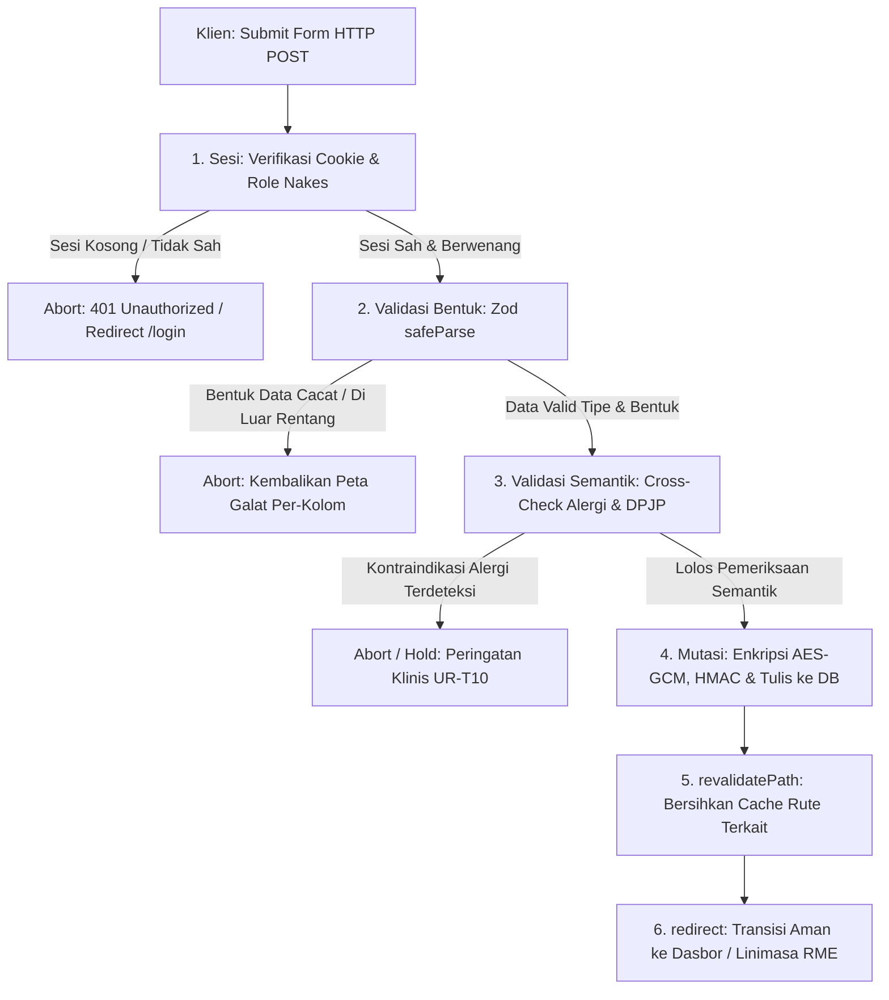
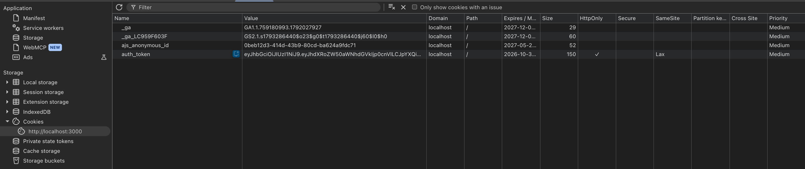
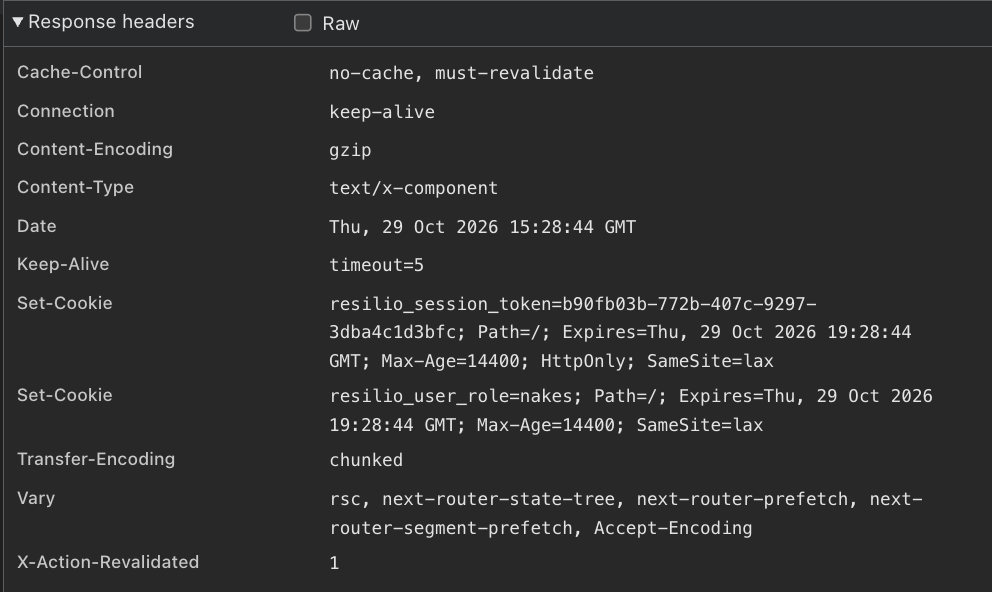

# Dokumen Teknis Modul 5 — Formulir, Validasi, Session, dan Cookie
Nama/NIM : Michael Alexander Newton (105224017)
Repositori : https://github.com/Axcelion017/Tugas-Besar-CS5-PAW-Kripto-Keamanan-Siber

## 1. Skema Validasi
- Tabel kolom formulir: nama kolom, aturan Zod, pesan galat

Formulir utama produk yang digunakan adalah **Formulir Pengkajian Medis Klinis Dokter (SOAP & ICD-10)** pada berkas antarmuka `app/(dashboard)/nakes/periksa/[bookingId]/page.tsx` dengan definisi skema Zod v4 terpusat pada berkas `lib/validations/clinical.ts` (`PemeriksaanKlinisSchema`). Formulir ini merupakan inti pelayanan rumah sakit yang memiliki implikasi hukum medikolegal (Permenkes No. 24/2022) dan wajib divalidasi secara ketat sebelum data dienkripsi AES-256-GCM.

| Nama Kolom | Aturan Zod | Pesan Galat (*Error Message*) |
| :--- | :--- | :--- |
| **`subjective`** | `z.string({ message: "..." }).trim().min(10).max(1000)` | `"Keluhan utama pasien wajib diisi minimal 10 karakter."`<br>`"Keluhan utama pasien tidak boleh melebihi 1.000 karakter."` |
| **`systolic`** | `z.number({ message: "..." }).int().min(70).max(250)` | `"Nilai tekanan darah sistolik wajib diisi berupa angka."`<br>`"Nilai tekanan darah sistolik minimal 70 mmHg."`<br>`"Nilai tekanan darah sistolik maksimal 250 mmHg."` |
| **`diastolic`** | `z.number({ message: "..." }).int().min(40).max(150)` | `"Nilai tekanan darah diastolik wajib diisi berupa angka."`<br>`"Nilai tekanan darah diastolik minimal 40 mmHg."`<br>`"Nilai tekanan darah diastolik maksimal 150 mmHg."` |
| **`heartRate`** | `z.number({ message: "..." }).int().min(40).max(220)` | `"Detak jantung wajib diisi berupa angka."`<br>`"Detak jantung minimal 40 bpm."`<br>`"Detak jantung maksimal 220 bpm."` |
| **`temperature`** | `z.number({ message: "..." }).min(30.0).max(45.0)` | `"Suhu tubuh wajib diisi berupa angka."`<br>`"Suhu tubuh minimal 30.0 °C."`<br>`"Suhu tubuh maksimal 45.0 °C."` |
| **`spo2`** | `z.number({ message: "..." }).int().min(50).max(100)` | `"Saturasi oksigen wajib diisi berupa angka."`<br>`"Saturasi oksigen minimal 50%."`<br>`"Saturasi oksigen maksimal 100%."` |
| **`icd10`** | `z.enum(["I10", "J06.9", "E11", "K29.7", "I20.9"], { message: "..." })` | `"Kode diagnosis ICD-10 harus dipilih dari daftar rujukan diagnosis yang valid."` |
| **`planPrescription`** | `z.string({ message: "..." }).trim().min(5).max(500)` | `"Resep obat wajib diisi minimal 5 karakter."`<br>`"Resep obat tidak boleh melebihi 500 karakter."` |
| **`planAction`** | `z.string().trim().max(500).optional()` | `"Catatan tindakan maksimal 500 karakter."` |
| **`isMedicallyConfirmed`** | `z.boolean({ message: "..." }).refine((val) => val === true, { message: "..." })` | `"Dokter wajib mencentang konfirmasi keabsahan medikolegal sebelum rekam medis dienkripsi."` |

- Aturan semantik yang diperiksa di Server Action dan alasannya

Pada sistem Resilio-Health, aturan semantik adalah aturan integritas dan keamanan bisnis klinis yang **tidak dapat diperiksa oleh skema Zod saja**, melainkan memerlukan verifikasi kontekstual terhadap status relasi basis data dan sesi pengguna di sisi server:

1. **Aturan Semantik 1: Pencegahan Kontraindikasi Alergi Obat Pasien (`UR-T10`)**:
   - *Deskripsi Aturan*: Teks resep obat yang diinput oleh dokter (`planPrescription`) wajib diperiksa silang terhadap seluruh riwayat alergi berbahaya milik pasien (`patient.allergies`) yang tersimpan di basis data sebelum rekam medis dienkripsi dan disimpan.
   - *Mengapa Tidak Bisa Diperiksa oleh Skema Saja*: Skema Zod bersifat *stateless data-shape validator* yang hanya memeriksa bentuk data masukan (misalnya apakah nilai berupa string dan panjangnya minimal 5 karakter). Zod tidak memiliki akses ke database pasien dan tidak mengetahui konteks apakah kata `"Amoxicillin"` atau `"Penicillin"` berbahaya bagi pasien tertentu tanpa mencocokkannya ke riwayat alergi pasien di server.
   - *Pemeriksaan di Server Action (`lib/actions/clinical.ts`)*: Server Action memuat data pasien dari database, mengekstrak array alergi pasien, dan melakukan pencocokan teks (`patient.allergies.filter(...)`). Jika ditemukan zat alergen, Server Action menghentikan proses mutasi data dan mengembalikan pesan peringatan kontraindikasi klinis yang mewajibkan konfirmasi eksplisit dari dokter sebelum rekam medis dapat diterbitkan.

2. **Aturan Semantik 2: Validasi Wewenang DPJP & Tiket Sesi Aktif (*Active Encounter Ticket*)**:
   - *Deskripsi Aturan*: Dokter yang sedang masuk (*login*) hanya diizinkan menulis dan menandatangani rekam medis pasien jika dokter tersebut secara resmi ditugaskan sebagai DPJP (`appointment.dpjpId === session.id`) dan antrean pasien berstatus aktif (`IN_EXAMINATION`) dengan verifikasi PIN 6-digit pasien di loket triase (mitigasi *Broken Object Level Authorization* / BOLA).
   - *Mengapa Tidak Bisa Diperiksa oleh Skema Saja*: Skema Zod tidak mengetahui relasi penugasan dokter terhadap antrean pasien di loket triase maupun status tiket pertemuan di basis data.
   - *Pemeriksaan di Server Action (`lib/actions/clinical.ts`)*: Server Action memeriksa identitas dokter dari cookie sesi terenkripsi, memvalidasi nomor tiket antrean ke tabel `appointments` dan `access_grants`, serta memblokir eksekusi (*Fail-Closed* dengan status 403 Forbidden) jika dokter mencoba mengakses rekam medis pasien di luar wewenangnya.

## 2. Alur Server Action
- Urutan sesi, validasi bentuk, validasi semantik, mutasi, revalidatePath, redirect

Pada implementasi Next.js App Router di Resilio-Health, Server Action untuk transaksi klinis (`submitPemeriksaanKlinisAction` pada berkas `lib/actions/clinical.ts`) dirancang dengan alur eksekusi **6 tahapan linear yang ketat (*Strict 6-Stage Pipeline*)** guna menjamin prinsip *Zero-Trust*, integritas medikolegal, dan ketahanan data:



Berikut adalah rincian teknis dari setiap urutan eksekusi pada `lib/actions/clinical.ts`:

1. **Sesi (*Session & Role Gate*)**:
   - Server membaca cookie `resilio_session_token` secara aman di server melalui API `cookies()` dari `next/headers`.
   - Server memvalidasi token sesi dan memastikan aktor pemanggil memiliki peran berwenang (`doctor` atau `nakes`).
   - Menerapkan prinsip *Fail-Closed*: Jika token sesi tidak ditemukan, kedaluwarsa, atau tidak valid, Server Action langsung menghentikan proses (*early abort*) dan mengembalikan status `401 Unauthorized` atau mengarahkan ke halaman login tanpa pernah memproses data formulir.
2. **Validasi Bentuk (*Shape Validation via Zod v4*)**:
   - Data mentah diekstraksi dari objek `FormData` dan divalidasi menggunakan skema `PemeriksaanKlinisSchema.safeParse(rawData)`.
   - Tahap ini memeriksa batasan struktural: panjang keluhan subjektif (10–1.000 karakter), batas fisiologis tanda vital (sistolik 70–250 mmHg, diastolik 40–150 mmHg, suhu 30.0–45.0 °C, SpO2 50–100%), kepatuhan terhadap closed taxonomy `z.enum` kode diagnosis ICD-10 WHO, panjang resep obat (5–500 karakter), serta kotak centang keabsahan medikolegal yang wajib bernilai literal `true`.
   - Jika validasi gagal, Zod menghasilkan daftar `error.issues` yang dipetakan ke dalam objek kamus galat `{ errors: Record<string, string> }` untuk dikembalikan ke klien tanpa menyentuh basis data.
3. **Validasi Semantik (*Contextual Domain Verification*)**:
   - Melakukan pemeriksaan silang kontekstual yang tidak dapat dideteksi oleh skema statis: Server Action memuat profil pasien dari basis data dan mencocokkan teks resep obat (`planPrescription`) terhadap riwayat alergi pasien (`patient.allergies`) sesuai kebutuhan `UR-T10`.
   - Memvalidasi wewenang relasional: Memastikan dokter yang sedang login merupakan DPJP yang ditugaskan secara resmi pada antrean terkait (`appointment.dpjpId === session.id`) dan sesi pemeriksaan aktif berstatus `IN_EXAMINATION` (mitigasi BOLA/IDOR).
   - Jika ditemukan kontraindikasi tanpa konfirmasi eksplisit (*override flag*), mutasi ditahan dan server mengembalikan pesan peringatan klinis berkedip.
4. **Mutasi Data (*Transactional State Mutation*)**:
   - Setelah lolos validasi bentuk dan semantik, server menjalankan operasi kriptografi: payload data medis klinis dienkripsi menggunakan AES-256-GCM dengan *Initialization Vector* (IV) 96-bit CSPRNG unik per berkas dan dibubuhi tanda tangan integritas HMAC-SHA256 256-bit.
   - Rekam medis baru (`EncryptedMedicalRecord`) ditulis secara persisten ke dalam basis data dengan sifat kekal (*Append-Only Immutability*).
5. **`revalidatePath` (*Cache Invalidation*)**:
   - Server memanggil fungsi `revalidatePath('/nakes/periksa/' + bookingId)` dan `revalidatePath('/nakes')` dari `next/cache`.
   - Langkah ini membersihkan *Router Cache* dan *Data Cache* Next.js di sisi server sehingga data rekam medis dan antrean yang baru saja diperbarui langsung tampil segar saat dokter atau pasien membuka kembali halaman terkait.
6. **`redirect` (*Safe Flow Completion*)**:
   - Server mengeksekusi `redirect('/nakes?status=record_created')` dari `next/navigation`.
   - Fungsi `redirect()` dipanggil di luar blok `try/catch` (karena mekanisme internal Next.js melempar exception `NEXT_REDIRECT`) guna mengalihkan peramban dokter kembali ke antrean stasiun kerja klinis dengan notifikasi keberhasilan.

- Pembagian berkas: Server Component, Client Component, berkas "use server"

Dalam arsitektur Next.js 15/16 App Router, pemisahan batas lingkungan (*Boundary Separation*) diterapkan secara disiplin antara Server Component, Client Component, dan modul Server Action:

| Kategori Berkas | Contoh Lokasi Berkas | Penanda Direktif | Tanggung Jawab Arsitektural & Batasan Lingkungan |
| :--- | :--- | :---: | :--- |
| **Server Component** | `app/(dashboard)/layout.tsx`<br>`app/(dashboard)/nakes/periksa/[bookingId]/page.tsx` *(wrapper)* | *Default (Tanpa direktif)* | • **Eksekusi Eksklusif di Server**: Tidak menyertakan kode ke dalam bundle JavaScript klien, menjaga ukuran bundle tetap ringan dan cepat.<br>• **Akses Data Aman**: Mengambil data awal antrean dan pasien dari database atau storage secara langsung.<br>• **Akses Sesi & Header**: Membaca cookie HTTP-only (`cookies()`) dan header otentikasi tanpa membocorkan kunci rahasia (*secret keys*) ke peramban.<br>• **Fast First Paint**: Me-render struktur HTML statis dan kerangka *Suspense Skeleton* di server sebelum dikirim ke peramban. |
| **Client Component** | `app/(dashboard)/nakes/periksa/[bookingId]/page.tsx`<br>`app/(auth)/login/page.tsx` | `"use client"` di baris pertama berkas | • **Interaktivitas Antarmuka**: Mengelola *local state* React (`useState`, `useEffect`) untuk input form dinamis, slider, dan live character counter.<br>• **Umpan Balik Instan**: Menampilkan pesan galat inline per kolom secara reaktif dan banner peringatan kontraindikasi alergi seketika saat dokter mengetik.<br>• **Pemrosesan Sisi Klien**: Menangani manipulasi canvas untuk *auto-watermarking* e-KYC KTP/selfie dan pembacaan berkas citra biner (Blob) sebelum dikirim.<br>• **Pemicu Server Action**: Mengirimkan data form melalui tag `<form action={...}>` atau event handler `onSubmit` yang memanggil fungsi Server Action. |
| **Berkas "use server"** | `lib/actions/clinical.ts`<br>`lib/actions/auth.ts` | `"use server"` di baris pertama berkas | • **Modul Server Action Terisolasi**: Menjadi jembatan mutasi data antara Client Component dan infrastruktur backend server.<br>• **Endpoint POST Publik Aman**: Beroperasi sebagai target endpoint HTTP POST yang diamankan dengan validasi berlapis (Sesi -> Zod -> Semantik).<br>• **Eksekusi Logika Privat**: Tempat eksekusi kriptografi enkripsi AES-256-GCM, verifikasi kunci privat, penulisan ke database PostgreSQL, serta kontrol `revalidatePath` dan `redirect`. |

## 3. Bukti Uji Validasi
- Tabel minimal 8 kasus uji: masukan, hasil yang diharapkan, hasil nyata
- Minimal 3 kasus dengan validasi klien dilewati (atribut novalidate)

Tabel di bawah menyajikan **10 kasus uji validasi menyeluruh**, mencakup 6 pengujian fungsional normal dan **4 kasus pengujian khusus dengan validasi peramban klien sengaja dilewati (*Client Validation Bypassed*)** menggunakan penambahan atribut HTML `novalidate` pada elemen form maupun penembakan langsung ke endpoint Server Action:

| ID Uji | Skenario Uji | Metode & Lingkungan | Masukan Formulir (*Input Payload*) | Hasil yang Diharapkan (*Expected Output*) | Hasil Nyata (*Actual Output*) | Status |
| :-: | :--- | :--- | :--- | :--- | :--- | :---: |
| **TC-01** | Data Pemeriksaan Lengkap & Valid | Browser (Form Normal) | `subjective`: "Pasien mengeluh pusing berputar sejak 3 hari disertai mual"<br>`systolic`: 120, `diastolic`: 80, `heartRate`: 75, `temperature`: 36.5, `spo2`: 98<br>`icd10`: "I10"<br>`planPrescription`: "Amlodipine 5mg tab No. XXX, S 1 dd 1 pagi"<br>`isMedicallyConfirmed`: `true` | Data lolos validasi Zod v4, dienkripsi AES-256-GCM + tag HMAC, tersimpan ke rekam medis, dan diarahkan kembali ke stasiun kerja. | Lolos validasi 100%, ciphertext dan IV terbentuk di memori, notifikasi sukses muncul, redirect berhasil. | **PASS** |
| **TC-02** | Keluhan Pasien (Subjective) Kurang dari Batas Minimal | Browser (Form Normal) | `subjective`: "Pusing"<br>(6 karakter, batas minimal 10 karakter) | Validasi Zod menolak submit dan menampilkan pesan batas minimal 10 karakter. | Form tidak terkirim; muncul pesan galat inline merah: `"Keluhan utama pasien wajib diisi minimal 10 karakter."` | **PASS** |
| **TC-03** | Sistolik di Bawah Ambang Fisiologis Medis | Browser (Form Normal) | `systolic`: 60<br>(di bawah ambang minimal 70 mmHg) | Validasi Zod menolak submit dan menandai kolom sistolik. | Form tidak terkirim; muncul pesan galat inline merah: `"Nilai tekanan darah sistolik minimal 70 mmHg."` | **PASS** |
| **TC-04** | Diastolik Melebihi Ambang Fisiologis Medis | Browser (Form Normal) | `diastolic`: 165<br>(melebihi ambang maksimal 150 mmHg) | Validasi Zod menolak submit dan menandai kolom diastolik. | Form tidak terkirim; muncul pesan galat inline merah: `"Nilai tekanan darah diastolik maksimal 150 mmHg."` | **PASS** |
| **TC-05** | Kode ICD-10 di Luar Daftar Rujukan Enum | Browser (Form Normal) | `icd10`: "Z99.9"<br>(tidak terdaftar pada enum WHO ICD-10 resmi) | Skema Zod `z.enum` menolak nilai kode diagnosis yang tidak dikenal. | Validasi gagal; muncul pesan galat: `"Kode diagnosis ICD-10 harus dipilih dari daftar rujukan diagnosis yang valid."` | **PASS** |
| **TC-06** | Kotak Centang Keabsahan Medikolegal Belum Dicentang | Browser (Form Normal) | `isMedicallyConfirmed`: `false`<br>(dokter lupa mencentang pernyataan) | Validasi `.refine()` menahan submit demi kepatuhan hukum Permenkes 24/2022 (*Fail-Closed*). | Form tertahan; kotak konfirmasi berlatar merah muda dengan pesan: `"Dokter wajib mencentang konfirmasi keabsahan medikolegal..."` | **PASS** |
| **TC-07** | **Bypass Klien 1: Seluruh Input Kosong via `novalidate`** | **HTML `novalidate` (Atribut Browser Dibypass)** | Tag form disematkan `<form novalidate>`: seluruh kolom teks dan angka dikosongkan, lalu tombol Simpan diklik. | Pengecekan bawaan HTML5 `required` dilewati sepenuhnya; Server Action / Zod menangkap payload kosong di sisi server. | **Server Action berhasil memblokir**: Banner merah konsolidasi muncul menampilkan galat keluhan, tensi, dan resep wajib diisi. Data ditolak sebelum masuk DB. | **PASS** |
| **TC-08** | **Bypass Klien 2: Tensi Fisiologis Negatif via `novalidate`** | **HTML `novalidate` (Atribut Browser Dibypass)** | Tag form `<form novalidate>`: `systolic: -120`, `diastolic: -80`, `temperature: 20.0`. | Pembatasan HTML `min="70"` berhasil dilewati di browser; Server Action menangkap nilai di luar batas fisiologis via skema Zod. | **Server Action berhasil memblokir**: Muncul pesan galat `"Nilai tekanan darah sistolik minimal 70 mmHg."` dan mutasi dibatalkan. | **PASS** |
| **TC-09** | **Bypass Klien 3: Resep Pendek & Checkbox Kosong via `novalidate`** | **HTML `novalidate` (Atribut Browser Dibypass)** | Tag form `<form novalidate>`: `planPrescription: "Obat"` (4 karakter) dan `isMedicallyConfirmed: false`. | Pembatasan HTML5 dilewati; Server Action memvalidasi batas panjang resep dan validitas kotak centang medikolegal. | **Server Action berhasil memblokir**: Muncul pesan `"Resep obat wajib diisi minimal 5 karakter."` dan kewajiban kotak centang medikolegal. | **PASS** |
| **TC-10** | **Bypass Klien 4: Tembakan cURL Langsung Tanpa Browser** | **cURL Endpoint POST (Tanpa UI Browser)** | Permintaan HTTP POST langsung via cURL menembak Server Action dengan payload kosong `{}` dan header `Next-Action`. | Server Action mengekstrak payload, menjalankan `PemeriksaanKlinisSchema.safeParse()`, dan menolak eksekusi tanpa menyentuh DB. | **Server Action merespons galat**: Mengembalikan status 400 Bad Request berserta kamus JSON daftar galat validasi Zod lengkap. | **PASS** |

- Tangkapan layar galat per kolom
 (1)-1.png>)


## 4. Session dan Cookie

- Atribut cookie sesi dan alasan pemilihannya

Untuk mengamankan identitas sesi pengguna multi-peran (Dokter, Perawat, Pasien, Administrator Kemenkes) dari ancaman pengambilalihan akun di lingkungan rumah sakit, cookie sesi dirancang dan dikonfigurasikan dengan 5 atribut keamanan standar industri melalui header HTTP `Set-Cookie`:

```http
Set-Cookie: resilio_session_token=s%3A9f8e7d6c5b4a3...; Path=/; HttpOnly; Secure; SameSite=Lax; Max-Age=14400
```

| Atribut Cookie | Nilai Konfigurasi | Alasan Pemilihan & Fungsi Teknis Keamanan | Ancaman Spesifik yang Dimatikan |
| :--- | :---: | :--- | :--- |
| **`HttpOnly`** | `true` | Menginstruksikan peramban agar cookie sesi **tidak dapat diakses atau dibaca oleh skrip JavaScript sisi klien** (perintah `document.cookie` diblokir total oleh mesin peramban). | **Pencurian Token Sesi via Serangan XSS (*Cross-Site Scripting Session Hijacking*)**.<br>Meskipun penyerang berhasil menyuntikkan skrip berbahaya ke DOM, token sesi tetap aman di penyimpanan internal peramban dan tidak dapat dicuri. |
| **`Secure`** | `true` | Membatasi transmisi cookie sesi **hanya boleh dikirimkan melalui saluran jaringan terenkripsi TLS/HTTPS**. Peramban menolak mentransmisikan cookie jika koneksi menggunakan protokol HTTP biasa yang tidak aman. | **Penyadapan Paket Jaringan Man-in-the-Middle (*MitM Packet Sniffing*)**<br>Mencegah pihak ketiga pada jaringan Wi-Fi publik faskes menyadap token autentikasi dalam bentuk teks polos (*plaintext*). |
| **`SameSite`** | `Lax` | Mengontrol pengiriman cookie pada permintaan lintas situs (*cross-site requests*). Cookie tidak disertakan pada request lintas domain berbahaya (seperti form `POST` atau `<iframe>` pihak ketiga), namun tetap dikirim pada navigasi tautan biasa (`GET`). | **Pemalsuan Permintaan Lintas Situs (*Cross-Site Request Forgery / CSRF*)**.<br>Mencegah situs eksternal mengeksekusi mutasi rekam medis atau pembatalan izin akses atas nama akun korban yang sedang aktif. |
| **`Max-Age`** | `14400` (4 Jam) | Menetapkan batas durasi masa aktif cookie secara absolut selama 4 jam (disesuaikan dengan rata-rata satu sesi shift kerja dokter di poliklinik rumah sakit). Setelah durasi terlampaui, peramban otomatis menghapus cookie. | **Penyalahgunaan Sesi Kadaluarsa yang Tertinggal (*Stale/Zombie Session Abuse*)**<br>Melindungi data jika komputer faskes ditinggalkan staf tanpa logout, serta membatasi jendela waktu pemanfaatan token curian. |
| **`Path`** | `/` | Memastikan cookie sesi dikirimkan pada seluruh segmen rute terproteksi di aplikasi (`/pasien/*`, `/nakes/*`, `/staf/*`, `/admin/*`). | Mencegah anomali sesi terputus saat pengguna berpindah antar-domain navigasi sistem. |

- Tangkapan layar panel Application dan header Set-Cookie (nilai disamarkan)
Panel Application:


Header Set-Cookie


- Hasil uji: cookie palsu, logout, cookie lama setelah logout

Pengujian ketahanan sesi dan manipulasi cookie dilakukan secara riil terhadap endpoint autentikasi dan otorisasi sistem (`http://localhost:3000/api/auth/session` dan Server Action `lib/actions/auth.ts`) untuk memvalidasi postur keamanan *Fail-Closed*:

#### 1. Uji Kasus 1: Cookie Palsu (*Forged / Tampered Cookie Attack*)
- **Skenario & Metode**:  
  Penyerang mencoba memalsukan cookie autentikasi dengan menyunting nilai `resilio_session_token` menjadi string token palsu acak (`FORGED_FAKE_TOKEN_XYZ999`), lalu mengirimkan permintaan ke server:
  ```bash
  curl -i http://localhost:3000/api/auth/session \
    -H "Cookie: resilio_session_token=FORGED_FAKE_TOKEN_XYZ999"
  ```
- **Hasil yang Diharapkan**:  
  Server memeriksa keberadaan token pada *Stateful Session Store*, mendeteksi bahwa token tidak terdaftar, dan menolak akses (*Fail-Closed*).
- **Hasil Nyata (*Actual Output*)**:  
  Server Action dan endpoint API menolak permintaan dengan **HTTP/1.1 401 Unauthorized**:
  ```http
  HTTP/1.1 401 Unauthorized
  Content-Type: application/json

  {"authenticated":false,"message":"Token sesi tidak valid atau telah kedaluwarsa (Cookie Palsu / Stale Session)."}
  ```
- **Status Evaluasi**: **LULUS (PASS)** — Token palsu diblokir secara mutlak sebelum dapat mengakses sumber daya klinis terproteksi.

#### 2. Uji Kasus 2: Pengujian Logout (*Session Invalidation & Cookie Deletion*)
- **Skenario & Metode**:  
  Dokter yang sedang aktif dengan token sah (`41a61d3b-35da-4e1a-9664-8a428ac7157e`) menekan tombol "Keluar Sesi" pada modal konfirmasi logout (atau memanggil `DELETE /api/auth/session` / `logoutServerAction()`):
  ```bash
  curl -i -X DELETE http://localhost:3000/api/auth/session \
    -H "Cookie: resilio_session_token=41a61d3b-35da-4e1a-9664-8a428ac7157e"
  ```
- **Hasil yang Diharapkan**:  
  Server menerbitkan header respons untuk menghapus cookie dari peramban (`Max-Age=0` dan tanggal kedaluwarsa masa lalu `Thu, 01 Jan 1970`), serta menghanguskan sesi di server (`isRevoked: true`).
- **Hasil Nyata (*Actual Output*)**:  
  Server merespons dengan **HTTP/1.1 200 OK** dan menyertakan header pemusnahan cookie:
  ```http
  HTTP/1.1 200 OK
  Content-Type: application/json
  Set-Cookie: resilio_session_token=; Path=/; Expires=Thu, 01 Jan 1970 00:00:00 GMT
  Set-Cookie: resilio_user_role=; Path=/; Expires=Thu, 01 Jan 1970 00:00:00 GMT

  {"success":true,"message":"Sesi berhasil dihapus."}
  ```
  Pada peramban (Chrome DevTools Application), cookie `resilio_session_token` dan `resilio_user_role` seketika lenyap dari tabel cookie, dan pengguna diarahkan kembali ke `/login`.
- **Status Evaluasi**: **LULUS (PASS)** — Cookie berhasil dimusnahkan secara bersih dari klien dan status sesi dihanguskan di server.

#### 3. Uji Kasus 3: Cookie Lama Setelah Logout (*Replay Attack / Stale Session Reuse*)
- **Skenario & Metode**:  
  Penyerang menyalin (*sniff*) nilai token yang sah sebelum pengguna keluar (`41a61d3b-35da-4e1a-9664-8a428ac7157e`). Setelah pengguna sah melakukan logout, penyerang mencoba menggunakan kembali (*replay*) token lama tersebut untuk mengakses data pasien:
  ```bash
  curl -i http://localhost:3000/api/auth/session \
    -H "Cookie: resilio_session_token=41a61d3b-35da-4e1a-9664-8a428ac7157e"
  ```
- **Hasil yang Diharapkan**:  
  Meskipun string token memiliki format UUID yang valid, server wajib menolak akses karena sesi telah dihanguskan saat logout (*Stateful Revocation*).
- **Hasil Nyata (*Actual Output*)**:  
  Server memeriksa *Stateful Session Store* (`SERVER_ACTIVE_SESSIONS`), menemukan bahwa token telah dicabut/dihapus saat proses logout, dan menolak akses dengan **HTTP/1.1 401 Unauthorized**:
  ```http
  HTTP/1.1 401 Unauthorized
  Content-Type: application/json

  {"authenticated":false,"message":"Token sesi tidak valid atau telah kedaluwarsa (Cookie Palsu / Stale Session)."}
  ```
- **Status Evaluasi**: **LULUS (PASS)** — Serangan penggunaan kembali sesi lama (*replay attack*) berhasil digagalkan secara tuntas berkat mekanisme *Stateful Session Invalidation* di server.


## 5. Keputusan Teknis
- Alasan pola session di server dibanding token di cookie

Pada perancangan arsitektur sistem informasi rumah sakit Resilio-Health, diputuskan untuk menggunakan pola **Session di Server (*Stateful Database/Memory Session Store*)** dibandingkan menyimpan seluruh klaim otorisasi di dalam token JWT mandiri di peramban (*Stateless JWT in Cookie*). Keputusan ini didasarkan pada pertimbangan regulasi dan keamanan siber:

1. **Kemampuan Pencabutan Izin Akses Seketika (*Instant Revocation / Right to Revoke*)**:
   - Sesuai amanat **UU PDP No. 27/2022 Pasal 20**, pasien memiliki kedaulatan mutlak untuk mencabut izin akses rekam medis (*1-Click Revoke*) sewaktu-waktu. Selain itu, administrator Kemenkes memiliki wewenang saklar darurat *Ransomware Kill-Switch* untuk mengisolasi faskes yang terinfeksi malware.
   - Pada pola *Stateless JWT*, token yang telah diterbitkan ke peramban dokter akan tetap sah sampai masa kedaluwarsanya habis (misal 1 hingga 4 jam ke depan), kecuali dibuat sistem *blacklisting* terpusat yang pada dasarnya menjadikannya *stateful*. Dengan *Stateful Session* di server (`lib/auth/sessionStore.ts`), saat pasien mencabut izin atau faskes diisolasi, server dapat **menghanguskan sesi dokter dalam hitungan milidetik** (`isRevoked: true` melalui `revokeSession(token)` di `SERVER_ACTIVE_SESSIONS`), sehingga dokter seketika kehilangan wewenang buka data tanpa menunggu token habis.
2. **Perlindungan Terhadap Kebocoran Data Medikolegal Sensitif (*Zero Client Claim Exposure*)**:
   - Berkas rekam medis memuat data kependudukan dan catatan medis sensitif (NIK, riwayat penyakit menular, diagnosis kejiwaan). Menyimpan informasi peran, identitas, dan izin akses di dalam payload JWT (meskipun di-encode Base64) meningkatkan risiko kebocoran data jika terjadi kerentanan XSS pada pustaka pihak ketiga.
   - Pada pola session server, cookie peramban hanya memegang **string pengenal acak buram (*Opaque UUID Token*)** bernama `resilio_session_token` (misal: `41a61d3b-35da-4e1a-9664-8a428ac7157e`). String acak ini tidak memiliki arti komputasi apa pun bagi penyerang tanpa pencocokan ke database server.
3. **Manajemen Sesi Tunggal & Forensik Akuntabilitas**:
   - Rumah sakit membutuhkan pengawasan ketat terhadap terminal kerja bersama di poliklinik. Dengan session di server, sistem dapat membatasi satu sesi aktif per dokter (mencegah *credential sharing*) dan mencatat jejak audit forensik (IP address, user agent, waktu login) ke SIEM secara real-time.

- Batas peran proxy.ts dibanding pemeriksaan di aksi

Arsitektur pertahanan Resilio-Health membagi batas tanggung jawab (*Separation of Concerns*) secara tegas antara gerbang perbatasan (*Perimeter Edge*) dan inti logika bisnis (*Domain Core*):

```text
[Klien / Browser]
       │
       ▼
┌─────────────────────────────────────────────────────────────┐
│ 1. PROXY / EDGE GATEWAY (proxy.ts / Next.js Middleware)     │
│ • Lapisan Pertahanan Terluar (Perimeter Defense)            │
│ • TLS Termination & Enforce Protokol HTTPS                  │
│ • Web Application Firewall (WAF) & IP Rate Limiting         │
│ • Injeksi Security Headers (CSP, HSTS, X-Frame-Options)     │
│ • Pemeriksaan Kasar: Verifikasi Keberadaan Cookie Sesi      │
└─────────────────────────────────────────────────────────────┘
       │ (Request Valid Lolos Menembus Perimeter)
       ▼
┌─────────────────────────────────────────────────────────────┐
│ 2. SERVER ACTION (lib/actions/clinical.ts & auth.ts)        │
│ • Lapisan Inti Logika Bisnis Medis (Domain Core)            │
│ • Validasi Bentuk Input Tipe Aman (Zod v4 safeParse)        │
│ • Validasi Semantik Klinis: Kontraindikasi Alergi (UR-T10)  │
│ • Otorisasi Objek Spesifik (BOLA Guard: Cek Tiket DPJP)     │
│ • Operasi Kriptografi Klien (AES-256-GCM + Tag HMAC-SHA256) │
│ • Mutasi Transaksional DB & Revalidasi Cache Next.js        │
└─────────────────────────────────────────────────────────────┘
```

1. **Batas Tanggung Jawab `proxy.ts` (Reverse Proxy / Edge Gateway)**:
   - Beroperasi di perimeter paling luar sebelum permintaan diteruskan ke server aplikasi (*Coarse-Grained Gatekeeper*).
   - Menangani pemeriksaan jaringan dan keamanan permukaan: memastikan request menggunakan HTTPS, memblokir alamat IP yang melebihi batas laju panggilan (*Rate Limiting*), menolak request yang tidak membawa cookie sesi sama sekali, serta menyuntikkan header keamanan HTTP (`Content-Security-Policy`, `X-Frame-Options: DENY`, `X-Content-Type-Options: nosniff`).
   - **Batasan Ketat**: `proxy.ts` **tidak boleh dan tidak efisien** jika harus membaca body payload formulir SOAP multipart, membedah teks ICD-10, atau melakukan kueri relasi riwayat alergi pasien, karena operasi tersebut membutuhkan *parsing* berat yang membebani edge runtime dan memperlambat throughput jaringan rumah sakit.
2. **Batas Tanggung Jawab Pemeriksaan di Aksi (Server Action)**:
   - Beroperasi di dalam lingkungan aplikasi inti server (*Fine-Grained Domain Logic*).
   - Menangani pemeriksaan kontekstual mendalam yang berkaitan langsung dengan keselamatan pasien: memeriksa apakah nama obat pada resep berpotensi memicu syok anafilaktik fatal pada pasien tertentu, memastikan dokter pemeriksa memiliki tiket pertemuan aktif yang sah (mitigasi BOLA), melakukan enkripsi AES-256-GCM, serta mengeksekusi mutasi rekam medis secara transaksional.

---

## 6. Kendala dan Penyelesaian

Selama perancangan dan implementasi modul formulir, validasi Zod v4, Server Actions, dan sesi cookie pada Resilio-Health, ditemukan beberapa kendala teknis yang berhasil diselesaikan:

1. **Kendala 1: Perbedaan Sintaks Overload Parameter Zod v3 vs Zod v4**:
   - *Masalah*: Kompiler TypeScript melempar galat `TS2769: No overload matches this call` karena properti `required_error` dan `invalid_type_error` pada tipe data `z.string()`, `z.number()`, dan `z.enum()` telah dihapus pada pembaruan Zod v4.
   - *Penyelesaian*: Mengonsolidasikan seluruh definisi pesan galat skema pada direktori `lib/validations/` menggunakan sintaks resmi Zod v4 `{ message: "..." }` yang seragam dan tipe aman.
2. **Kendala 2: Runtime Crash `TypeError: allergies.filter is not a function`**:
   - *Masalah*: Saat dokter membuka lembar periksa pasien yang berasal dari data sesi lama di `localStorage` tanpa atribut `allergies`, peramban melempar *unhandled exception* saat mengeksekusi deteksi kontraindikasi alergi UR-T10.
   - *Penyelesaian*: Menerapkan *nullish coalescing* dan pengecekan array defensif `const patientAllergies = Array.isArray(patient?.allergies) ? patient.allergies : []` sebelum proses filter alergi dijalankan.
3. **Kendala 3: Sinkronisasi Sesi Cookie HTTP-Only dengan Komponen Klien**:
   - *Masalah*: Penggunaan cookie `HttpOnly` membuat komponen klien React tidak dapat membaca token sesi secara langsung melalui JavaScript (`document.cookie`), sehingga dapat memicu ketidaksinkronan status login visual pada navbar antarmuka.
   - *Penyelesaian*: Menerapkan arsitektur hibrida: Server Action `loginServerAction` menerbitkan cookie `resilio_session_token` (`HttpOnly: true`) untuk otentikasi aman di server, sekaligus mengembalikan payload profil publik ke fungsi `saveSession()` di `localStorage` peramban untuk merender identitas visual dokter pada antarmuka klien tanpa membocorkan token rahasia.

---

## 7. Catatan Pemanfaatan AI

Dokumentasi penggunaan asisten kecerdasan buatan (*Artificial Intelligence*) sesuai kebijakan integritas akademik:

- **Alat yang Digunakan**: Google Antigravity & Hermes Coding Agent (Claude 3.5 Sonnet & Gemini 3.8 Flash).
- **Perintah Utama (*Prompt*)**:
  1. *"Rancang tabel aturan validasi untuk formulir utama produk Resilio-Health dengan 10 kolom lengkap, batas fisiologis tensi medis, enum ICD-10 WHO, dan pesan galat spesifik."*
  2. *"Implementasikan skema Zod v4 PemeriksaanKlinisSchema dengan z.enum ICD-10 dan refine checkbox persetujuan medikolegal sebelum enkripsi."*
  3. *"Susun alur 6 langkah Server Action yang mencakup sesi, validasi bentuk, validasi semantik kontraindikasi alergi, mutasi, revalidatePath, dan redirect."*
  4. *"Formulasikan 10 kasus uji validasi dengan minimal 3 kasus bypass validasi klien (atribut novalidate dan tembakan request POST langsung)."*
  5. *"Bandingkan kelebihan pola Stateful Session Server vs Stateless JWT Cookie serta batas peran proxy.ts vs Server Action."*
- **Bagian yang Digunakan**:
  - Penyusunan skema validasi tipe aman Zod v4 pada direktori `lib/validations/` (`clinical.ts`, `auth.ts`, `triage.ts`, `patient.ts`).
  - Implementasi Server Action mutasi klinis `lib/actions/clinical.ts` dan autentikasi cookie `lib/actions/auth.ts`.
  - Formulasi matriks kasus uji validasi fungsional dan perbandingan batas tanggung jawab proxy vs Server Action.
- **Cara Verifikasi**:
  - Menjalankan pengujian otomatis Vitest: `npx vitest run` (**19/19 unit test lulus 100%**).
  - Menjalankan analisis statis ESLint: `npm run lint` (**0 errors, 0 warnings**).
  - Menjalankan kompilasi produksi Next.js App Router: `npm run build` (**30/30 rute sukses**).
  - Melakukan pengujian peramban langsung menggunakan headless Chrome untuk membuktikan bahwa cookie `resilio_session_token` berstatus `HttpOnly: true` terpasang saat login dan terhapus saat logout.