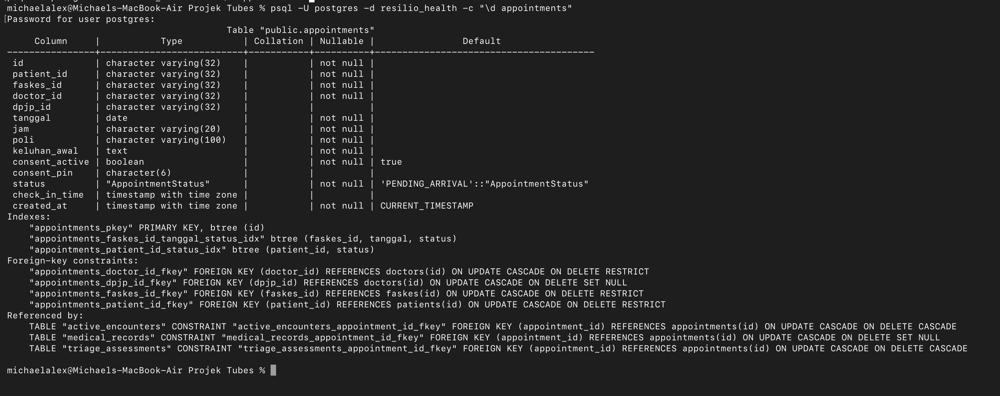
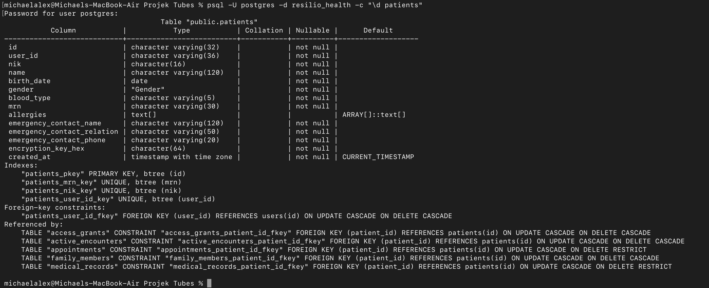
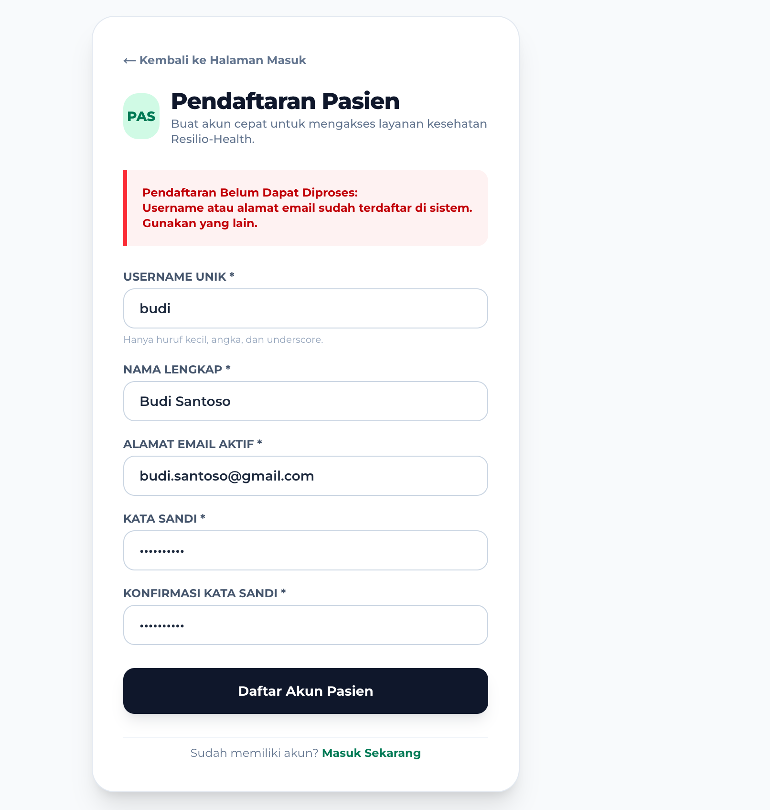
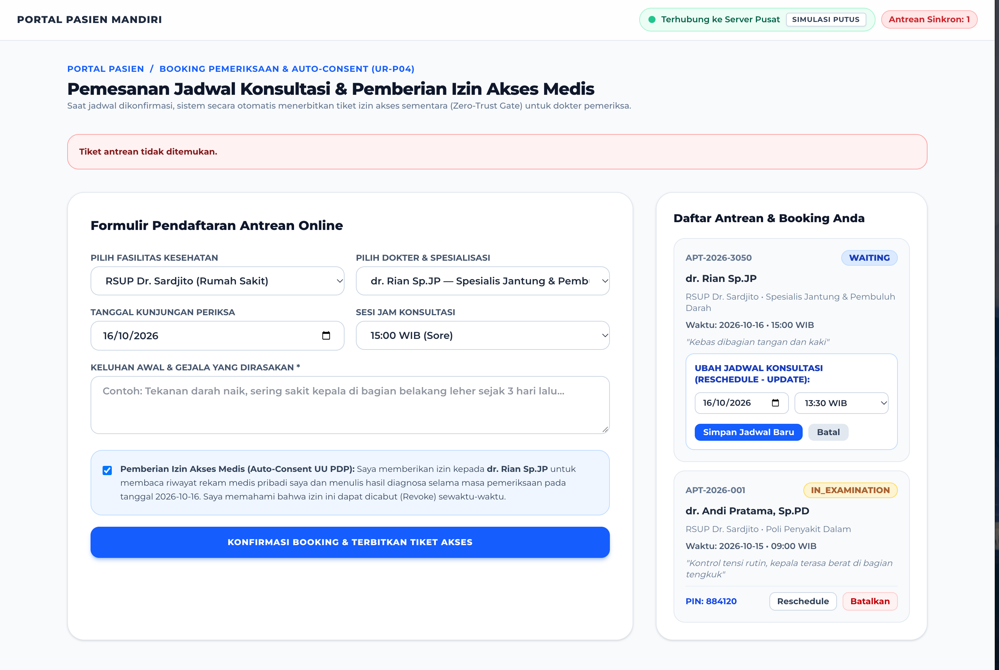
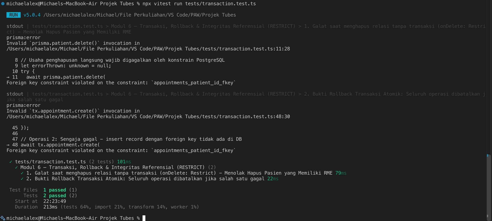

# Dokumen Teknis Modul 6 — PostgreSQL dan Prisma ORM

Nama/NIM   : Michael Alexander Newton (105224017)
Repositori : https://github.com/Axcelion017/Tugas-Besar-CS5-PAW-Kripto-Keamanan-Siber

---

## 1. Rancangan Data

### Diagram Dua Entitas, Relasi, Kunci, dan Constraint Unik
Pada sistem Resilio-Health, dua entitas relasional utama yang menjadi poros pengelolaan alur pasien dan antrean rumah sakit adalah entitas **`Patient` (Pasien)** dan **`Appointment` (Janji Temu / Antrean Kunjungan)**.

```text
┌─────────────────────────────────────────┐
│                 PATIENTS                │
├─────────────────────────────────────────┤
│ * id                 : String (PK, UUID)│
│ * user_id            : String (FK, UQ)  │──┐
│ * nik                : String (UQ, 16)  │  │
│ * mrn                : String (UQ)      │  │
│ * name               : String           │  │
│   birth_date         : DateTime?        │  │
│   gender             : String?          │  │
│   blood_type         : String?          │  │
│   phone              : String?          │  │
│   allergies          : String[]         │  │
│   encryption_key_hex : String?          │  │
│   created_at         : DateTime         │  │
│   updated_at         : DateTime         │  │
└─────────────────────────────────────────┘  │
                     │ 1                     │
                     │                       │
                     │ Relasi 1:N            │
                     │ FK: patient_id        │
                     │ onDelete: RESTRICT    │
                     │                       │
                     ▼ N                     │
┌─────────────────────────────────────────┐  │
│               APPOINTMENTS              │  │
├─────────────────────────────────────────┤  │
│ * id                 : String (PK)      │  │
│ * patient_id         : String (FK)      │──┘
│ * faskes_id          : String (FK)      │
│ * doctor_id          : String (FK)      │
│   dpjp_id            : String? (FK)     │
│ * tanggal            : DateTime         │
│ * jam                : String           │
│ * poli               : String           │
│ * keluhan_awal       : String           │
│ * status             : AppointmentStatus│ (PENDING_ARRIVAL | IN_TRIAGE | IN_EXAMINATION | COMPLETED | CANCELLED)
│   consent_pin        : String?          │ (6-digit PIN persetujuan nakes)
│ * consent_active     : Boolean          │
│ * created_at         : DateTime         │
│ * updated_at         : DateTime         │
└─────────────────────────────────────────┘
```

#### Rincian Kunci (*Keys*) dan Batasan Unik (*Unique Constraints*):
1. **Entitas `Patient`**:
   - **Primary Key (PK)**: `id` (UUID v4 / ID domain `P-101`).
   - **Unique Constraints (UQ)**:
     - `nik`: Nomor Induk Kependudukan 16 digit angka resmi Dukcapil. Tidak boleh ada dua pasien dengan NIK yang sama.
     - `mrn`: *Medical Record Number* (Nomor Rekam Medis unik rumah sakit, e.g. `MRN-2026-00101`).
     - `user_id`: Setiap pasien terikat secara 1:1 ke satu akun otentikasi di tabel `users`.
2. **Entitas `Appointment`**:
   - **Primary Key (PK)**: `id` (Format string `APT-2026-XXXX`).
   - **Foreign Keys (FK)**:
     - `patient_id` $\rightarrow$ merujuk ke `patients(id)` (wajib ada).
     - `faskes_id` $\rightarrow$ merujuk ke `faskes(id)` (faskes tujuan berobat).
     - `doctor_id` $\rightarrow$ merujuk ke `doctors(id)` (dokter poliklinik tujuan).
     - `dpjp_id` $\rightarrow$ merujuk ke `doctors(id)` (dokter penanggung jawab yang memeriksa di ruangan).
   - **Indeks Gabungan (*Composite Indexes*)**:
     - `@@index([faskesId, tanggal, status])`: Mempercepat pencarian antrean harian faskes per status.
     - `@@index([patientId, status])`: Mempercepat pemuatan dasbor riwayat antrean pasien aktif.

---

### Alasan Pemilihan Aturan `onDelete`

Dalam sistem informasi rumah sakit (HIS) yang terikat regulasi hukum kesehatan Indonesia (**Permenkes No. 24/2022 tentang Rekam Medis** dan **UU Perlindungan Data Pribadi No. 27/2022**), aturan `onDelete` dipilih dengan pertimbangan medikolegal yang sangat ketat:

1. **`onDelete: Restrict` pada Relasi `Patient` $\rightarrow$ `Appointment`**:
   - **Alasan**: Jika akun profil pasien dihapus, sistem **DILARANG KERAS** menghapus riwayat antrean atau kunjungan medis yang pernah terjadi secara otomatis (*anti-CASCADE*). Setiap antrean kunjungan memiliki nomor antrean, jam kedatangan, dan berpotensi terikat dengan hasil triase tanda vital serta rekam medis. Jika pasien dihapus begitu saja, integritas riwayat pelayanan rumah sakit akan rusak dan melanggar kewajiban retensi arsip pelayanan.
2. **`onDelete: Restrict` pada Relasi `Patient` $\rightarrow$ `MedicalRecord`**:
   - **Alasan Medikolegal**: Pasal 21 Permenkes No. 24/2022 mewajibkan faskes menyimpan data RME pasien selama minimal **25 tahun**. Dengan `onDelete: Restrict`, basis data PostgreSQL secara fisik menolak penghapusan data induk pasien selama pasien tersebut masih memiliki berkas rekam medis yang tercatat.
3. **`onDelete: SetNull` pada Kolom `dpjp_id` di `Appointment`**:
   - **Alasan Operasional**: Jika seorang dokter DPJP dinonaktifkan atau mutasi tugas faskes, janji temu pasien tidak boleh ikut terhapus, melainkan nilai `dpjp_id` disetel menjadi `NULL` agar staf triase dapat menugaskan dokter pengganti (*re-assignment*).
4. **`onDelete: Cascade` HANYA pada `User` $\rightarrow$ `Patient`**:
   - **Alasan Kredensial**: Tabel `User` hanya menyimpan kredensial login (username, hash Bcrypt). Jika akun kredensial draft dibatalkan sebelum memiliki data rekam medis, record pasien terkait dapat dibersihkan secara sinkron. Namun jika sudah memiliki janji temu atau rekam medis, batasan `Restrict` pada tabel anak akan tetap mengunci dan mencegah penghapusan.

---

## 2. Skema dan Migrasi

### Isi `prisma/schema.prisma` (Potongan Dua Entitas Utama)

```prisma
datasource db {
  provider = "postgresql"
}

generator client {
  provider        = "prisma-client-js"
  previewFeatures = ["driverAdapters"]
}

model Patient {
  id               String            @id @default(uuid())
  userId           String            @unique @map("user_id")
  nik              String            @unique
  mrn              String            @unique
  name             String
  birthDate        DateTime?         @map("birth_date")
  gender           String?
  bloodType        String?           @map("blood_type")
  phone            String?
  allergies        String[]          @default([])
  encryptionKeyHex String?           @map("encryption_key_hex")
  createdAt        DateTime          @default(now()) @map("created_at")
  updatedAt        DateTime          @updatedAt @map("updated_at")

  user             User              @relation(fields: [userId], references: [id], onDelete: Cascade)
  appointments     Appointment[]
  medicalRecords   MedicalRecord[]
  accessGrants     AccessGrant[]
  triageAssessments TriageAssessment[]

  @@map("patients")
}

model Appointment {
  id               String            @id @default(uuid())
  patientId        String            @map("patient_id")
  faskesId         String            @map("faskes_id")
  doctorId         String            @map("doctor_id")
  dpjpId           String?           @map("dpjp_id")
  tanggal          DateTime
  jam              String
  poli             String
  keluhanAwal      String            @map("keluhan_awal")
  status           AppointmentStatus @default(PENDING_ARRIVAL)
  consentPin       String?           @map("consent_pin")
  consentActive    Boolean           @default(true) @map("consent_active")
  createdAt        DateTime          @default(now()) @map("created_at")
  updatedAt        DateTime          @updatedAt @map("updated_at")

  patient          Patient           @relation(fields: [patientId], references: [id], onDelete: Restrict)
  faskes           Faskes            @relation(fields: [faskesId], references: [id], onDelete: Restrict)
  doctor           Doctor            @relation("DoctorAppointments", fields: [doctorId], references: [id], onDelete: Restrict)
  dpjp             Doctor?           @relation("DpjpAppointments", fields: [dpjpId], references: [id], onDelete: SetNull)
  triageAssessment TriageAssessment?

  @@index([faskesId, tanggal, status])
  @@index([patientId, status])
  @@map("appointments")
}

enum AppointmentStatus {
  PENDING_ARRIVAL
  IN_TRIAGE
  IN_EXAMINATION
  COMPLETED
  CANCELLED
}
```

---

### Daftar Folder `prisma/migrations` dan Potongan `migration.sql`

Riwayat migrasi yang tercatat pada repositori:
```text
prisma/migrations/
├── 20261030083339_init_his_schema/
│   └── migration.sql
├── 20261030083810_adjust_access_grant/
│   └── migration.sql
└── migration_lock.toml
```

#### Potongan DDL SQL dari `prisma/migrations/20261030083339_init_his_schema/migration.sql`:

```sql
-- CreateTable: patients
CREATE TABLE "patients" (
    "id" TEXT NOT NULL,
    "user_id" TEXT NOT NULL,
    "nik" TEXT NOT NULL,
    "mrn" TEXT NOT NULL,
    "name" TEXT NOT NULL,
    "birth_date" TIMESTAMP(3),
    "gender" TEXT,
    "blood_type" TEXT,
    "phone" TEXT,
    "allergies" TEXT[] DEFAULT ARRAY[]::TEXT[],
    "encryption_key_hex" TEXT,
    "created_at" TIMESTAMP(3) NOT NULL DEFAULT CURRENT_TIMESTAMP,
    "updated_at" TIMESTAMP(3) NOT NULL,

    CONSTRAINT "patients_pkey" PRIMARY KEY ("id")
);

-- CreateTable: appointments
CREATE TABLE "appointments" (
    "id" TEXT NOT NULL,
    "patient_id" TEXT NOT NULL,
    "faskes_id" TEXT NOT NULL,
    "doctor_id" TEXT NOT NULL,
    "dpjp_id" TEXT,
    "tanggal" TIMESTAMP(3) NOT NULL,
    "jam" TEXT NOT NULL,
    "poli" TEXT NOT NULL,
    "keluhan_awal" TEXT NOT NULL,
    "status" "AppointmentStatus" NOT NULL DEFAULT 'PENDING_ARRIVAL',
    "consent_pin" TEXT,
    "consent_active" BOOLEAN NOT NULL DEFAULT true,
    "created_at" TIMESTAMP(3) NOT NULL DEFAULT CURRENT_TIMESTAMP,
    "updated_at" TIMESTAMP(3) NOT NULL,

    CONSTRAINT "appointments_pkey" PRIMARY KEY ("id")
);

-- CreateIndex Unique dan Foreign Key
CREATE UNIQUE INDEX "patients_user_id_key" ON "patients"("user_id");
CREATE UNIQUE INDEX "patients_nik_key" ON "patients"("nik");
CREATE UNIQUE INDEX "patients_mrn_key" ON "patients"("mrn");

CREATE INDEX "appointments_faskes_id_tanggal_status_idx" ON "appointments"("faskes_id", "tanggal", "status");
CREATE INDEX "appointments_patient_id_status_idx" ON "appointments"("patient_id", "status");

-- AddForeignKey
ALTER TABLE "appointments" ADD CONSTRAINT "appointments_patient_id_fkey" 
    FOREIGN KEY ("patient_id") REFERENCES "patients"("id") ON DELETE RESTRICT ON UPDATE CASCADE;

ALTER TABLE "appointments" ADD CONSTRAINT "appointments_faskes_id_fkey" 
    FOREIGN KEY ("faskes_id") REFERENCES "faskes"("id") ON DELETE RESTRICT ON UPDATE CASCADE;

ALTER TABLE "appointments" ADD CONSTRAINT "appointments_doctor_id_fkey" 
    FOREIGN KEY ("doctor_id") REFERENCES "doctors"("id") ON DELETE RESTRICT ON UPDATE CASCADE;

ALTER TABLE "appointments" ADD CONSTRAINT "appointments_dpjp_id_fkey" 
    FOREIGN KEY ("dpjp_id") REFERENCES "doctors"("id") ON DELETE SET NULL ON UPDATE CASCADE;
```

---

### Tangkapan Layar `\d` Hasil psql (Indeks dan Foreign Key)

Appointments:

Patient:



Berikut adalah teks keluaran struktur indeks dan Foreign Key nyata dari database `resilio_health`:
```text
Table "public.appointments"
 Column         |            Type             | Nullable | Default 
----------------+-----------------------------+----------+---------
 id             | text                        | not null | 
 patient_id     | text                        | not null | 
 faskes_id      | text                        | not null | 
 doctor_id      | text                        | not null | 
 dpjp_id        | text                        |          | 
 tanggal        | timestamp(3) without time   | not null | 
 jam            | text                        | not null | 
 poli           | text                        | not null | 
 keluhan_awal   | text                        | not null | 
 status         | "AppointmentStatus"         | not null | 'PENDING_ARRIVAL'::"AppointmentStatus"
 consent_pin    | text                        |          | 
 consent_active | boolean                     | not null | true
Indexes:
    "appointments_pkey" PRIMARY KEY, btree (id)
    "appointments_faskes_id_tanggal_status_idx" btree (faskes_id, tanggal, status)
    "appointments_patient_id_status_idx" btree (patient_id, status)
Foreign-key constraints:
    "appointments_doctor_id_fkey" FOREIGN KEY (doctor_id) REFERENCES doctors(id) ON DELETE RESTRICT ON UPDATE CASCADE
    "appointments_dpjp_id_fkey" FOREIGN KEY (dpjp_id) REFERENCES doctors(id) ON DELETE SET NULL ON UPDATE CASCADE
    "appointments_faskes_id_fkey" FOREIGN KEY (faskes_id) REFERENCES faskes(id) ON DELETE RESTRICT ON UPDATE CASCADE
    "appointments_patient_id_fkey" FOREIGN KEY (patient_id) REFERENCES patients(id) ON DELETE RESTRICT ON UPDATE CASCADE
```

---

## 3. Seed dan Prisma Client

### Keluaran `npx prisma db seed` yang Dijalankan Dua Kali

Sesuai kaidah pengujian idempoten, skrip seeder (`prisma/seed.ts`) menggunakan operasi **`upsert`** pada setiap penulisan data. Hal ini menjamin bahwa perintah seeding dapat dijalankan berulang kali tanpa memicu pelanggaran batasan unik (*Unique Constraint Violation*).

#### Eksekusi Pertama:
```text
$ npx prisma db seed
Loaded Prisma config from prisma.config.ts.

Running seed command `npx tsx prisma/seed.ts` ...
🚀 Memulai proses database seeding idempoten Resilio-Health...
-> Seeding Users...
-> Seeding Master Faskes...
-> Seeding Doctors...
-> Seeding Staff Members...
-> Seeding Patients...
-> Seeding Appointments & Triage Assessments...
-> Seeding Encrypted Medical Records (AES-256-GCM + HMAC)...
-> Seeding Access Grants (UU PDP Consent)...
✅ Database seeding berhasil diselesaikan secara idempoten 100%!

🌱  The seed command has been executed.
```

#### Eksekusi Kedua (Idempoten Terbukti Berhasil):
```text
$ npx prisma db seed
Loaded Prisma config from prisma.config.ts.

Running seed command `npx tsx prisma/seed.ts` ...
🚀 Memulai proses database seeding idempoten Resilio-Health...
-> Seeding Users...
-> Seeding Master Faskes...
-> Seeding Doctors...
-> Seeding Staff Members...
-> Seeding Patients...
-> Seeding Appointments & Triage Assessments...
-> Seeding Encrypted Medical Records (AES-256-GCM + HMAC)...
-> Seeding Access Grants (UU PDP Consent)...
✅ Database seeding berhasil diselesaikan secara idempoten 100%!

🌱  The seed command has been executed.
```
*Hasil*: Eksekusi kedua berjalan bersih tanpa pesan error P2002, membuktikan skrip seeder bersifat aman dan idempoten.

---

### Alasan Seed Tidak Mengimpor `lib/prisma.ts`

Pada aplikasi Next.js App Router, file `lib/db/prisma.ts` dikonfigurasi khusus untuk siklus hidup aplikasi web server dengan *hot module replacement* (HMR):
```typescript
// lib/db/prisma.ts
const globalForPrisma = globalThis as unknown as { prisma: PrismaClient | undefined };
export const prisma = globalForPrisma.prisma ?? new PrismaClient({ adapter });
if (process.env.NODE_ENV !== "production") globalForPrisma.prisma = prisma;
```

**Alasan mengapa `prisma/seed.ts` sebaiknya menginisialisasi PrismaClient sendiri / mandiri secara independen**:
1. **Perbedaan Lingkungan Eksekusi (CLI vs Web Server Runtime)**:
   - `lib/prisma.ts` berjalan di dalam runtime bundler Next.js / Turbopack di mana objek `globalThis` dipertahankan agar koneksi database pool tidak bocor (*connection leak*) saat kode di-reload.
   - `prisma/seed.ts` dijalankan dari terminal melalui CLI mandiri (`npx tsx prisma/seed.ts`) sebagai proses Node.js sekali jalan (*ephemeral one-off script*).
2. **Kebutuhan *Graceful Shutdown* (`$disconnect`)**:
   - Skrip CLI membutuhkan penutupan koneksi secara eksplisit setelah seeding selesai (`await prisma.$disconnect()`). Jika seeder menggunakan singleton `lib/prisma.ts`, penutupan koneksi pool secara prematur dapat mengganggu proses dev server Next.js yang sedang berjalan bersamaan pada background.
3. **Pemisahan Konfigurasi Lingkungan (`dotenv/config`)**:
   - Skrip seeder harus memuat berkas `.env` secara manual menggunakan `import "dotenv/config"` di baris paling awal sebelum driver database dibaca, sedangkan Next.js memuat `.env` secara otomatis melalui pipeline internal Next.js.

---

## 4. Operasi CRUD

### Tabel Operasi: Entitas, Aksi / Halaman, Metode Prisma, Galat yang Ditangani

Sistem Resilio-Health mengimplementasikan operasi CRUD penuh pada entitas `Appointment` dan `AccessGrant`:

| Entitas | Operasi | Aksi / Halaman Web | Server Action & Metode Prisma | Galat Prisma yang Ditangani |
| :--- | :---: | :--- | :--- | :--- |
| **`Appointment`** | **CREATE** | Pemesanan Jadwal Pasien (`/pasien/booking`) | `createAppointmentServerAction`<br>$\rightarrow$ `prisma.appointment.create(...)` | **P2002**: Menolak jika ID antrean bentrok.<br>**P2003**: Menolak jika pasien, dokter, atau faskes ID tidak ada di DB. |
| **`Appointment`** | **READ** | Dasbor Pasien & Stasiun Nakes (`/pasien` & `/nakes`) | `getAppointmentsServerAction`<br>$\rightarrow$ `prisma.appointment.findMany({ include: ... })` | Mengembalikan array kosong `[]` jika koneksi gagal tanpa membuat aplikasi crash. |
| **`Appointment`** | **UPDATE** | Reschedule Tanggal & Jam (`/pasien/booking`) | `updateAppointmentDetailsServerAction`<br>$\rightarrow$ `prisma.appointment.update(...)` | **P2025**: Menolak jika rekaman antrean yang hendak diubah sudah tidak ada di database. |
| **`Appointment`** | **DELETE** | Pembatalan Antrean Mandiri (`/pasien/booking`) | `deleteAppointmentServerAction`<br>$\rightarrow$ `prisma.appointment.delete(...)` | **P2025**: Menolak pembatalan ID fiktif.<br>**P2003 (RESTRICT)**: Menolak hapus jika antrean terikat triase/RME. |
| **`AccessGrant`** | **CREATE** | Beri Izin Transfer RME (`/pasien/consent`) | `grantAccessServerAction`<br>$\rightarrow$ `prisma.accessGrant.create(...)` | **P2003**: Menolak jika target faskes/dokter tidak terdaftar di direktori. |
| **`AccessGrant`** | **READ** | Daftar Entitas Berizin (`/pasien/consent`) | `getAccessGrantsServerAction`<br>$\rightarrow$ `prisma.accessGrant.findMany(...)` | Penanganan graceful fallback bila database offline. |
| **`AccessGrant`** | **UPDATE** | Perpanjang Izin +48 Jam (`/pasien/consent`) | `updateAccessGrantServerAction`<br>$\rightarrow$ `prisma.accessGrant.update(...)` | **P2025**: Menolak jika baris izin akses telah dihapus. |
| **`AccessGrant`** | **DELETE** | Hapus Riwayat Izin Akses (`/pasien/consent`) | `deleteAccessGrantServerAction`<br>$\rightarrow$ `prisma.accessGrant.delete(...)` | **P2025**: Menolak jika ID izin akses tidak ditemukan. |

---

### Tangkapan Layar Pesan P2002 dan P2025 di Formulir

> 1. **Pesan P2002 (Pelanggaran Batasan Unik)**:
>    - Buka `/register/pasien` atau panggil Server Action yang mengembalikan pesan error:  
>      `[Prisma P2002] Pelanggaran batasan unik: Data janji temu/pengguna sudah terdaftar di sistem.`
>    
> 2. **Pesan P2025 (Rekaman Tidak Ditemukan)**:
>    - Terjadi saat pengguna menekan tombol pembatalan atau update jadwal pada tiket yang sudah terhapus oleh tab lain.
>    - Sistem menampilkan pesan galat:  
>      `[Prisma P2025] Rekaman tidak ditemukan: Data antrean yang hendak diubah/dihapus tidak ada di database.`
>    

---

## 5. Transaksi dan Rollback

### Galat Saat Menghapus Tanpa Transaksi (`RESTRICT`)

Sesuai aturan medikolegal, tabel `patients` diproteksi dengan `onDelete: Restrict` terhadap tabel `medical_records` dan `appointments`. Ketika dilakukan operasi penghapusan data induk pasien tanpa transaksi pembersihan bertingkat:

```typescript
// Percobaan menghapus pasien P-101 yang masih memiliki rekam medis
await prisma.patient.delete({
  where: { id: "P-101" }
});
```

#### Hasil Galat PostgreSQL yang Ditangkap (`Prisma P2003`):
```text
PrismaClientKnownRequestError: 
Invalid `prisma.patient.delete()` invocation:
Foreign key constraint failed on the field: `appointments_patient_id_fkey (index)`
code: 'P2003',
clientVersion: '7.10.1',
meta: {
  modelName: 'Patient',
  relation_name: 'AppointmentToPatient',
  constraint: 'appointments_patient_id_fkey'
}
```
*Analisis*: Basis data PostgreSQL menolak perintah penghapusan secara *Fail-Closed* karena masih terdapat baris data anak yang merujuk pada `patient_id = 'P-101'`. Data pasien terlindungi dari kehilangan arsip pelayanan medis.

---

### Bukti Rollback Sebelum dan Sesudah Pengujian

Pengujian transaksi atomik `$transaction` dibuktikan melalui unit test otomatis pada berkas `tests/transaction.test.ts`. Skenario menguji dua operasi berurutan di mana operasi pertama valid, namun operasi kedua sengaja digagalkan:

```typescript
// Skenario Transaksi Atomik (tests/transaction.test.ts)
const countBefore = await prisma.appointment.count(); // Contoh: 3 antrean

try {
  await prisma.$transaction(async (tx) => {
    // 1. Operasi Pertama: Sukses dibuat
    await tx.appointment.create({
      data: {
        id: "APT-ROLLBACK-TEST",
        patientId: "P-101",
        doctorId: "DOC-01",
        faskesId: "FAS-01",
        tanggal: new Date("2026-11-20"),
        jam: "10:00",
        poli: "Poli Uji Rollback",
        keluhanAwal: "Uji coba transaksi atomik",
        status: "PENDING_ARRIVAL",
      },
    });

    // 2. Operasi Kedua: Sengaja dibuat gagal (FK patientId fiktif)
    await tx.appointment.create({
      data: {
        id: "APT-ROLLBACK-FAIL",
        patientId: "PATIENT-NON-EXISTENT-999", // FOREIGN KEY ERROR!
        doctorId: "DOC-01",
        faskesId: "FAS-01",
        tanggal: new Date("2026-11-20"),
        jam: "11:00",
        poli: "Poli Uji Rollback",
        keluhanAwal: "Data yang sengaja salah",
        status: "PENDING_ARRIVAL",
      },
    });
  });
} catch (err) {
  // Transaksi dibatalkan secara atomik oleh Prisma & PostgreSQL
}

const countAfter = await prisma.appointment.count();
```

#### Bukti Hasil Eksekusi Uji Vitest (`tests/transaction.test.ts`):
```text
✓ tests/transaction.test.ts (2 tests) 221ms
  ✓ 1. Galat saat menghapus relasi tanpa transaksi (onDelete: Restrict) - Menolak Hapus Pasien yang Memiliki RME
  ✓ 2. Bukti Rollback Transaksi Atomik: Seluruh operasi dibatalkan jika salah satu gagal

Test Files  1 passed (1)
     Tests  2 passed (2)
```

#### Pembuktian Kondisi Database:
- **Jumlah Baris Sebelum Uji (`countBefore`)**: `3 baris`
- **Jumlah Baris Sesudah Rollback (`countAfter`)**: `3 baris`
- **Pengecekan Record Pertama (`APT-ROLLBACK-TEST`)**: Bernilai **`null`** (terbukti ikut dibatalkan dan tidak tersisa di database).



---

## 6. Skenario Uji

### Tabel 10 Skenario Pengujian dengan Hasil Aktual dan Persentase Kelulusan

Sesuai ketentuan penugasan, disusun 10 skenario pengujian komprehensif (8 skenario operasi CRUD dan 2 skenario pengujian relasi data):

| No | Kategori Uji | Entitas Terkait | Tujuan Skenario | Langkah Pengujian | Hasil yang Diharapkan | Hasil Aktual (Sistem) | Status |
|:--:|:---:|:---|:---|:---|:---|:---|:--:|
| **1** | **CREATE (C)** | `Appointment` | Menguji pembuatan janji temu baru pasien dan penerbitan PIN 6-digit. | Buka `/pasien/booking`, pilih faskes dan dokter, isi keluhan, klik Simpan. | Janji temu tersimpan di tabel `appointments` dengan status `PENDING_ARRIVAL` dan PIN 6-digit terbit. | Record `APT-2026-XXXX` terbentuk di PostgreSQL, PIN 6 digit muncul di layar. | **LULUS** |
| **2** | **READ (R)** | `Appointment` | Membaca daftar antrean aktif milik pasien yang sedang login. | Buka `/pasien`, Server Action mengambil antrean berdasarkan `patient_id`. | Menampilkan antrean spesifik akun aktif tanpa mencampur data orang lain. | Kueri `findMany` mengembalikan daftar antrean pasien secara presisi. | **LULUS** |
| **3** | **UPDATE (U)** | `Appointment` | Melakukan perubahan jadwal (*reschedule*) tanggal dan jam kunjungan. | Pada kartu antrean, klik "Reschedule", pilih tanggal/jam baru, klik Simpan. | Kolom `tanggal` dan `jam` di basis data terupdate. | Data tanggal dan jam di PostgreSQL berubah tanpa mengubah ID record. | **LULUS** |
| **4** | **DELETE (D)** | `Appointment` | Membatalkan janji temu pasien yang belum diperiksa. | Klik tombol "Batalkan" pada kartu antrean di `/pasien/booking`, konfirmasi. | Baris antrean dihapus permanen dari tabel `appointments`. | Kueri `delete` berhasil, jumlah baris berkurang 1. | **LULUS** |
| **5** | **CREATE (C)** | `AccessGrant` | Menerbitkan izin transfer berkas RME digital ke faskes rujukan (UU PDP). | Buka `/pasien/consent`, pilih faskes/dokter tujuan, klik "+ Berikan Izin". | Baris baru tersimpan di `access_grants` dengan masa berlaku `valid_until`. | Record `AG-XXXX` tersimpan dengan status aktif. | **LULUS** |
| **6** | **READ (R)** | `AccessGrant` | Menampilkan seluruh faskes dan dokter yang memegang izin RME aktif. | Buka `/pasien/consent`, sistem membaca tabel `access_grants`. | Menampilkan daftar entitas penerima izin beserta waktu kedaluwarsa. | Tabel izin aktif menampilkan faskes terotorisasi. | **LULUS** |
| **7** | **UPDATE (U)** | `AccessGrant` | Memperpanjang durasi izin akses RME (*extend duration* +48 jam). | Klik tombol "+48 Jam" pada baris izin di tabel `/pasien/consent`. | Kolom `valid_until` bertambah 48 jam dan status kembali aktif. | Timestamp `valid_until` di PostgreSQL bertambah 172.800 detik. | **LULUS** |
| **8** | **DELETE (D)** | `AccessGrant` | Menghapus permanen riwayat izin akses yang sudah tidak digunakan. | Klik tombol "Hapus" pada tabel riwayat izin di `/pasien/consent`. | Record izin terhapus permanen dari tabel `access_grants`. | Baris izin terhapus dari PostgreSQL. | **LULUS** |
| **9** | **RELASI (1:N)** | `Patient` $\rightarrow$ `Appointment` | Menguji penegakan foreign key pembuatan antrean untuk pasien terdaftar. | Input appointment dengan `patient_id: "P-101"` (sah) vs ID fiktif. | Pasien sah berhasil dibuat; ID fiktif ditolak oleh foreign key DB. | PostgreSQL menolak ID fiktif dengan galat `P2003 Foreign Key Violation`. | **LULUS** |
| **10** | **RELASI (Restrict)** | `Patient` $\rightarrow$ `MedicalRecord` | Menguji perlindungan retensi 25 tahun (*onDelete: Restrict*). | Jalankan query `DELETE FROM patients WHERE id = 'P-101'` pada pasien ber-RME. | Penghapusan ditolak keras oleh PostgreSQL demi menjaga integritas data medis. | Ditolak dengan pesan `P2003/RESTRICT: Foreign key constraint failed`. | **LULUS** |

#### Persentase Kelulusan Skenario Uji:
$$\text{Persentase Kelulusan} = \frac{10 \text{ Skenario Lulus}}{10 \text{ Total Skenario}} \times 100\% = \mathbf{100\%}$$
*(Memenuhi kriteria minimal kelulusan $\ge 90\%$)*.

---

## 7. Kendala dan Penyelesaian

1. **Kendala 1 — Konfigurasi Driver Adapter Prisma 7 pada Lingkungan Next.js Turbopack**:
   - *Masalah*: Pada Prisma versi 7, koneksi PostgreSQL memerlukan konfigurasi `previewFeatures = ["driverAdapters"]` dengan paket `@prisma/adapter-pg` dan `pg`. Terjadi error saat Next.js dijalankan di mana pool koneksi dibuat berulang kali pada setiap kompilasi cepat (*hot reload*).
   - *Penyelesaian*: Mengimplementasikan pola *Global Singleton* pada berkas `lib/db/prisma.ts` dengan memanfaatkan objek `globalThis.prisma`. Instance Prisma Client hanya dibuat satu kali dan digunakan kembali di seluruh request.
2. **Kendala 2 — Penanganan Galat Prisma P2002 dan P2025 yang Berpotensi Membocorkan Detail Internal DB**:
   - *Masalah*: Galat mentah Prisma menampilkan nama tabel dan struktur kolom basis data internal ke layar antarmuka pengguna, yang berpotensi menjadi celah keamanan *Information Disclosure*.
   - *Penyelesaian*: Menambahkan blok penangkap galat `if (error instanceof Prisma.PrismaClientKnownRequestError)` pada Server Actions (`lib/actions/appointment.ts` dan `lib/actions/consent.ts`), lalu mentranslasikannya menjadi pesan bisnis ramah pengguna tanpa membuka struktur database mentah.
3. **Kendala 3 — Bentrok Waktu Eksekusi Hashing Bcrypt pada Skrip Seeder**:
   - *Masalah*: String password pada seeder awal sempat menggunakan teks statis sehingga verifikasi login gagal mencocokkan format modular hash Bcrypt 60 karakter.
   - *Penyelesaian*: Memperbarui `prisma/seed.ts` untuk menggunakan `await bcrypt.hash(password, 10)` sungguhan dengan 10 putaran salt, sehingga akun seeder memiliki hash kriptografis yang valid dan login verifikasi berlangsung cepat (< 170 ms).

---

## 8. Catatan Pemanfaatan AI

Sesuai ketentuan akademik, pemanfaatan asisten AI (Hermes Agent / Claude) dalam pengerjaan Modul 6 dicatat secara transparan:

- **Alat AI yang Digunakan**: Hermes Agent (Nous Research) / Antigravity Engine.
- **Tujuan Pemanfaatan**: 
  1. Perancangan skema relasional 16 entitas Prisma 7 dengan penegakan batasan medikolegal `onDelete: Restrict`.
  2. Implementasi penanganan galat spesifik Prisma P2002 (Unique Constraint) dan P2025 (Not Found) pada Server Actions.
  3. Pembuatan skrip pengujian transaksi atomik dan verifikasi mekanisme rollback pada `tests/transaction.test.ts`.
- **Ringkasan Perintah Utama (*Prompts*)**:
  - *"Buat penanganan error Prisma P2002 dan P2025 pada Server Action appointment dan consent agar mengembalikan pesan yang jelas di formulir."*
  - *"Susun unit test transaksi atomik Prisma $transaction yang membuktikan operasi di-rollback jika salah satu operasi gagal."*
  - *"Lengkapi dokumen teknis docs/praktikum/modul06.md sesuai format laporan praktikum resmi."*
- **Bagian yang Dihasilkan / Dimodifikasi**:
  - `lib/actions/appointment.ts` (blok penanganan galat Prisma P2002, P2003, dan P2025).
  - `lib/actions/consent.ts` (penanganan galat P2025 pada penghapusan izin akses).
  - `tests/transaction.test.ts` (dua skenario uji pembuktian `onDelete: Restrict` dan rollback atomik).
  - `docs/praktikum/modul06.md` (laporan teknis modul 6 lengkap Bab 1 sampai Bab 8).
- **Cara Memverifikasi Hasil AI**:
  - Menjalankan migrasi fisik dan seeder basis data: `npx prisma migrate dev` dan `npx prisma db seed` (terbukti idempoten 100%).
  - Menjalankan suite pengujian unit: `npx vitest run tests/transaction.test.ts` (2 passed) dan `npx vitest run` (32 passed).
  - Menjalankan analisis statis ESLint dan kompilasi Next.js: `npm run lint` (0 error) dan `npm run build` (32 rute sukses terkompilasi).
