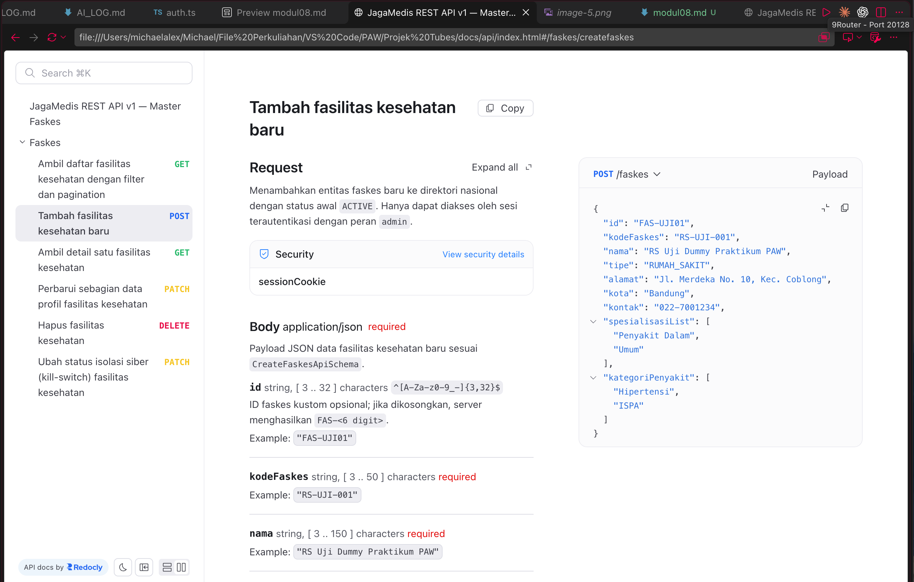
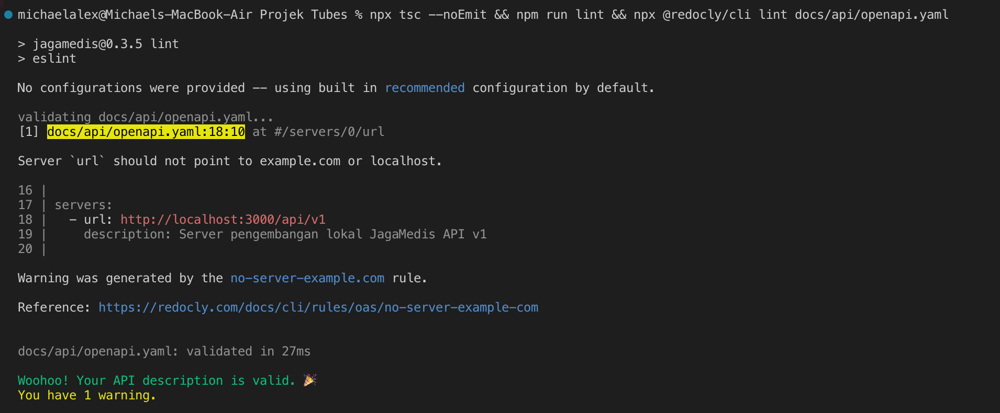
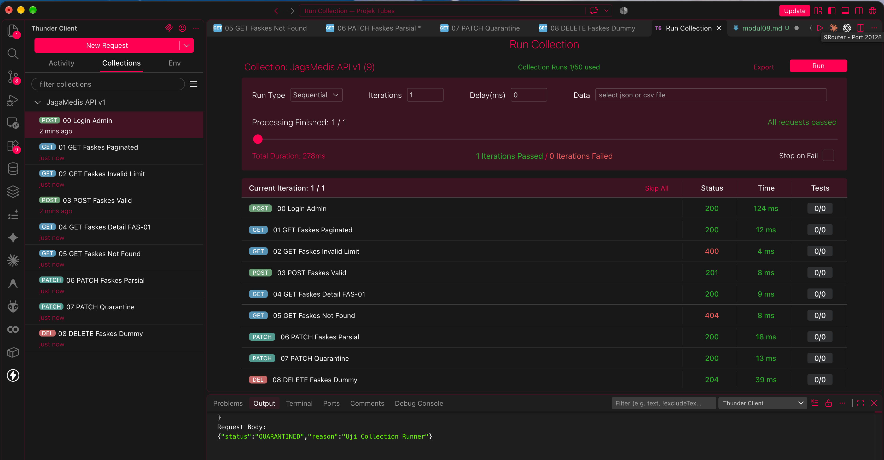

# Dokumen Teknis Modul 8 — RESTful API dengan Route Handlers

- **Nama / NIM** : Michael Alexander Newton (105224017)
- **Repositori** : https://github.com/Axcelion017/Tugas-Besar-CS5-PAW-Kripto-Keamanan-Siber
- **Branch**     : `praktikum/modul-08`
- **Proyek**     : JagaMedis — Hospital Information System (Next.js 16.3.6 App Router, Prisma 7.10.1, PostgreSQL 17, Zod 4.6.7)

---

## 1. Daftar Endpoint

Resource utama yang difokuskan pada Praktikum Modul 8 adalah **Master Fasilitas Pelayanan Kesehatan (`Faskes`, model Prisma `prisma.faskes`)** beserta relasi dokter praktiknya (`Doctor`, `prisma.doctor`). Metode `PUT` sengaja tidak diimplementasikan pada domain ini karena pembaruan profil dan status karantina menggunakan semantik parsial `PATCH`.

Seluruh endpoint berikut merujuk pada spesifikasi kebutuhan di [docs/PAW/kebutuhan.md](../PAW/kebutuhan.md) dan berada di bawah prefix `/api/v1`:

| No | Metode | Path | ID Kebutuhan (`docs/PAW/kebutuhan.md`) | Akses / Peran | Kode Status yang Mungkin |
| :-: | :--- | :--- | :--- | :--- | :--- |
| 1 | `GET` | `/api/v1/faskes` | `UR-P02`, `UR-A03` | Publik (semua peran) | `200`, `400`, `500` |
| 2 | `POST` | `/api/v1/faskes` | `UR-A03` | `admin` (cookie sesi HTTP-Only) | `201` (+ `Location`), `400`, `401`, `403`, `409`, `422`, `500` |
| 3 | `GET` | `/api/v1/faskes/[id]` | `UR-P03` | Publik (semua peran) | `200`, `400`, `404`, `500` |
| 4 | `PATCH` | `/api/v1/faskes/[id]` | `UR-A03` | `admin` (cookie sesi HTTP-Only) | `200`, `400`, `401`, `403`, `404`, `422`, `500` |
| 5 | `DELETE` | `/api/v1/faskes/[id]` | `UR-A03` | `admin` (cookie sesi HTTP-Only) | `204`, `400`, `401`, `403`, `404`, `409`, `500` |
| 6 | `PATCH` | `/api/v1/faskes/[id]/quarantine` | `UR-A03` | `admin` (cookie sesi HTTP-Only) | `200`, `400`, `401`, `403`, `404`, `422`, `500` |

> **Catatan**: Selain 6 endpoint Master Faskes di atas, repositori JagaMedis tetap mempertahankan seluruh endpoint domain lain yang sudah ada di bawah `app/api/v1/` (`appointments`, `medical-records`, `access-grants`, `patients/me/family-members`, `trouble-tickets`) dan endpoint utilitas (`/api/health`, `/api/auth/session`, `/api/sync/outbox`, `/api/attachments`) tanpa merusak fitur maupun form UI lama.

---

## 2. Implementasi Route Handler dan Validasi

### 2.1 Struktur Folder `app/api/v1`

Next.js 16 App Router memetakan setiap berkas `route.ts` di dalam direktori `app/api/v1/` menjadi HTTP Route Handler. Parameter segmen dinamis `[id]` dibaca secara asinkron melalui `await context.params` sesuai konvensi Next.js 16.

```text
app/api/v1/
├── faskes/
│   ├── route.ts                        # GET (koleksi + filter + pagination transaksi), POST (201 + Location)
│   └── [id]/
│       ├── route.ts                    # GET (detail + relasi doctors), PATCH (parsial), DELETE (204 / 409 Restrict)
│       └── quarantine/
│           └── route.ts                # PATCH (Ransomware Kill-Switch ACTIVE <-> QUARANTINED + audit SIEM)
├── appointments/                       # Endpoint kunjungan, check-in, triase, assign-dpjp (fitur eksisting)
├── medical-records/                    # Endpoint RME Zero-Knowledge & addendum immutable (fitur eksisting)
├── access-grants/                      # Endpoint persetujuan izin pasien & revoke (fitur eksisting)
├── patients/me/family-members/         # Endpoint proxy anggota keluarga (fitur eksisting)
└── trouble-tickets/                    # Endpoint tiket kendala sistem (fitur eksisting)
```

### 2.2 Helper Problem Details RFC 9457 (`lib/api/problem.ts`)

Seluruh respons sukses maupun galat pada `/api/v1/*` dikelola secara terpusat di [lib/api/problem.ts](../../lib/api/problem.ts) agar seragam dan mematuhi **RFC 9457 (Problem Details for HTTP APIs)** dengan header wajib `Content-Type: application/problem+json; charset=utf-8`.

Fungsi utama yang disediakan:
- `problemResponse(options)`: Menyusun payload standar `{ type, title, status, detail, instance, errors? }` dengan URI tipe berbasis `https://jagamedis.id/problems/<slug>`.
- `parseJsonObject(request)`: Mem-parse body permintaan secara aman; menolak sintaksis JSON rusak atau tipe non-objek (seperti array atau primitif) dengan HTTP **`400`** (`invalid-json`).
- `zodProblemResponse(error, instance, status)`: Memetakan `ZodError` menjadi array `errors: [{ field, message, code }]` dengan status `400` (untuk kueri) atau `422` (untuk isi body).
- `parseJsonBody(request, schema)`: Helper gabungan yang menjalankan `parseJsonObject` (`400`) lalu validasi isi dengan skema Zod (`422`).
- `parseQueryParams(request, schema, status = 400)`: Membaca `request.nextUrl.searchParams` lalu memvalidasinya dengan skema Zod (mengembalikan HTTP **`400`** bila parameter kueri tidak valid).
- `validatePathId(rawId, resourceLabel, instance, schema)` dan `readPathId(context, ...)`: Membaca `await context.params` lalu memvalidasi format `[id]` sebelum kueri Prisma dijalankan (mengembalikan HTTP **`400`** `invalid-path-param` bila tidak sesuai pola).
- `prismaErrorToProblem(error, instance, resourceLabel)`: Memetakan galat Prisma `P2025` $\rightarrow$ `404`, `P2002` (duplikasi kunci unik) $\rightarrow$ `409`, `P2003` (konflik foreign key) $\rightarrow$ `409`, dan galat tak terduga $\rightarrow$ `500`.
- `jsonOk(data, status, headers)`, `jsonPaginatedOk(data, meta, headers)`, dan `noContentResponse()`: Pembungkus respons `200`/`201`/`204`.

Cuplikan implementasi inti pada [lib/api/problem.ts](../../lib/api/problem.ts):

```typescript
export const PROBLEM_CONTENT_TYPE = "application/problem+json; charset=utf-8";
const PROBLEM_BASE_URI = "https://jagamedis.id/problems";

export function problemResponse(options: ProblemOptions): NextResponse<ProblemDetails> {
  const payload: ProblemDetails = {
    type: `${PROBLEM_BASE_URI}/${options.slug}`,
    title: options.title,
    status: options.status,
    detail: options.detail,
    instance: options.instance,
    ...(options.errors && options.errors.length > 0 ? { errors: options.errors } : {}),
  };

  const headers = new Headers(options.headers);
  headers.set("Content-Type", PROBLEM_CONTENT_TYPE);

  return new NextResponse(JSON.stringify(payload), {
    status: options.status,
    headers,
  }) as NextResponse<ProblemDetails>;
}

export async function parseJsonBody<TSchema extends z.ZodType>(
  request: NextRequest,
  schema: TSchema
) {
  const jsonBody = await parseJsonObject(request);
  if (!jsonBody.ok) return jsonBody;

  const parsed = schema.safeParse(jsonBody.data);
  if (!parsed.success) {
    return {
      ok: false as const,
      response: zodProblemResponse(parsed.error, request.nextUrl.pathname, 422),
    };
  }
  return { ok: true as const, data: parsed.data };
}

export function parseQueryParams<TSchema extends z.ZodType>(
  request: NextRequest,
  schema: TSchema,
  status: 400 | 422 = 400
) {
  const rawQuery: Record<string, string> = {};
  for (const [key, value] of request.nextUrl.searchParams.entries()) {
    rawQuery[key] = value;
  }
  const parsed = schema.safeParse(rawQuery);
  if (!parsed.success) {
    return {
      ok: false as const,
      response: zodProblemResponse(parsed.error, request.nextUrl.pathname, status),
    };
  }
  return { ok: true as const, data: parsed.data };
}
```

### 2.3 Skema Validasi Zod v4 (`lib/validations/api-v1.ts`)

Seluruh validasi kontrak API menggunakan **Zod v4** (parameter pesan seragam `{ message: "..." }`) tanpa mengubah skema form UI eksisting di `lib/validations/{auth,clinical,patient,triage}.ts`:

1. **Parameter Path (`id`)**:
   - Pada skema Prisma [prisma/schema.prisma](../../prisma/schema.prisma), kolom `Faskes.id` bertipe **`String @id @db.VarChar(32)`** (bukan `Int`), sehingga validasi ID menggunakan pola string ketat `^[A-Za-z0-9_-]{3,32}$` pada `FaskesIdSchema` (dan `^[A-Za-z0-9_-]{3,36}$` pada `PathIdSchema` untuk kompatibilitas UUID/ID lintas resource).
2. **Body `POST /api/v1/faskes` (`CreateFaskesApiSchema`)**:
   - Field wajib: `kodeFaskes` (3–50 karakter, unik), `nama` (3–150 karakter), `tipe` (`FaskesTypeEnum`: `RUMAH_SAKIT`, `KLINIK_PRATAMA`, `PUSKESMAS`), `alamat` (5–500 karakter), `kota` (2–100 karakter), dan `kontak` (6–50 karakter).
   - Field opsional/default: `id` (`FaskesIdSchema.optional()`, otomatis `FAS-<6 digit>` jika kosong), `spesialisasiList` (array string maks. 30 item, default `[]`), `kategoriPenyakit` (array string maks. 30 item, default `[]`).
3. **Body `PATCH /api/v1/faskes/[id]` (`UpdateFaskesApiSchema`)**:
   - Seluruh field profil (`nama`, `tipe`, `alamat`, `kota`, `kontak`, `spesialisasiList`, `kategoriPenyakit`) bersifat opsional **tanpa `.default([])`** dan dilengkapi `.refine((data) => Object.values(data).some((v) => v !== undefined))`.
   - Aturan ini memastikan body kosong `{}` selalu ditolak (`422`), sekaligus mencegah pembaruan parsial menimpa array `spesialisasiList`/`kategoriPenyakit` lama dengan array kosong.
4. **Body `PATCH /api/v1/faskes/[id]/quarantine` (`QuarantineFaskesApiSchema`)**:
   - Field `status` wajib bernilai `ACTIVE` atau `QUARANTINED` (`FaskesStatusEnum`), dan `reason` opsional (maks. 500 karakter).
5. **Parameter Kueri `GET /api/v1/faskes` (`FaskesQuerySchema`)**:
   - `page`: string digit positif $\rightarrow$ integer minimal `1` (default `1`).
   - `limit`: string digit positif $\rightarrow$ integer `1..50` (maksimum `50`, default `20`).
   - Filter model `Faskes`: `kota`, `poli` (kecocokan array `spesialisasiList`), `gejala` (kecocokan array `kategoriPenyakit`), `tipe` (`FaskesTypeEnum`), `status` (`FaskesStatusEnum`), serta pencarian teks `q` pada `nama`, `kodeFaskes`, `alamat`, dan `kota`.
   - Kueri koleksi (`findMany`) dan total baris (`count`) dijalankan dalam satu **`prisma.$transaction`** agar `data` dan `meta: { page, limit, total, totalPages }` konsisten secara atomik.

### 2.4 Aturan Pemetaan Hasil ke Kode Status HTTP

| Kode Status | Kondisi Pemetaan pada Route Handler | Content-Type |
| :---: | :--- | :--- |
| **`200 OK`** | Permintaan `GET` koleksi/detail atau `PATCH` profil/karantina berhasil. | `application/json` |
| **`201 Created`** | Pembuatan faskes via `POST` berhasil; menyertakan header `Location: /api/v1/faskes/<id>`. | `application/json` |
| **`204 No Content`** | Penghapusan faskes tanpa relasi aktif via `DELETE` berhasil; body kosong. | *(tanpa body)* |
| **`400 Bad Request`** | Body JSON rusak / bukan objek JSON (`invalid-json`), parameter kueri melanggar skema seperti `limit=51` (`bad-request`), atau format parameter path `[id]` ilegal seperti `/faskes/x` (`invalid-path-param`). | `application/problem+json; charset=utf-8` |
| **`401 Unauthorized`** | Endpoint mutasi dipanggil tanpa cookie sesi `resilio_session_token` yang valid di tabel `sessions`. | `application/problem+json; charset=utf-8` |
| **`403 Forbidden`** | Sesi valid tetapi peran akun bukan `admin` (mis. `pasien` mencoba `POST /api/v1/faskes`); percobaan dicatat ke `security_audit_logs`. | `application/problem+json; charset=utf-8` |
| **`404 Not Found`** | Format ID valid tetapi data faskes tidak ditemukan (`findUnique === null` atau Prisma `P2025`). | `application/problem+json; charset=utf-8` |
| **`409 Conflict`** | Duplikasi kunci unik `kodeFaskes`/`id` pada `POST` (Prisma `P2002`), atau percobaan `DELETE` pada faskes yang masih memiliki relasi aktif dokter/staf/antrean/RME (`onDelete: Restrict` / `P2003`). | `application/problem+json; charset=utf-8` |
| **`422 Unprocessable Entity`** | JSON valid secara sintaksis tetapi melanggar aturan validasi isi Zod (enum tidak dikenal, panjang field kurang, atau body `PATCH` kosong `{}`). | `application/problem+json; charset=utf-8` |
| **`500 Internal Server Error`** | Kegagalan tak terduga pada koneksi basis data atau server. | `application/problem+json; charset=utf-8` |

---

## 3. Format Galat Problem Details

Seluruh contoh di bawah merupakan respons nyata (header dan body) hasil eksekusi `curl -sS -i` terhadap server lokal JagaMedis (`http://localhost:3000`).

### 3.1 Contoh `400 Bad Request` — Parameter Kueri Melanggar Batas (`GET /api/v1/faskes?limit=51`)

```http
HTTP/1.1 400 Bad Request
content-type: application/problem+json; charset=utf-8
X-Content-Type-Options: nosniff
X-Frame-Options: DENY

{
  "type": "https://jagamedis.id/problems/bad-request",
  "title": "Bad Request",
  "status": 400,
  "detail": "Parameter limit maksimal 50.",
  "instance": "/api/v1/faskes",
  "errors": [
    {
      "field": "limit",
      "message": "Parameter limit maksimal 50.",
      "code": "too_big"
    }
  ]
}
```

### 3.2 Contoh `400 Bad Request` — JSON Rusak (`POST /api/v1/faskes` dengan body `'{"nama":"RS JSON Rusak"'`)

```http
HTTP/1.1 400 Bad Request
content-type: application/problem+json; charset=utf-8
X-Content-Type-Options: nosniff
X-Frame-Options: DENY

{
  "type": "https://jagamedis.id/problems/invalid-json",
  "title": "Invalid JSON Body",
  "status": 400,
  "detail": "Body permintaan harus berupa objek JSON yang valid (RFC 8259).",
  "instance": "/api/v1/faskes"
}
```

### 3.3 Contoh `404 Not Found` — ID Tidak Ditemukan (`GET /api/v1/faskes/FAS-999999`)

```http
HTTP/1.1 404 Not Found
content-type: application/problem+json; charset=utf-8
X-Content-Type-Options: nosniff
X-Frame-Options: DENY

{
  "type": "https://jagamedis.id/problems/not-found",
  "title": "Resource Not Found",
  "status": 404,
  "detail": "Faskes dengan ID 'FAS-999999' tidak ditemukan di direktori nasional JagaMedis.",
  "instance": "/api/v1/faskes/FAS-999999"
}
```

### 3.4 Contoh `409 Conflict` — Larangan Hapus Relasi Aktif (`DELETE /api/v1/faskes/FAS-01`)

```http
HTTP/1.1 409 Conflict
content-type: application/problem+json; charset=utf-8
X-Content-Type-Options: nosniff
X-Frame-Options: DENY

{
  "type": "https://jagamedis.id/problems/conflict",
  "title": "Relational Conflict",
  "status": 409,
  "detail": "Faskes 'RSUP Dr. Sardjito' tidak dapat dihapus karena masih memiliki data relasi aktif (2 dokter, 1 staf, 3 antrean, 6 rekam medis). Gunakan PATCH /api/v1/faskes/FAS-01/quarantine untuk isolasi.",
  "instance": "/api/v1/faskes/FAS-01"
}
```

### 3.5 Contoh `422 Unprocessable Entity` — Validasi Isi Body Gagal (`POST /api/v1/faskes`)

```http
HTTP/1.1 422 Unprocessable Entity
content-type: application/problem+json; charset=utf-8
X-Content-Type-Options: nosniff
X-Frame-Options: DENY

{
  "type": "https://jagamedis.id/problems/validation-error",
  "title": "Unprocessable Entity",
  "status": 422,
  "detail": "Kode faskes minimal 3 karakter.",
  "instance": "/api/v1/faskes",
  "errors": [
    {
      "field": "kodeFaskes",
      "message": "Kode faskes minimal 3 karakter.",
      "code": "too_small"
    },
    {
      "field": "nama",
      "message": "Nama faskes minimal 3 karakter.",
      "code": "too_small"
    },
    {
      "field": "tipe",
      "message": "Tipe faskes harus salah satu dari RUMAH_SAKIT, KLINIK_PRATAMA, atau PUSKESMAS.",
      "code": "invalid_value"
    },
    {
      "field": "alamat",
      "message": "Alamat minimal 5 karakter.",
      "code": "too_small"
    },
    {
      "field": "kota",
      "message": "Nama kota minimal 2 karakter.",
      "code": "too_small"
    },
    {
      "field": "kontak",
      "message": "Kontak minimal 6 karakter.",
      "code": "too_small"
    }
  ]
}
```

---

## 4. Spesifikasi OpenAPI

### 4.1 Berkas Spesifikasi dan Dokumentasi HTML
- **Spesifikasi OpenAPI 3.1.0**: [docs/api/openapi.yaml](../api/openapi.yaml)
- **Bundel Dokumentasi Interaktif (Redoc)**: [docs/api/index.html](../api/index.html) (dibangun menggunakan `npx @redocly/cli build-docs docs/api/openapi.yaml -o docs/api/index.html`, ukuran `307 KiB`).
- Spesifikasi mencakup server lokal `http://localhost:3000/api/v1`, `security: []` di root (dengan `sessionCookie` pada operasi mutasi), `summary` dan `operationId` unik untuk 6 operasi (`listFaskes`, `createFaskes`, `getFaskesById`, `updateFaskes`, `deleteFaskes`, `quarantineFaskes`), serta komponen `$ref` penuh tanpa komponen tak terpakai.

### 4.2 Keluaran `npx @redocly/cli lint docs/api/openapi.yaml`

Pengujian statis (`npx tsc --noEmit`, `npm run lint`, dan `npx @redocly/cli lint docs/api/openapi.yaml`) dijalankan di terminal lokal tanpa galat:

```text
No configurations were provided -- using built in recommended configuration by default.

validating docs/api/openapi.yaml...
[1] docs/api/openapi.yaml:18:10 at #/servers/0/url

Server `url` should not point to example.com or localhost.

16 |
17 | servers:
18 |   - url: http://localhost:3000/api/v1
19 |     description: Server pengembangan lokal JagaMedis API v1
20 |

Warning was generated by the no-server-example.com rule.

docs/api/openapi.yaml: validated in 27ms

Woohoo! Your API description is valid.
You have 1 warning.
```

> **Catatan**: Satu peringatan `no-server-example.com` bersifat non-blocking (`0 error`) karena spesifikasi praktikum mensyaratkan URL server lokal `http://localhost:3000/api/v1`.

### 4.3 Selisih yang Ditemukan antara Spesifikasi dan Kode serta Perbaikannya

| No | Temuan Selisih | Dampak | Perbaikan yang Diterapkan |
| :-: | :--- | :--- | :--- |
| 1 | `GET /api/v1/faskes` sebelumnya hanya memvalidasi parameter `status` (dengan status `422`), belum memiliki pagination `page`/`limit`, dan belum menghitung `meta.total`. | Parameter kueri tidak konsisten dengan spesifikasi paginasi dan kode status `400`. | Menambahkan `FaskesQuerySchema`, mengganti parsing manual dengan `parseQueryParams(request, FaskesQuerySchema, 400)`, serta membungkus `findMany` + `count` dalam `prisma.$transaction` untuk mengembalikan `{ data, meta }`. |
| 2 | `UpdateFaskesApiSchema` sebelumnya memakai `CreateFaskesApiSchema.omit(...).partial()`, sehingga field `spesialisasiList` dan `kategoriPenyakit` yang memiliki `.default([])` berisiko ikut terisi `[]`. | Body kosong `{}` bisa lolos validasi dan `PATCH` parsial dapat menimpa daftar spesialisasi/kategori penyakit yang sudah ada. | Menulis ulang `UpdateFaskesApiSchema` dengan field opsional eksplisit tanpa `.default([])` dan `.refine((data) => Object.values(data).some((v) => v !== undefined))`. Terverifikasi pada `TC-13` (`422`) dan `TC-14` (`spesialisasiList` tetap utuh). |
| 3 | Dua deskripsi di draf awal `docs/api/openapi.yaml` (baris `FaskesIdPath` dan `ConflictProblem`) mengandung tanda `: ` tanpa kutip di dalam skalar YAML. | Gagal di-parse (`YAMLException: bad indentation of a mapping entry`) saat divalidasi parser `js-yaml`. | Mengubah kedua deskripsi ke format *folded block scalar* (`>-`), lalu memverifikasi ulang hingga `YAML_VALID: true`, `MISSING_REFS: []`, `UNUSED_COMPONENTS: []`, dan lulus Redocly lint (`0 error`). |
| 4 | Perbedaan struktur respons antara `GET /faskes/{id}` (menyertakan relasi `doctors`) dengan `POST /faskes` dan `PATCH /faskes/{id}` (tanpa array `doctors`), serta field `reason` bernilai `string \| null` pada `/quarantine`. | Skema respons bisa tidak cocok jika semuanya merujuk satu skema yang sama atau memakai `nullable: true` (sintaksis OpenAPI 3.0). | Memisahkan `FaskesSingleResponse` (`Faskes`) dan `FaskesDetailResponse` (`FaskesWithDoctors`), serta memakai `type: ["string", "null"]` sesuai standar OpenAPI 3.1.0. |

---

## 5. Hasil Pengujian Manual

Pengujian dijalankan langsung terhadap server lokal `http://localhost:3000` dengan basis data dummy PostgreSQL lokal `resilio_health` (berisi 4 data faskes seed: `FAS-01` s.d. `FAS-04`). Untuk skenario mutasi, sesi autentikasi diperoleh terlebih dahulu melalui `POST /api/auth/session` dan disimpan dalam cookie jar lokal (`/tmp/cookies-admin.txt` untuk peran `admin` dan `/tmp/cookies-pasien.txt` untuk peran `pasien`). Data uji dummy `FAS-UJI08` dihapus kembali pada kasus terakhir (`TC-17`) agar basis data tetap bersih.

### 5.1 Tabel Hasil 17 Kasus Uji Manual (`curl -sS -i`)

| No | Kode | Permintaan | Status Harapan | Status Aktual | Lulus / Gagal |
| :-: | :--- | :--- | :--- | :--- | :---: |
| 1 | **TC-01** | `GET /api/v1/faskes?page=1&limit=2` | `200 OK` (`data` maks. 2, `meta.total >= 4`) | `200 OK` (`data`: `FAS-03`, `FAS-04`; `meta: { page: 1, limit: 2, total: 4, totalPages: 2 }`) | **Lulus** |
| 2 | **TC-02** | `GET /api/v1/faskes?kota=Sleman&tipe=RUMAH_SAKIT&status=ACTIVE` | `200 OK` (memuat `FAS-02`) | `200 OK` (`data`: `[FAS-02 RS Harapan Sehat]`, `meta.total: 1`) | **Lulus** |
| 3 | **TC-03** | `GET /api/v1/faskes?limit=51` | `400 Bad Request` (`application/problem+json`) | `400 Bad Request` (`application/problem+json; charset=utf-8`, `errors[0].field: "limit"`) | **Lulus** |
| 4 | **TC-04** | `POST /api/v1/faskes` (tanpa cookie sesi) | `401 Unauthorized` (`application/problem+json`) | `401 Unauthorized` (`type: .../unauthorized`) | **Lulus** |
| 5 | **TC-05** | `POST /api/v1/faskes` (cookie peran `pasien`) | `403 Forbidden` (`application/problem+json`) | `403 Forbidden` (`type: .../forbidden`) | **Lulus** |
| 6 | **TC-06** | `POST /api/v1/faskes` (admin, body JSON rusak `'{"nama":"RS JSON Rusak"'`) | `400 Bad Request` (`invalid-json`) | `400 Bad Request` (`type: .../invalid-json`) | **Lulus** |
| 7 | **TC-07** | `POST /api/v1/faskes` (admin, isi invalid: `tipe: "APOTEK"`, field pendek) | `422 Unprocessable Entity` (`validation-error`) | `422 Unprocessable Entity` (`type: .../validation-error`, 6 item `errors[]`) | **Lulus** |
| 8 | **TC-08** | `POST /api/v1/faskes` (admin, payload valid `FAS-UJI08` / `RS-UJI-MOD08`) | `201 Created` + header `Location` | `201 Created`, `location: /api/v1/faskes/FAS-UJI08`, `data.status: "ACTIVE"` | **Lulus** |
| 9 | **TC-09** | `POST /api/v1/faskes` (admin, duplikat `kodeFaskes: "RS-SARDJITO-001"`) | `409 Conflict` (`conflict`) | `409 Conflict` (`type: .../conflict`) | **Lulus** |
| 10 | **TC-10** | `GET /api/v1/faskes/FAS-01` | `200 OK` (detail + array `doctors`) | `200 OK` (`id: "FAS-01"`, `doctors`: `DOC-01` & `DOC-04`) | **Lulus** |
| 11 | **TC-11** | `GET /api/v1/faskes/x` (path ID < 3 karakter) | `400 Bad Request` (`invalid-path-param`) | `400 Bad Request` (`type: .../invalid-path-param`) | **Lulus** |
| 12 | **TC-12** | `GET /api/v1/faskes/FAS-999999` (ID tidak ada di DB) | `404 Not Found` (`not-found`) | `404 Not Found` (`type: .../not-found`) | **Lulus** |
| 13 | **TC-13** | `PATCH /api/v1/faskes/FAS-UJI08` (admin, body `{}` kosong) | `422 Unprocessable Entity` (minimal 1 field) | `422 Unprocessable Entity` (`detail: "Minimal satu field harus disertakan..."`) | **Lulus** |
| 14 | **TC-14** | `PATCH /api/v1/faskes/FAS-UJI08` (admin, ubah `nama` & `kontak`) | `200 OK` (field lain tetap utuh) | `200 OK` (`nama` & `kontak` diperbarui; `spesialisasiList` & `kategoriPenyakit` utuh) | **Lulus** |
| 15 | **TC-15** | `PATCH /api/v1/faskes/FAS-UJI08/quarantine` (admin, `status: "QUARANTINED"`) | `200 OK` (`status: "QUARANTINED"`) | `200 OK` (`status: "QUARANTINED"`, `reason: "Simulasi isolasi Modul 8"`) | **Lulus** |
| 16 | **TC-16** | `DELETE /api/v1/faskes/FAS-01` (admin, masih memiliki relasi aktif) | `409 Conflict` (`onDelete: Restrict`) | `409 Conflict` (2 dokter, 1 staf, 3 antrean, 6 rekam medis) | **Lulus** |
| 17 | **TC-17** | `DELETE /api/v1/faskes/FAS-UJI08` (admin, faskes dummy tanpa relasi) | `204 No Content` (body kosong) | `204 No Content` (body kosong) | **Lulus** |

### 5.2 Persentase Kasus Lulus
- **Jumlah kasus lulus**: **17 dari 17 kasus (`100%`)** — memenuhi syarat minimal 12 kasus uji dan melampaui target kelulusan minimal `90%`.

### 5.3 Bukti Keluaran `curl -sS -i` (Siklus Lengkap CRUD + Karantina)

#### 1) `GET` Koleksi dengan Paginasi & Transaksi (`TC-01`)
```http
HTTP/1.1 200 OK
content-type: application/json
Date: Fri, 27 Nov 2026 08:57:01 GMT

{"data":[{"id":"FAS-03","kodeFaskes":"KLN-PRATAMA-003","nama":"Klinik Pratama Sehat Mandiri","tipe":"KLINIK_PRATAMA","alamat":"Jl. Gejayan No. 45, Condongcatur, Depok","kota":"Sleman","kontak":"(0274) 556789","spesialisasiList":["Dokter Umum","Kesehatan Gigi & Mulut","Kesehatan Ibu & Anak"],"kategoriPenyakit":["Demam","Flu & Batuk","Gigi & Mulut","Gastritis","ISPA"],"status":"ACTIVE","createdAt":"2026-10-30T08:34:00.093Z","doctors":[{"id":"DOC-03","name":"dr. Sarah Sp.A","specialty":"Spesialis Anak","kuotaHarian":25,"strNumber":"31.1.2.300.2.20.789012","sipNumber":"446/SIP-D/2022/003","isActive":true}]},{"id":"FAS-04","kodeFaskes":"PUSK-MLATI-004","nama":"Puskesmas Mlati 1","tipe":"PUSKESMAS","alamat":"Jl. Magelang KM 7, Mlati","kota":"Sleman","kontak":"(0274) 868400","spesialisasiList":["Pelayanan Umum","Poli Gizi","Poli Imunisasi"],"kategoriPenyakit":["ISPA","Stunting & Gizi","Imunisasi","Pemeriksaan Rutin"],"status":"ACTIVE","createdAt":"2026-10-30T08:34:00.094Z","doctors":[]}],"meta":{"page":1,"limit":2,"total":4,"totalPages":2}}
```

#### 2) `POST` Pembuatan Faskes Baru — `201 Created` + Header `Location` (`TC-08`)
```http
HTTP/1.1 201 Created
content-type: application/json
location: /api/v1/faskes/FAS-UJI08
Date: Fri, 27 Nov 2026 09:08:13 GMT

{"data":{"id":"FAS-UJI08","kodeFaskes":"RS-UJI-MOD08","nama":"RS Uji Dummy Modul 8","tipe":"RUMAH_SAKIT","alamat":"Jl. Merdeka No. 10 Coblong","kota":"Bandung","kontak":"022-7001234","spesialisasiList":["Penyakit Dalam","Umum"],"kategoriPenyakit":["Hipertensi","ISPA"],"status":"ACTIVE","createdAt":"2026-11-27T09:08:13.244Z"}}
```


#### 3) `PATCH` Pembaruan Parsial — `200 OK` (`TC-14`)
```http
HTTP/1.1 200 OK
content-type: application/json
Date: Fri, 27 Nov 2026 09:08:19 GMT

{"data":{"id":"FAS-UJI08","kodeFaskes":"RS-UJI-MOD08","nama":"RS Uji Dummy Modul 8 (Revisi)","tipe":"RUMAH_SAKIT","alamat":"Jl. Merdeka No. 10 Coblong","kota":"Bandung","kontak":"022-7009999","spesialisasiList":["Penyakit Dalam","Umum"],"kategoriPenyakit":["Hipertensi","ISPA"],"status":"ACTIVE","createdAt":"2026-11-27T09:08:13.244Z"}}
```

#### 4) `PATCH` Isolasi Karantina (`TC-15`) & `DELETE` Bersih — `204 No Content` (`TC-17`)
```http
HTTP/1.1 200 OK
content-type: application/json
Date: Fri, 27 Nov 2026 09:08:19 GMT

{"data":{"id":"FAS-UJI08","nama":"RS Uji Dummy Modul 8 (Revisi)","status":"QUARANTINED","reason":"Simulasi isolasi Modul 8"}}
```

```http
HTTP/1.1 204 No Content
Date: Fri, 27 Nov 2026 09:08:19 GMT
```







---

## 6. Keputusan Teknis dan Kendala

### 6.1 Pemisahan Kode Status `400 Bad Request` vs `422 Unprocessable Entity`
- **`400 Bad Request`** digunakan ketika permintaan gagal di lapisan sintaksis atau struktur URL sebelum evaluasi aturan domain: body bukan JSON valid (RFC 8259), body bukan objek JSON, format parameter path `[id]` tidak valid (`/faskes/x`), atau parameter kueri tidak valid (`?limit=51`).
- **`422 Unprocessable Entity`** digunakan ketika body JSON berhasil di-parse secara sintaksis, tetapi nilainya melanggar kontrak validasi domain pada skema Zod (misalnya `tipe: "APOTEK"` di luar enum `FaskesType`, panjang `kodeFaskes` < 3 karakter, atau body `PATCH` kosong `{}`). Pemisahan ini memudahkan klien membedakan galat format permintaan dari galat isian formulir/field.

### 6.2 Penolakan `409 Conflict` pada `DELETE`
- Di skema Prisma [prisma/schema.prisma](../../prisma/schema.prisma), relasi `Doctor`, `StaffMember`, `Appointment`, dan `MedicalRecord` terhadap `Faskes` menggunakan aturan **`onDelete: Restrict`** demi kepatuhan integritas rekam medis (Permenkes No. 24/2022).
- Oleh karena itu, `DELETE /api/v1/faskes/[id]` secara eksplisit memeriksa jumlah relasi aktif (`_count`) sebelum memanggil `prisma.faskes.delete`, dan mengembalikan **`409 Conflict`** dengan rincian jumlah relasi aktif serta arahan untuk menggunakan mekanisme isolasi non-destruktif `PATCH /api/v1/faskes/{id}/quarantine`.

### 6.3 Batas Maksimum Paginasi (`limit <= 50`) dan Transaksi Atomik
- Parameter `limit` dibatasi ketat pada rentang `1..50` (default `20`) di `FaskesQuerySchema`. Pembatasan ini mencegah klien meminta ribuan baris sekaligus beserta relasi `doctors` dalam satu kueri (mitigasi konsumsi memori berlebih dan *denial-of-service*).
- Pengambilan daftar (`findMany`) dan penghitungan total (`count`) dijalankan dalam satu `prisma.$transaction` agar nilai `meta.total` dan `meta.totalPages` selalu sinkron dengan halaman `data` yang dikembalikan.

### 6.4 Kendala yang Dihadapi Selama Pelaksanaan
1. **Autentikasi Cookie HTTP-Only pada Pengujian CLI (`curl`)**: Karena endpoint mutasi dilindungi `requireApiSession()` berbasis sesi PostgreSQL (`resilio_session_token`), pengujian `curl` awal tanpa login aktif sempat mengembalikan `401 Unauthorized`. Masalah teratasi setelah memperoleh cookie melalui `POST /api/auth/session` ke `/tmp/cookies-admin.txt` dan `/tmp/cookies-pasien.txt`.
2. **Pemotongan Baris (*Line-Wrap*) & Indentasi *Heredoc* pada `zsh`**: Saat menyalin payload JSON panjang satu baris dan blok `<<'EOF'` ke terminal `zsh`, karakter *newline* di tengah string sempat memicu `400 Invalid JSON Body` dan *heredoc* menggantung karena `EOF` ter-indentasi. Masalah diatasi dengan format JSON multi-baris pendek di dalam argumen `-d '...'`.
3. **Kesesuaian Mock Unit Test Lama**: Penambahan `tx.faskes.count` di dalam transaksi pada `GET /api/v1/faskes` membuat berkas uji mock lama (`tests/v035-rest-api-v1.test.ts`) perlu diperbarui dengan mock `faskes.count` pada sesi pengujian unit berikutnya (tidak diubah pada tahap ini agar lingkup perubahan tetap terkendali).

---

## 7. Catatan Pemanfaatan AI

- **Alat yang digunakan**: Antigravity (Google Gemini coding assistant).
- **Perintah utama yang diberikan**:
  1. Inspeksi *read-only* repositori untuk memetakan model Prisma, relasi, skema Zod, helper RFC 9457, dan memilih kandidat resource utama (`Faskes` + relasi `Doctor`).
  2. Melengkapi skema validasi Zod v4 (`FaskesIdSchema`, `FaskesQuerySchema`, `FaskesDoctorsQuerySchema`, perbaikan `UpdateFaskesApiSchema`) dan helper RFC 9457 (`readPathId`, `parseJsonBody`, `parseQueryParams`, `jsonPaginatedOk`).
  3. Memperbarui `app/api/v1/faskes/route.ts` untuk validasi query Zod, filter sesuai model, serta paginasi + `meta.total` melalui `prisma.$transaction`.
  4. Menyusun spesifikasi OpenAPI 3.1.0 di `docs/api/openapi.yaml` sesuai implementasi aktual tanpa mengarang kontrak.
  5. Menyusun 17 skenario uji manual `curl` dan 8 skenario Bruno/Thunder Client, serta merangkum hasil uji nyata ke `docs/praktikum/modul08.md`.
- **Bagian yang digunakan**: Perubahan kode pada [lib/validations/api-v1.ts](../../lib/validations/api-v1.ts), [lib/api/problem.ts](../../lib/api/problem.ts), [app/api/v1/faskes/route.ts](../../app/api/v1/faskes/route.ts), spesifikasi [docs/api/openapi.yaml](../api/openapi.yaml), dan penyusunan draf laporan [docs/praktikum/modul08.md](modul08.md).
- **Cara memverifikasi**:
  1. Membaca ulang seluruh perubahan kode dan mencocokkan nama model, field, enum, dan kode status dengan `prisma/schema.prisma` serta route handler aktual.
  2. Menjalankan pengecekan tipe dan linter secara mandiri (`npx tsc --noEmit` dan `npm run lint`) — lulus tanpa error.
  3. Menjalankan validasi dan build OpenAPI secara mandiri (`npx @redocly/cli lint docs/api/openapi.yaml` dan `npx @redocly/cli build-docs docs/api/openapi.yaml -o docs/api/index.html`) — valid `0 error`.
  4. Mengeksekusi sendiri seluruh 17 kasus uji `curl -sS -i` terhadap server Next.js dan database PostgreSQL dummy lokal hingga mencapai 17/17 lulus (`100%`), serta memverifikasi tidak ada data pribadi atau kredensial yang terekspos di dokumen.
