# Data Flow Diagram (DFD) — Resilio-Health

Dokumen ini memetakan arsitektur aliran data, batas kepercayaan (*Trust Boundaries*), proses komputasi, dan penyimpanan data pada sistem Resilio-Health sesuai ketentuan Tugas 1 Keamanan Komputasi dan Siber (Penanda `sec-0.1` dan `sec-0.2`).

---

## 1. Katalog Elemen Diagram Alir Data

### 1.1 Entitas Eksternal (*External Entities*)
| ID Entitas | Nama Entitas | Deskripsi Peran & Hak Akses |
| :--- | :--- | :--- |
| **EXT-01** | **Pasien (Patient)** | Pemilik sah data medis yang mengontrol izin akses (*Consent*), mencari faskes, memesan jadwal, dan mendekripsi rekam medis pribadi via kunci privat. |
| **EXT-02** | **Tenaga Kesehatan (Dokter/Perawat)** | Tenaga medis berlisensi (STR/SIP) yang memeriksa pasien, menginput data SOAP, menerbitkan rujukan, dan mengoperasikan sistem baik saat *online* maupun *offline*. |
| **EXT-03** | **Admin Regulator (Kemenkes)** | Pengawas sistem yang memvalidasi identitas kependudukan (KYC), lisensi dokter (KYD), memantau log SIEM, dan mengaktifkan saklar darurat *kill-switch* isolasi faskes. |

### 1.2 Proses Komputasi (*Processes*)
| ID Proses | Nama Proses | Deskripsi Operasi |
| :--- | :--- | :--- |
| **PRC-01** | **KYC & KYD Identity Verification Gateway** | Memvalidasi keaslian dokumen NIK/KTP pasien dan lisensi STR/SIP dokter sebelum status akun diaktifkan. |
| **PRC-02** | **Zero-Trust BOLA / IDOR Gatekeeper** | Memeriksa kepemilikan data dan keabsahan tiket izin akses aktif (`access_grants`) sebelum mengembalikan rekam medis pasien. Akses tanpa izin diblokir 403 Forbidden. |
| **PRC-03** | **SOAP Clinical & Client Encryption Engine** | Memvalidasi input SOAP (ICD-10, vital signs), membangkitkan IV 96-bit (CSPRNG), mengenkripsi payload via AES-256-GCM, dan membuat digest HMAC-SHA256 di browser. |
| **PRC-04** | **Decryption & HMAC Integrity Verifier** | Memverifikasi keutuhan ciphertext via HMAC-SHA256 (Fail-Closed) dan mendekripsi plaintext klinis hanya di browser pasien/dokter berizin. |
| **PRC-05** | **Offline Queue & Background Sync Manager** | Menangkap kegagalan jaringan via Service Worker, mengantrekan ciphertext terenkripsi di IndexedDB, dan mengirimkannya ke server saat online. |
| **PRC-06** | **SIEM Logger & Faskes Kill-Switch Engine** | Mencatat log keamanan (IDOR, HMAC failure, login) dan mengeksekusi karantina faskes untuk mengisolasi faskes yang terinfeksi ransomware. |

### 1.3 Penyimpanan Data (*Data Stores*)
| ID Penyimpanan | Nama Penyimpanan | Tipe Media | Klasifikasi Data & Proteksi |
| :--- | :--- | :--- | :--- |
| **DS-01** | `resilio_records` | Basis Data Server / PostgreSQL | **Sangat Rahasia [TERENKRIPSI]** Hanya menyimpan ciphertext AES-256-GCM, IV heksadesimal, HMAC digest, dan metadata ICD-10 (Zero-Knowledge Admin). |
| **DS-02** | `resilio_patients` & `appointments` | Basis Data Server / PostgreSQL | **Internal Terbatas** Menyimpan data identitas pasien, NIK, golongan darah, riwayat alergi, dan jadwal antrean. |
| **DS-03** | `resilio_access_grants` | Basis Data Server / PostgreSQL | **Rahasia** Tabel relasi izin akses medis aktif antara pasien dan dokter/faskes (pondasi pertahanan BOLA/IDOR). |
| **DS-04** | `resilio_offline_queue` | IndexedDB Browser Lokal | **Sangat Rahasia [TERENKRIPSI]** Antrean data rekam medis terenkripsi yang disimpan lokal di komputer klinik saat offline mode. |
| **DS-05** | `resilio_security_logs` & `faskes` | Storage / SIEM Stream | **Internal Kritis** Jejak audit keamanan sistem, anomali serangan IDOR, dan status isolasi faskes (`ACTIVE` / `QUARANTINED`). |

### 1.4 Batas Kepercayaan (*Trust Boundaries*)
| ID Boundary | Nama Batas Kepercayaan | Deskripsi Garis Demarkasi |
| :--- | :--- | :--- |
| **TB-1** | **User-to-Client Interface Boundary** | Memisahkan pengguna fisik di luar browser dengan runtime antarmuka React/Next.js. Rentan terhadap masukan berbahaya (XSS / malformed data). |
| **TB-2** | **Memory-to-Local Storage Boundary** | Memisahkan memori aplikasi terpercaya dengan media penyimpanan browser (`localStorage` / `IndexedDB`). **Data rekam medis wajib dalam bentuk Ciphertext + HMAC**. |
| **TB-3** | **Client-to-Server Network Boundary** | Jalur transmisi internet/LAN faskes ke server pusat cloud. Rentan terhadap Man-in-the-Middle (MitM) dan pemadaman jaringan (*Downtime*). |

---

## 2. Diagram Alir Data (DFD Visual — Mermaid)

```mermaid
flowchart TD
    %% Entitas Eksternal
    subgraph External_Entities ["Entitas Eksternal (Untrusted Zone)"]
        EXT01["EXT-01: Pasien"]
        EXT02["EXT-02: Tenaga Kesehatan / Dokter"]
        EXT03["EXT-03: Admin Regulator Kemenkes"]
    end

    %% Trust Boundary 1
    TB1{{"=== TB-1: User-to-Client Interface Boundary ==="}}

    %% Trusted Client Runtime
    subgraph Trusted_Client_Runtime ["Aplikasi Web Klien (Trusted Runtime Zone)"]
        PRC01["PRC-01: KYC/KYD Identity Verifier"]
        PRC02["PRC-02: Zero-Trust BOLA/IDOR Gate"]
        PRC03["PRC-03: SOAP & Client Crypto Engine\n(AES-256-GCM + HMAC-SHA256)"]
        PRC04["PRC-04: Decryption & HMAC Verifier"]
        PRC05["PRC-05: Offline Queue & Sync Manager"]
        PRC06["PRC-06: SIEM Logger & Kill-Switch"]
    end

    %% Trust Boundary 2 & 3
    TB2{{"=== TB-2: Memory-to-Local Storage Boundary (IndexedDB) ==="}}
    TB3{{"=== TB-3: Client-to-Server Network Boundary (REST API) ==="}}

    %% Data Stores
    subgraph Storage_Zone ["Penyimpanan Data Server & Lokal"]
        DS01[("DS-01: resilio_records\n[Zero-Knowledge Ciphertext + HMAC]")]
        DS02[("DS-02: patients & appointments\n(Data Identitas & Antrean)")]
        DS03[("DS-03: access_grants\n(Consent Tickets & Revoke)")]
        DS04[("DS-04: resilio_offline_queue\n(IndexedDB Antrean Offline)")]
        DS05[("DS-05: security_logs & faskes\n(SIEM Events & Kill-Switch)")]
    end

    %% Alur Pasien
    EXT01 -->|"Registrasi NIK & Unggah KTP"| TB1
    TB1 -->|"Verifikasi KYC"| PRC01
    PRC01 -->|"Update Akun Terverifikasi"| DS02
    EXT01 -->|"Booking & Auto-Consent"| TB1
    TB1 -->|"Terbitkan Tiket Akses"| DS03
    EXT01 -->|"Request Rekam Medis Pribadi"| TB1
    TB1 -->|"Kunci Pasien + Dekripsi"| PRC04
    DS01 -->|"Ambil Ciphertext + HMAC"| TB3
    TB3 -->|"Verifikasi HMAC & Dekripsi Klien"| PRC04
    PRC04 -->|"Plaintext SOAP Terdekripsi"| EXT01

    %% Alur Dokter (Nakes)
    EXT02 -->|"Cari Pasien NIK"| TB1
    TB1 -->|"Cek Relasi Izin (Anti-IDOR)"| PRC02
    PRC02 -.->|"Validasi Consent Aktif"| DS03
    PRC02 -->|"Jika Ilegal: Blokir 403 & Log SIEM"| PRC06
    PRC06 -->|"Catat Anomali IDOR"| DS05
    EXT02 -->|"Input SOAP & ICD-10"| TB1
    TB1 -->|"Enkripsi AES-GCM + Sign HMAC"| PRC03
    PRC03 -->|"Jika Offline: Simpan ke Antrean Lokal"| TB2
    TB2 -->|"Antrean Offline"| DS04
    PRC03 -->|"Jika Online: Kirim Ciphertext"| TB3
    TB3 -->|"Simpan RME Terenkripsi"| DS01

    %% Alur Admin
    EXT03 -->|"Validasi Berkas STR/SIP Dokter"| TB1
    TB1 -->|"Aktivasi Akun Dokter (KYD)"| PRC01
    EXT03 -->|"Monitor Live SIEM Log"| TB1
    TB1 -->|"Ambil Audit Trail"| DS05
    EXT03 -->|"Aktivasi Kill-Switch Faskes"| TB1
    TB1 -->|"Karantina Jaringan Faskes"| PRC06
    PRC06 -->|"Update Status Faskes QUARANTINED"| DS05

    %% Styling
    classDef cryptoProtected fill:#dcfce7,stroke:#16a34a,stroke-width:2px;
    classDef boundary fill:#fee2e2,stroke:#dc2626,stroke-width:2px,stroke-dasharray: 5 5;
    class DS01,DS04 cryptoProtected;
    class TB1,TB2,TB3 boundary;
```

---

## 3. Titik Penegakan Keamanan Kriptografi (*Enforcement Points*)

1. **Titik Enkripsi Sisi Klien (Enforcement Point 1 — PRC-03)**:
   - Terjadi di browser dokter sebelum data klinis menembus `TB-2` (ke IndexedDB) atau `TB-3` (ke server pusat).
   - Menggunakan AES-256-GCM dengan pembangkitan IV baru per rekam medis melalui CSPRNG `window.crypto.getRandomValues()`.
2. **Titik Integritas Data (Enforcement Point 2 — PRC-03 & PRC-04)**:
   - Tag HMAC-SHA256 dihitung langsung atas string ciphertext.
   - Saat pembacaan data di PRC-04, tag dihitung ulang dan dicocokkan; jika terdapat perbedaan sekecil 1 bit, proses dekripsi langsung dibatalkan (*Fail-Closed*).
3. **Titik Pertahanan BOLA / IDOR (Enforcement Point 3 — PRC-02)**:
   - Terjadi di pintu gerbang pemanggilan API data pasien.
   - Gateway secara atomik memeriksa tabel `access_grants`; jika tidak ditemukan tiket izin aktif yang cocok dengan ID dokter, sistem menolak pengembalian ciphertext dan mengirim notifikasi alert ke SIEM.
4. **Titik Karantina Faskes (Enforcement Point 4 — PRC-06)**:
   - Berfungsi sebagai saklar pembeku (*Kill-Switch*) yang memutus seluruh komunikasi API dari faskes yang terinfeksi ransomware.
