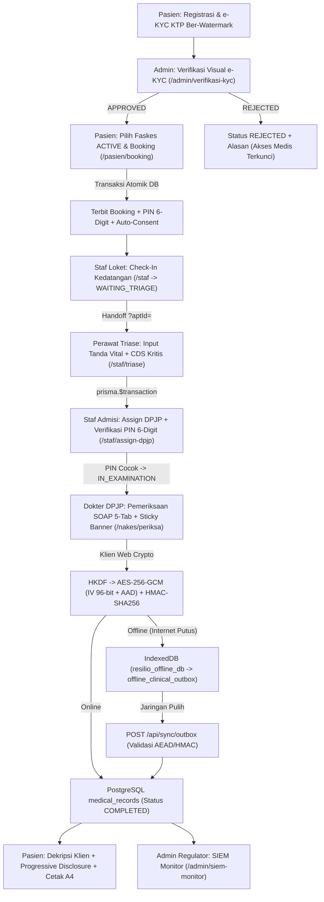
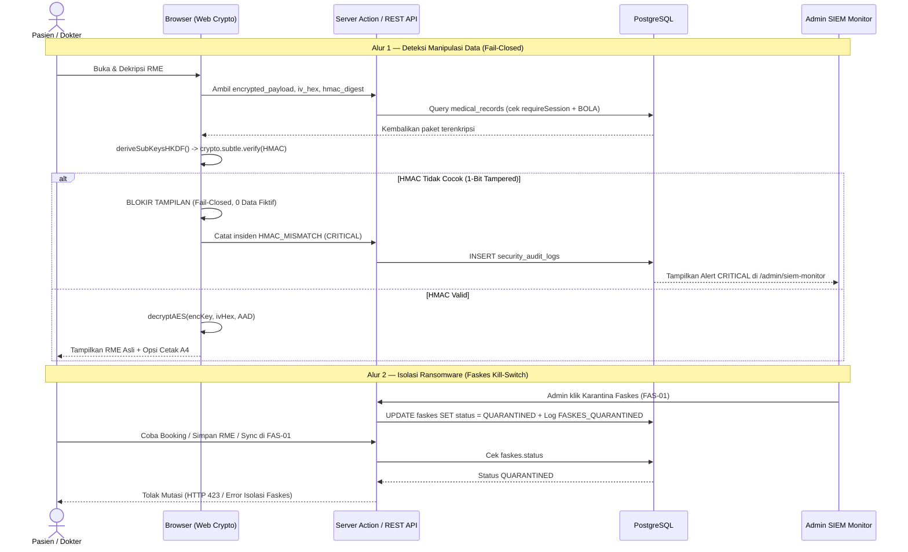

# Panduan Simulasi Penggunaan Aplikasi, Diagram Alur & SOP Penanganan — JagaMedis `v0.3`

> **Metadata Dokumen**
> - **Proyek**: JagaMedis (sebelumnya Resilio-Health) — Cryptographic Offline-First HIS & RME
> - **Versi Basis Kode**: **`v0.3.4`** (Milestone `v0.2` $\rightarrow$ `v0.3`)
> - **Tanggal Berlaku**: 26 November 2026
> - **Cakupan Dokumen**:
>   1. **Bagian A**: Panduan Simulasi Penggunaan Aplikasi *End-to-End* (5 Skenario Operasional & Pengujian Keamanan).
>   2. **Bagian B**: Diagram Alur Sistem & Penanganan Insiden (Mermaid).
>   3. **Bagian C**: Standar Operasional Prosedur (SOP) Resmi Operasional & Penanganan Insiden (`SOP-JM-01` s.d. `SOP-JM-07`).
> - **Dokumen Acuan Terkait**:
>   - Matriks Standar Acuan: [matriks_standar_acuan_v0.3.md](../standar/matriks_standar_acuan_v0.3.md)
>   - Laporan Audit Ulang Menyeluruh: [audit_ulang_menyeluruh_v0.3_26Nov2026.md](../audit/audit_ulang_menyeluruh_v0.3_26Nov2026.md)

---

## Prasyarat Simulasi & Akun Uji Resmi (`prisma/seed.ts`)

Pastikan PostgreSQL 17 berjalan dan aplikasi aktif di `http://localhost:3000`:
```bash
npx prisma migrate deploy && npx prisma db seed
npm run dev
```

| Peran Sistem | Username / Identifier | Kata Sandi | Rute Awal Dasbor | Peran Operasional |
| :--- | :--- | :--- | :--- | :--- |
| **Pasien** | `budi` *(NIK: `3171012304800001`)* | `patient123` | `/pasien` | Pemilik data RME, booking, PIN 6-digit, consent, & dekripsi mandiri |
| **Staf Nakes (Triase)** | `suster_maya` | `nurse123` | `/staf` | Admisi check-in/walk-in, input triase CDS, & assign DPJP ber-PIN |
| **Dokter (DPJP)** | `dr_andi` | `doctor123` | `/nakes` | Pemeriksaan SOAP 5-tab AEAD, addendum, Break-Glass IGD, & sync luring |
| **Admin Regulator** | `admin` | `admin123` | `/admin` | Verifikasi e-KYC/e-KYD, SIEM monitor, Incident Center, & Kill-Switch |

> **Tips Uji Multi-Peran Tanpa Konflik Sesi**: Gunakan jendela *Incognito* / profil browser terpisah untuk masing-masing peran (atau keluar melalui tombol **Keluar** yang membersihkan cookie `HttpOnly` di tabel `sessions` PostgreSQL).

---

## Bagian A — Panduan Simulasi Penggunaan Aplikasi (*End-to-End*)

### Skenario 1: Siklus Layanan Klinis Rawat Jalan Normal (4 Peran Terintegrasi)
*Tujuan: Membuktikan aliran data 100% PostgreSQL dari hulu ke hilir dengan enkripsi AEAD klien nyata dan cetak resume A4 terisolasi.*

1. **Tahap Pasien — Booking 3-Langkah, Family Proxy & Auto-Consent (`budi`)**:
   - Masuk sebagai `budi` di `/login` $\rightarrow$ sistem otomatis mengarahkan langsung ke `/pasien` dengan menu pertama sidebar aktif (`bg-red-50/80 border-l-4 border-red-600`). *(Opsional: uji kelola anggota keluarga di `/pasien/profil?tab=keluarga`.)*
   - Buka `/pasien/booking`, lengkapi **3 langkah** (*1. Faskes & Dokter*, *2. Tanggal & Slot Jam*, *3. Keluhan & Auto-Consent*), lalu klik **Konfirmasi Booking & Terbitkan Tiket**.
   - **Hasil Terverifikasi**: Sistem menerbitkan `bookingId` PostgreSQL, **PIN 6-digit persetujuan DPJP** (dengan tombol **Salin** cepat), serta tiket *Auto-Consent* otomatis di `/pasien/consent`.
2. **Tahap Staf Admisi — Check-In & Handoff (`suster_maya`)**:
   - Masuk sebagai `suster_maya` $\rightarrow$ di `/staf`, temukan antrean `budi` berstatus `SCHEDULED` $\rightarrow$ klik **Check-In Kedatangan** (status berubah ke `WAITING_TRIAGE`).
   - Klik tombol **Mulai Triase** (membawa parameter `?aptId=...` langsung ke `/staf/triase`).
3. **Tahap Perawat Triase — Tanda Vital & CDS (`suster_maya`)**:
   - Di `/staf/triase`, masukkan tanda vital (contoh uji CDS kritis: Sistolik `185`, Diastolik `110`, SpO2 `91%`, Suhu `38.9°C`). Perhatikan peringatan visual abnormal (*Clinical Decision Support*) otomatis menyala.
   - Pilih tingkat kegawatan (`MERAH` / `KUNING` / `HIJAU`) lalu simpan.
   - **Hasil Terverifikasi**: `submitTriageServerAction` menjalankan transaksi atomik (`prisma.$transaction`) yang menyimpan `triage_assessments` sekaligus memindahkan status `Appointment` ke `WAITING_DOCTOR`.
4. **Tahap Staf — Penugasan DPJP Ber-PIN (`suster_maya`)**:
   - Buka `/staf/assign-dpjp`, pilih pasien `budi` (triase asli tampil).
   - **Uji Negatif**: Coba submit dengan kolom PIN kosong atau PIN salah $\rightarrow$ **server menolak**.
   - **Uji Positif**: Masukkan PIN 6-digit persis dari tahap 1 $\rightarrow$ klik **Tetapkan DPJP** (status berubah ke `IN_EXAMINATION`).
5. **Tahap Dokter DPJP — Pemeriksaan SOAP 5-Tab & Enkripsi AEAD (`dr_andi`)**:
   - Masuk sebagai `dr_andi` $\rightarrow$ di `/nakes` (Server Component), verifikasi antrean sinkron dengan `/nakes/jadwal` (WIB hari ini) $\rightarrow$ klik **Mulai Periksa** (`/nakes/periksa/[bookingId]`).
   - Perhatikan **Sticky Patient Banner** (NISTIR 7804) tetap terlihat saat berpindah Tab 1 s.d. Tab 5.
   - Pada Tab 4 (Plan/Resep), ketik obat alergen pasien (`Penicillin` / `Amoxicillin`) $\rightarrow$ peringatan merah kontraindikasi alergi otomatis muncul (`UR-T10`). Ganti dengan obat aman (`Amlodipine 5mg`).
   - Lengkapi Tab 1–5 lalu klik **Tanda Tangani & Enkripsi RME**.
   - **Hasil Terverifikasi**: Browser menurunkan sub-kunci via **HKDF**, mengenkripsi payload dengan **AES-256-GCM + IV 96-bit CSPRNG + AAD**, menghitung **HMAC-SHA256**, mengirim *opaque ciphertext* ke PostgreSQL, dan mengubah `Appointment.status` menjadi `COMPLETED`.
6. **Tahap Pasien — Dekripsi Mandiri, *Progressive Disclosure* & Cetak A4 (`budi`)**:
   - Buka `/pasien/rekam-medis` $\rightarrow$ klik **Dekripsi & Baca RME**.
   - Verifikasi tampilan ramah awam (*"Rekam Medis Terlindungi & Asli"*), dan buka accordion `<details>` *"Lihat Bukti Kriptografi"* untuk meninjau `IV Hex`, `HMAC Digest`, dan `AAD`.
   - Klik **Cetak Resume Medis** $\rightarrow$ klik **Cetak / Simpan PDF** $\rightarrow$ pastikan pratinjau cetak (`Ctrl/Cmd+P`) **hanya menampilkan dokumen Resume Medis A4** tanpa sidebar/navbar aplikasi (`#jagamedis-print-portal`).
7. **Tahap Admin Regulator — Verifikasi Jejak Audit (`admin`)**:
   - Masuk sebagai `admin` $\rightarrow$ buka `/admin/siem-monitor` $\rightarrow$ pastikan log `WRITE_RME` dan `VIEW_RME` tercatat secara real-time dari PostgreSQL tanpa membocorkan isi diagnosis/resep.

---

### Skenario 2: Protokol Darurat IGD (*Break-Glass Access* — ISO 27799)
*Tujuan: Mensimulasikan penanganan pasien tidak sadar/kritis di IGD yang tidak memiliki izin aktif maupun PIN 6-digit.*

1. Masuk sebagai `dr_andi` $\rightarrow$ buka `/nakes/pasien-lookup`.
2. Cari pasien berdasarkan NIK yang belum memberikan izin akses aktif ke `dr_andi`.
3. **Verifikasi Anti-BOLA**: Sistem menolak pembukaan RME (menampilkan status akses terkunci; **tidak mengirim** NIK utuh, alergi, maupun `encryptionKeyHex` di payload jaringan) dan mencatat `IDOR_BLOCKED` bila diakses paksa.
4. Klik tombol **Aktifkan Akses Darurat IGD (Break-Glass)** $\rightarrow$ modal konfirmasi WCAG terbuka $\rightarrow$ pilih/tulis alasan klinis wajib (misal: *"Pasien tidak sadar / syok anafilaktik di IGD, butuh riwayat alergi obat segera"*).
5. **Hasil Terverifikasi**: Server menerbitkan `AccessGrant` darurat berbatas waktu dan langsung memicu log `BREAK_GLASS_ACCESS` ber-severity **`CRITICAL`** di `/admin/siem-monitor` serta tampil di `/pasien/audit-log`.

---

### Skenario 3: Operasional Luring (*Offline-First PWA*) & Pemulihan Sinkronisasi
*Tujuan: Membuktikan stasiun kerja dokter tetap beroperasi saat internet faskes putus total.*

1. Masuk sebagai `dr_andi`, buka Chrome DevTools $\rightarrow$ tab **Application** $\rightarrow$ pastikan **Manifest** (`/manifest.json`) valid dan **Service Worker** (`/sw.js`) berstatus `activated`.
2. Di DevTools tab **Network**, aktifkan mode **Offline**. Perhatikan `NetworkStatusBanner` berubah menjadi indikator luring.
3. Di `/nakes/periksa/[bookingId]`, isi formulir SOAP dan klik simpan.
   - **Hasil Terverifikasi**: Enkripsi AES-256-GCM + HKDF + HMAC tetap berjalan 100% lokal di browser (Web Crypto API), lalu ciphertext disimpan ke **IndexedDB** (`resilio_offline_db` $\rightarrow$ store `offline_clinical_outbox`).
4. Buka `/nakes/offline-sync` $\rightarrow$ verifikasi item tertunda muncul dari IndexedDB dengan badge *Menunggu Jaringan*.
5. Kembalikan Network ke **Online**, lalu klik **Sinkronkan Sekarang** (atau tunggu pemicu otomatis event `online`).
   - **Hasil Terverifikasi**: Klien mengirim paket ke `POST /api/sync/outbox` $\rightarrow$ server memvalidasi sesi, status faskes tidak dikarantina, panjang IV 24-hex & HMAC 64-hex $\rightarrow$ data masuk `medical_records` PostgreSQL $\rightarrow$ item dihapus dari IndexedDB.

---

### Skenario 4: Simulasi Serangan Siber (BOLA/IDOR, Manipulasi Ciphertext & Ransomware Kill-Switch)
*Tujuan: Membuktikan pertahanan berlapis (Fail-Closed & Isolation) terhadap 3 ancaman utama KKS & Kriptografi.*

1. **Uji BOLA, Anti-Enumeration, Rate Limit (`429`) & Eskalasi Cookie**:
   - Di browser tanpa login, coba akses `/admin` $\rightarrow$ `proxy.ts` langsung me-redirect ke `/login`.
   - Coba panggil `curl -X POST http://localhost:3000/api/sync/outbox` tanpa cookie $\rightarrow$ HTTP **`401 Unauthorized`**.
   - Coba login gagal dengan akun tak terdaftar vs sandi salah pada `POST /api/auth/session` $\rightarrow$ keduanya mengembalikan pesan **identik** (`"Kredensial atau kata sandi tidak valid."`, anti-CWE-204); pada percobaan ke-11 dalam 1 menit, server mengembalikan HTTP **`429 Too Many Requests`** + header `Retry-After`.
   - Masuk sebagai `budi`, coba manipulasi cookie `resilio_user_role=admin` via DevTools lalu muat ulang `/admin` $\rightarrow$ tetap ditolak (cookie non-HttpOnly diabaikan).
2. **Uji Manipulasi Ciphertext (*Tampering* $\rightarrow$ *Fail-Closed*)**:
   - Ubah 1 karakter pada kolom `encrypted_payload` atau `hmac_digest` salah satu baris di tabel `medical_records` PostgreSQL.
   - Buka halaman `/pasien/rekam-medis` dan klik dekripsi pada berkas tersebut.
   - **Hasil Terverifikasi**: `verifyHMAC` (*constant-time*) gagal $\rightarrow$ UI **menolak menampilkan konten** (*0 data fiktif*), memunculkan peringatan merah *Integritas Data Gagal / Indikasi Manipulasi*, dan mencatat `HMAC_MISMATCH` (`CRITICAL`) ke SIEM.
3. **Uji Isolasi Ransomware (*Faskes Kill-Switch*)**:
   - Masuk sebagai `admin` $\rightarrow$ buka `/admin/faskes` $\rightarrow$ klik **Karantina Faskes** pada `FAS-01` $\rightarrow$ konfirmasi via `ConfirmModal` $\rightarrow$ status berubah menjadi `QUARANTINED`.
   - Uji sebagai `budi` mencoba booking ke `FAS-01`, dan `dr_andi` mencoba menyimpan SOAP / sinkronisasi di `FAS-01`.
   - **Hasil Terverifikasi**: Seluruh mutasi booking dan 5 aksi tulis klinis **diblokir di sisi server** (HTTP `423` pada `/api/sync/outbox` & error karantina pada Server Action).

---

### Skenario 5: Hak Subjek Data UU PDP (*1-Click Revoke* & Audit Trail)
1. Masuk sebagai `budi` $\rightarrow$ buka `/pasien/consent` $\rightarrow$ tinjau daftar faskes/dokter yang memiliki izin aktif.
2. Klik **Cabut Izin (1-Click Revoke)** pada salah satu entitas $\rightarrow$ konfirmasi di `ConfirmModal`.
3. Segera uji akun `dr_andi` membuka profil `budi` di `/nakes/pasien-lookup` $\rightarrow$ akses langsung **terblokir seketika** tanpa menunggu kedaluwarsa sesi, dan peristiwa `REVOKE_CONSENT` tampil pada `/pasien/audit-log` serta `/admin/siem-monitor`.

---

## Bagian B — Diagram Alur Sistem & Penanganan Insiden

### B.1. Diagram Alur End-to-End 4 Peran (Rawat Jalan Terpadu)



### B.2. Diagram Urutan (*Sequence Diagram*) Penanganan Insiden `HMAC_MISMATCH` & Ransomware *Kill-Switch*



---

## Bagian C — Dokumen SOP Operasional & Penanganan Insiden Resmi

Seluruh SOP di bawah ini disusun mengacu pada **Permenkes RI No. 24/2022**, **UU PDP No. 27/2022**, **ISO 27799**, **ISO 22301**, **OWASP ASVS v4.0**, dan **NIST SP 800-38D/107**.

---

### `SOP-JM-01` — SOP Verifikasi Identitas Digital (e-KYC Pasien & e-KYD Dokter)

- **Tujuan**: Mencegah akun fiktif, pencurian identitas KTP (*spoofing*), dan praktik dokter tanpa izin sah (STR/SIP).
- **Ruang Lingkup**: Pendaftaran pasien baru (`/register/pasien`, `/pasien/profil`), pendaftaran nakes (`/register/nakes`), dan meja verifikasi regulator (`/admin/verifikasi-kyc`, `/admin/verifikasi-kyd`).
- **Standar Acuan**: UU Kesehatan No. 17/2023, Permenkes 24/2022 Pasal 13, UU PDP 27/2022, OWASP ASVS V2.
- **Penanggung Jawab**: Pasien/Dokter (pemohon) & Admin Regulator Kemenkes (verifikator).
- **Prosedur Terurut**:
  1. Pemohon mengunggah foto dokumen resmi (KTP + Swafoto untuk Pasien; STR + SIP untuk Dokter). Sistem secara otomatis membubuhkan *watermark* permanen di canvas klien sebelum unggah (`UR-P09`).
  2. Sistem mengunci akun pada status `AccountStatus.PENDING` (*Restricted Mode*: belum dapat melakukan booking/menulis RME; NIK resmi belum ditimpa sebelum disetujui).
  3. Admin Regulator membuka berkas di `/admin/verifikasi-kyc` atau `/admin/verifikasi-kyd` dan memeriksa kecocokan visual nomor NIK/STR/SIP, kejelasan swafoto, serta tanggal berlaku lisensi.
  4. Jika valid, Admin menekan **Setujui (`APPROVED`)**; jika tidak cocok/buram/kedaluwarsa, Admin menekan **Tolak (`REJECTED`)** dan wajib mengisi alasan penolakan yang jelas.
  5. Status perubahan tercatat di PostgreSQL dan dicatat ke `security_audit_logs`.
- **SLA & Bukti Audit**: Waktu verifikasi maksimal 1x24 jam kerja; status `REJECTED` bertahan persisten pasca-reload dan mengharuskan pengajuan ulang berkas valid.

---

### `SOP-JM-02` — SOP Layanan Rawat Jalan Terpadu & Penulisan RME *Immutable*

- **Tujuan**: Menjamin akurasi identifikasi pasien, keselamatan klinis, kerahasiaan enkripsi *Zero-Knowledge*, dan keabsahan medikolegal RME.
- **Ruang Lingkup**: Seluruh tahapan kunjungan pasien dari Booking hingga Penandatanganan SOAP & Addendum.
- **Standar Acuan**: Permenkes 24/2022 Pasal 21, NISTIR 7804, NIST SP 800-38D, RFC 5869, WHO ICD-10.
- **Penanggung Jawab**: Pasien, Staf Admisi & Perawat Triase, Dokter DPJP.
- **Prosedur Terurut**:
  1. **Admisi**: Staf memverifikasi kedatangan pasien di `/staf` (Check-In atau Walk-In NIK), lalu menekan **Mulai Triase** (`?aptId=`).
  2. **Triase & CDS**: Perawat menginput 8 parameter tanda vital di `/staf/triase`. Bila sistem menampilkan sorotan peringatan vital kritis (SpO2 $< 92\%$, Sistolik $> 180$ mmHg, Suhu $> 38.5^\circ$C), perawat wajib mengklasifikasikan triase ke `MERAH`/`KUNING` dan memprioritaskan antrean.
  3. **Penugasan DPJP Ber-PIN**: Staf meminta **PIN 6-digit** dari pasien di `/staf/assign-dpjp` sebelum menugaskan dokter poli. Staf dilarang melewati atau menebak PIN.
  4. **Pemeriksaan & Pencegahan Kesalahan**: Dokter memeriksa **Sticky Patient Banner** (Nama, MRN, Alergi, Triase) di `/nakes/periksa/[bookingId]`, mengisi Tab 1–5 (Anamnesis, Fisik, Diagnosis ICD-10, Resep, Medikolegal), dan menanggapi setiap peringatan **Kontraindikasi Alergi Obat** sebelum menyimpan.
  5. **Enkripsi & Addendum**: Dokter menekan **Tanda Tangani & Enkripsi** (enkripsi HKDF + AES-256-GCM + AAD + HMAC otomatis di peramban). Jika diperlukan koreksi setelah sah, dokter **dilarang menghapus catatan lama** dan wajib membuat **Addendum Versi Baru (`version + 1`)** disertai alasan revisi tertulis.
  6. **Cetak Resume**: Cetak dokumen RME ke kertas/PDF hanya diperbolehkan setelah dekripsi & verifikasi HMAC dinyatakan valid.
- **SLA & Bukti Audit**: 100% berkas RME di `medical_records` tersimpan dalam bentuk ciphertext AES-GCM + IV unik + HMAC 64-hex; `onDelete: Restrict` aktif.

---

### `SOP-JM-03` — SOP Akses Darurat Gawat Darurat IGD (*Break-Glass Protocol*)

- **Tujuan**: Menjamin keselamatan nyawa pasien tidak sadar/kritis di IGD tanpa mengorbankan akuntabilitas akses data pribadi spesifik.
- **Ruang Lingkup**: Instalasi Gawat Darurat (`/nakes/pasien-lookup` & `/admin/siem-monitor`).
- **Standar Acuan**: ISO 27799 (*Emergency Access*), UU PDP No. 27/2022 Pasal 20 ayat (2) huruf d (kepentingan vital subjek data).
- **Penanggung Jawab**: Dokter Jaga IGD (pelaksana) & Admin Regulator / Komite Medik (auditor pasca-kejadian).
- **Prosedur Terurut**:
  1. Kondisi pemicu sah: Pasien dalam keadaan gawat darurat (tidak sadar, henti napas/jantung, trauma berat, syok anafilaktik) dan tidak ada wali yang dapat memberikan PIN 6-digit atau persetujuan digital.
  2. Dokter IGD mencari identitas pasien via NIK di `/nakes/pasien-lookup`, lalu menekan **Aktifkan Akses Darurat IGD (Break-Glass)**.
  3. Dokter wajib menuliskan alasan klinis spesifik pada modal konfirmasi.
  4. Sistem membuka akses baca riwayat alergi & RME secara terbatas waktu, sekaligus mengirim alarm `BREAK_GLASS_ACCESS` ber-severity **`CRITICAL`** ke SIEM Regulator dan mencatatnya di Audit Trail Pasien.
  5. **Audit Pasca-Kejadian (Mandatory Post-Audit)**: Dalam waktu maksimal **24 jam**, Admin Regulator wajib meninjau log `BREAK_GLASS_ACCESS` di `/admin/siem-monitor` dan memverifikasi kesesuaiannya dengan catatan kunjungan IGD.
  6. **Eskalasi Penyalahgunaan**: Jika terbukti diakses tanpa indikasi gawat darurat, akun dokter segera dibekukan (`SUSPENDED`) dan dilaporkan ke Komite Medik / penegak hukum UU PDP.

---

### `SOP-JM-04` — SOP Operasional Mode Luring (*Offline-First PWA*) & Pemulihan Sinkronisasi

- **Tujuan**: Mempertahankan kelangsungan pelayanan klinis saat internet faskes terputus atau server pusat mengalami gangguan.
- **Ruang Lingkup**: Stasiun kerja Dokter (`/nakes/periksa/*`, `/nakes/offline-sync`), IndexedDB `resilio_offline_db`, dan endpoint `POST /api/sync/outbox`.
- **Standar Acuan**: ISO 22301, W3C PWA & IndexedDB API, NIST SP 800-38D & SP 800-107.
- **Penanggung Jawab**: Dokter DPJP, Staf IT Faskes, Admin Regulator (Incident Center).
- **Prosedur Terurut**:
  1. **Deteksi Putus Jaringan**: Saat `NetworkStatusBanner` menunjukkan status **Offline**, nakes **tidak perlu menghentikan pemeriksaan** dan dilarang membersihkan *site data/cache* browser pada komputer poli.
  2. **Pencatatan Terenkripsi Luring**: Dokter tetap mengisi SOAP 5-tab dan menekan simpan; sistem mengenkripsi payload secara lokal (HKDF + AES-256-GCM + HMAC) dan menyimpannya ke IndexedDB (`offline_clinical_outbox`).
  3. **Pemantauan Antrean**: Nakes memantau jumlah berkas tertunda pada halaman `/nakes/offline-sync`.
  4. **Pemulihan & Sinkronisasi**: Begitu koneksi internet pulih, sistem memicu sinkronisasi ke `POST /api/sync/outbox` (atau nakes menekan **Sinkronkan Sekarang**). Server memvalidasi sesi, status faskes (`ACTIVE`), serta integritas struktur ciphertext/IV/HMAC sebelum menulis ke PostgreSQL.
  5. **Penanganan Gagal Sinkron (*Failed Sync*)**: Jika terdapat item gagal sinkron akibat konflik atau gangguan server, nakes melaporkan ID antrean melalui tiket kendala agar Admin meninjaunya di `/admin/incident-center` tanpa membuka isi klinis.
- **SLA & Bukti Audit**: 0 kehilangan berkas klinis selama downtime; 100% berkas luring tersinkronisasi maksimal 15 menit setelah koneksi pulih.

---

### `SOP-JM-05` — SOP Penanganan Insiden Manipulasi Data (`HMAC_MISMATCH`) & Percobaan BOLA/IDOR

- **Tujuan**: Merespons cepat dugaan perusakan integritas rekam medis atau upaya pencurian data lintas pasien secara terukur dan aman bagi pasien.
- **Ruang Lingkup**: Peringatan `HMAC_MISMATCH` (*Fail-Closed*) dan `IDOR_BLOCKED` pada UI & `/admin/siem-monitor`.
- **Standar Acuan**: NIST SP 800-107, CWE-208, OWASP API1:2023 (BOLA), ISO 27799, UU ITE No. 1/2024.
- **Penanggung Jawab**: Tim CSIRT / Admin Regulator, Staf IT Faskes, Dokter DPJP.
- **Prosedur Terurut**:
  1. **Deteksi & Penahanan Otomatis (*Fail-Closed*)**:
     - Pada `HMAC_MISMATCH`: Browser **otomatis memblokir tampilan** isi RME (0 data korup/palsu ditampilkan) dan mengirim alert `CRITICAL` ke SIEM.
     - Pada `IDOR_BLOCKED`: Server **otomatis menolak akses** (0 PII/kunci dikirim) dan mencatat aktor, IP/sesi, serta target ID ke SIEM.
  2. **Tindakan Klinis Aman (Dokter)**: Jika dokter menemui banner `HMAC_MISMATCH`, dokter dilarang menebak isi berkas yang rusak; lakukan anamnesis ulang langsung kepada pasien atau rujuk versi addendum sebelumnya yang masih valid HMAC-nya, lalu buat tiket insiden.
  3. **Triase Forensik (Admin Regulator — SLA $\le$ 15 Menit)**:
     - Buka `/admin/siem-monitor`, filter tingkat `CRITICAL`.
     - Untuk `IDOR_BLOCKED` berulang ($\ge 3$ kali dalam 10 menit dari akun sama): Cabut seluruh sesi aktif pengguna pada tabel `sessions` dan bekukan akun terkait.
     - Untuk `HMAC_MISMATCH`: Periksa apakah berasal dari korupsi transmisi lokal atau modifikasi tidak sah di basis data PostgreSQL.
  4. **Pemulihan & Pelaporan**: Pulihkan baris terdampak dari *encrypted backup* yang terverifikasi HMAC-nya, dokumentasikan RCA (*Root Cause Analysis*) di `/admin/incident-center`, dan bila terkonfirmasi kebocoran data spesifik, jalankan notifikasi pelanggaran data paling lambat **3x24 jam** sesuai **UU PDP No. 27/2022 Pasal 46**.

---

### `SOP-JM-06` — SOP Isolasi Darurat Serangan Ransomware (*Faskes Kill-Switch* `QUARANTINED`)

- **Tujuan**: Memutus propagasi serangan ransomware/kompromi kredensial dari satu fasilitas kesehatan sebelum menyebar ke jaringan nasional, sambil menjaga layanan faskes lain tetap berjalan.
- **Ruang Lingkup**: Konsol Master Faskes (`/admin/faskes`), seluruh Server Actions booking & klinis, serta `/api/sync/outbox`.
- **Standar Acuan**: ISO 22301, ISO 27799, OWASP ASVS V4, CIS Docker Benchmark.
- **Penanggung Jawab**: Admin Regulator Kemenkes (eksekutor *Kill-Switch*) & Tim IT Faskes terdampak.
- **Prosedur Terurut**:
  1. **Identifikasi Pemicu**: Terdeteksi anomali enkripsi massal, serangan ransomware di jaringan lokal RS, lonjakan `HMAC_MISMATCH`/`IDOR_BLOCKED` masif dari satu Faskes, atau laporan darurat resmi dari direksi RS.
  2. **Aktivasi Isolasi Instan (SLA $\le$ 5 Menit)**: Admin Regulator masuk ke `/admin/faskes`, memilih Faskes terdampak, menekan **Karantina Faskes (*Kill-Switch*)**, dan mengonfirmasi melalui `ConfirmModal`.
  3. **Dampak Teknis Otomatis**:
     - Status faskes berubah menjadi `QUARANTINED` di PostgreSQL dan tercatat `FASKES_QUARANTINED` (`CRITICAL`) di SIEM.
     - Seluruh pembuatan booking baru dan **seluruh 5 aksi tulis klinis + `/api/sync/outbox`** untuk faskes tersebut langsung diblokir di sisi server (`HTTP 423`).
     - Faskes lain yang berstatus `ACTIVE` tetap beroperasi normal tanpa gangguan.
  4. **Operasional Kontinjensi Faskes Terisolasi**: Pelayanan gawat darurat fisik berjalan dengan prosedur darurat lokal / mode luring terisolasi tanpa mengirim trafik ke server pusat hingga pembersihan malware selesai.
  5. **Verifikasi Pembersihan & Pemulihan (`ACTIVE`)**: Setelah tim IT Faskes menyerahkan laporan pembersihan, rotasi kata sandi/sesi seluruh staf faskes terkait, dan pemindaian kerentanan bersih, Admin Regulator memulihkan status faskes menjadi `ACTIVE` di `/admin/faskes`.

---

### `SOP-JM-07` — SOP Pengelolaan Kedaulatan Data & Permintaan Pencabutan Izin Pasien (UU PDP)

- **Tujuan**: Menjamin pemenuhan hak hukum subjek data pasien atas persetujuan eksplisit, portabilitas RME lintas faskes, transparansi akses, dan pencabutan izin seketika.
- **Ruang Lingkup**: Portal Pasien (`/pasien/consent`, `/pasien/audit-log`, `/pasien/tiket-kendala`).
- **Standar Acuan**: UU PDP No. 27/2022 (Pasal 8, 20, 40), Permenkes 24/2022.
- **Penanggung Jawab**: Pasien (pemilik hak), Staf Faskes, & Admin Regulator (Data Protection Officer / DPO).
- **Prosedur Terurut**:
  1. **Pemberian Izin Lintas Faskes**: Pasien membuka `/pasien/consent`, memilih Faskes/Dokter tujuan rujukan, menentukan durasi berlaku izin (*least-time privilege*), dan menyetujui pemberian akses.
  2. **Pemantauan Transparansi**: Pasien secara berkala dapat meninjau siapa yang mengakses RME-nya di `/pasien/audit-log` (mencakup `VIEW_RME`, `WRITE_RME`, `BREAK_GLASS_ACCESS`, dan `IDOR_BLOCKED`).
  3. **Pencabutan Seketika (*1-Click Revoke*)**: Apabila pasien selesai berobat atau merasa akses tidak lagi diperlukan, pasien menekan **Cabut Izin** $\rightarrow$ konfirmasi di `ConfirmModal`. Hak baca dokter/faskes tersebut **terputus seketika di PostgreSQL**.
  4. **Pelaporan Keberatan Akses**: Jika pasien menemukan akses mencurigakan pada `/pasien/audit-log` (misalnya *Break-Glass* tanpa riwayat masuk IGD), pasien melapor melalui `/pasien/tiket-kendala` dengan kategori keamanan; Admin DPO wajib menginvestigasi dalam maksimal 2x24 jam.
- **SLA & Bukti Audit**: Efek *1-Click Revoke* berlaku real-time ($< 1$ detik di basis data); seluruh tindakan pemberian & pencabutan izin terekam permanen di `security_audit_logs`.
